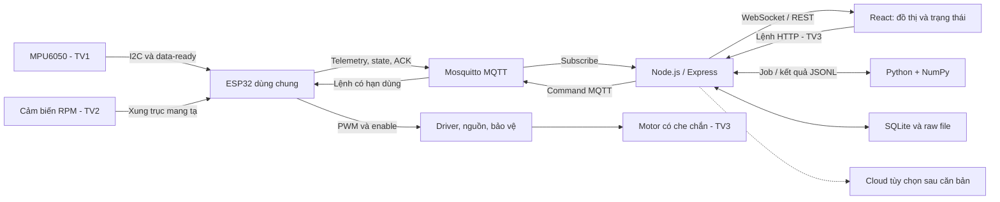

# RESONANCEGUARD — SỔ TAY TRIỂN KHAI ĐỒ ÁN HOÀN CHỈNH

**Dành cho nhóm 3 sinh viên · Biên soạn ngày 21/10/2026 · Từ chuẩn bị đến demo và bảo vệ.**

Đây là hướng dẫn để nhóm triển khai sản phẩm trong tương lai. Chưa có mạch, motor hay dữ liệu đo thật nào được kiểm thử trong quá trình biên soạn. Những tiêu chí nghiệm thu dưới đây là mục tiêu nội bộ đề xuất, không phải yêu cầu bổ sung của giảng viên.

## Tóm tắt dành cho nhóm trưởng và người mới

Nhóm làm một **thước thép kẹp một đầu**, đo rung bằng MPU6050, truyền dữ liệu qua ESP32 và MQTT lên website. Trước tiên kéo nhẹ rồi thả thước khi chưa có motor để tìm đặc trưng dao động lặp lại. Sau đó mới chọn motor, đo tốc độ trục thực, lắp driver, nguồn và che chắn để khảo sát rung cưỡng bức. Website hiển thị dữ liệu, lưu phiên đo và cho phép điều khiển motor qua backend.

Ba người chia theo **ba luồng xuyên suốt**: người 1 phụ trách MPU6050 → website; người 2 phụ trách cảm biến RPM → website; người 3 phụ trách website → motor. Cả ba cùng làm trong một project. Một ESP32 dùng chung là quyết định thiết kế tiết kiệm; PDF không bắt buộc ba board riêng.

**Mua trước:** ESP32, MPU6050, dây; tận dụng thước 30 cm, ngàm, bàn và cáp USB. **Chưa mua:** motor, tạ, driver và nguồn motor cho đến khi biết dải tần và tải cơ khí cần thiết. Số tiền 300.000–400.000đ chỉ có thể là khoản chi mới khi mượn/tận dụng đủ đồ; phương án mua thực tế có dự trù khoảng 610.000đ và có thể vượt 750.000đ nếu phải mua ngàm, nguồn tốt hoặc đổi motor. Không cắt bỏ gá, bảo vệ và che chắn để vừa ngân sách.

**Bốn mốc phải đạt:** (1) đo tự do lặp lại; (2) điều khiển motor và đọc RPM an toàn; (3) chứng minh đủ ba luồng IoT; (4) demo có dữ liệu, đối chứng và lời giải thích đúng. Đo tự do tốt chưa có nghĩa đã hoàn thành đồ án vì còn thiếu luồng RPM và điều khiển motor.

**Thứ tự triển khai:** MVP 1 có số đo rung thật lên web và ringdown theo phiên; MVP 2 chứng minh đủ ba luồng với motor được bảo vệ; MVP 3 kiểm chứng baseline đóng băng, đánh giá cộng hưởng và hoàn thiện demo. Sau đó mới chọn nâng cao. Chương 8 chỉ rõ phase nào thuộc từng MVP; không cần chờ quét được cộng hưởng mới tích hợp MQTT/web. Không MVP nào được bỏ công tắc cắt nguồn, che phần quay hoặc dừng cục bộ khi sử dụng motor.

Quy ước đọc tài liệu:

| Nhãn | Ý nghĩa và cách sử dụng |
|---|---|
| **Yêu cầu giảng viên** | Lấy từ PDF 4 trang; ưu tiên cao nhất khi xét yêu cầu môn học |
| **Thiết kế nhóm đề xuất** | Lựa chọn mặc định của sổ tay, nhóm được điều chỉnh sau thử nghiệm |
| **Giả định lý thuyết** | Công thức chỉ dùng khi các điều kiện đi kèm đúng |
| **Cần kiểm chứng** | Chưa có dữ liệu phần cứng xác nhận; phải đo rồi mới kết luận |
| **GIẢ ĐỊNH/MÔ PHỎNG** | Số minh họa hoặc dữ liệu sinh bằng thuật toán; không phải số đo nhóm |

## Mục lục

1. [Tổng quan đồ án dành cho người mới](#chuong-1)
2. [Lý thuyết vật lý cần hiểu](#chuong-2)
3. [Kiến trúc hệ thống hoàn chỉnh](#chuong-3)
4. [Nguyên vật liệu và ngân sách](#chuong-4)
5. [Chế tạo mô hình thước thép 30 cm](#chuong-5)
6. [Lắp đặt điện tử và đấu nối](#chuong-6)
7. [Phần mềm, môi trường và cấu trúc project](#chuong-7)
8. [Thực hiện theo từng giai đoạn](#chuong-8)
9. [Thực nghiệm và kiểm chứng khoa học](#chuong-9)
10. [Phân công nhóm ba người](#chuong-10)
11. [Yêu cầu môn học và chiến lược điểm số](#chuong-11)
12. [Kiểm thử, xử lý lỗi và rủi ro](#chuong-12)
13. [Kịch bản demo và thuyết trình](#chuong-13)
14. [Câu hỏi bảo vệ và kiến thức cần nắm](#chuong-14)
15. [Checklist bàn giao cuối cùng](#chuong-15)
16. [Nguồn tham khảo và tài liệu gốc](#nguon)
17. [10 việc nhóm nên làm ngay](#muoi-viec)

<a id="chuong-1"></a>
## 1. Tổng quan đồ án dành cho người mới

### 1.1. Nhóm đang giải quyết việc gì?

Máy móc và kết cấu đều rung. Khi nhịp của lực kích thích đi vào một vùng mà kết cấu đáp ứng mạnh, rung có thể tăng và gây khó vận hành, lỏng mối nối hoặc mỏi vật liệu. ResonanceGuard là **mô hình học tập về giám sát rung và phát hiện thay đổi đặc trưng dao động**, không phải thiết bị chứng nhận an toàn cầu hay chẩn đoán vết nứt.

Thước kẹp một đầu đại diện cho một bộ phận đàn hồi như tay đỡ, thanh máy, cánh hoặc dầm nhô ra. Nó đơn giản hơn mô hình cầu nhiều gối và giằng, giúp nhóm kiểm soát chiều dài, tải và ngàm với ít chi phí. Kết quả của thước không được tự động suy rộng sang công trình thật.

| Thành phần | Công việc | Vì sao cần |
|---|---|---|
| Thước và ngàm | Tạo kết cấu có thể dao động | Cung cấp đối tượng vật lý thật, dễ đổi chiều dài/tải |
| MPU6050 | Đo gia tốc có dấu trên ba trục; có thêm gyro | Quan sát rung, không trực tiếp trả về tần số riêng |
| ESP32 | Đọc cảm biến, đếm xung, bảo vệ và truyền Wi-Fi | Cầu nối giữa phần cứng và hệ thống web, đáp ứng board ESP |
| Motor và driver | Tạo lực tuần hoàn có thể thay đổi tốc độ | Khảo sát cưỡng bức; driver chịu dòng công suất thay GPIO |
| Cảm biến RPM | Đếm vòng trục mang lệch tâm | Cho tần số kích thích thực; PWM không phải tốc độ |
| MQTT broker | Chuyển tiếp bản tin theo topic | Kết nối ESP với backend theo yêu cầu môn học |
| Backend | Kiểm tra dữ liệu, phân tích, lưu và phát lệnh | Giữ đơn vị/thuật toán/lệnh nhất quán, có API cho frontend |
| Frontend | Đồ thị, trạng thái, lịch sử và nút điều khiển | Cho người dùng quan sát và thao tác rõ ràng |

### 1.2. Đo được gì, không đo được gì?

Hệ thống có hai cách sử dụng khác nhau:

| Chế độ | Thu/hiển thị gì? | Điều kiện và giới hạn |
|---|---|---|
| **Giám sát rung liên tục** | Raw có dấu, RMS/peak theo cửa sổ, RPM, tuổi dữ liệu và trạng thái cảm biến | Mô tả mức rung và chất lượng dữ liệu; khi đứng yên hoặc kích không đủ thông tin thì không cập nhật tần số riêng |
| **Kiểm tra đặc trưng modal theo phiên** | Ringdown khi motor dừng, mode ứng viên/$f_{d,est}$ và tùy điều kiện $f_{n,est}$; so với phiên/baseline phù hợp | Người dùng bắt đầu phiên kéo–thả có kiểm soát, kiểm SNR/timing/mode; không đạt thì trả “chưa đủ dữ liệu”, không giữ tần số cũ như số đo hiện tại |

Khảo sát cộng hưởng là một **phiên sweep riêng**: ghép RPM thực và gia tốc, lấy thành phần 1× ở từng nấc rồi phân tích đường đáp ứng theo chương 9.6. Cảnh báo rung mạnh có thể hoạt động liên tục; đánh giá cộng hưởng cần bộ bằng chứng của phiên và không được suy duy nhất từ RMS cao hay $RPM/60$ gần tần số mode.

Hệ thống không trực tiếp đo lực kích, chuyển vị, ứng suất hoặc độ bền thước. Không đủ cơ sở định vị vết nứt, dự đoán sập hoặc phân biệt duy nhất nguyên nhân tần số đổi. Ngưỡng rung đặt cho mô hình chỉ là giới hạn vận hành thử, không phải chuẩn an toàn kết cấu.

### 1.3. Sản phẩm cuối và một lần demo

Sản phẩm gồm đế/ngàm chắc, thước có MPU gá nhẹ, bộ kích có che chắn, cảm biến tốc độ, hộp điện có nhãn dây và công tắc cắt nguồn motor. Một laptop chạy broker, backend và website; điện thoại có thể mở website nếu cùng mạng và được cấp quyền.

Một lần demo: mở giám sát raw/RMS và trạng thái → bắt đầu phiên kéo–thả khi rotor đã dừng → xem tín hiệu/phổ hợp lệ → đổi tải có chủ đích và trả về A để minh họa vật lý → nếu trình diễn bộ phát hiện thì dùng bài kiểm riêng với baseline đã đóng băng → bật motor trong vùng đã thử để chứng minh điều khiển/RPM và mở kết quả khảo sát cộng hưởng → Stop → lịch sử và giới hạn. Nếu chưa tìm được đỉnh, dùng nhánh dự phòng chương 9.10 và thông báo đúng trạng thái, không giả lập một đỉnh để hoàn tất demo.

### 1.4. Giải thích ResonanceGuard trong 60 giây

> ResonanceGuard là mô hình giám sát rung bằng IoT. MPU6050 trên thước thép đo gia tốc, ESP32 gửi qua MQTT đến backend và website để theo dõi raw, RMS và chất lượng cảm biến. Tần số mode được kiểm tra trong phiên kéo–thả khi motor dừng và dữ liệu đủ tốt, không được đo liên tục chỉ vì website đang mở. Motor có cảm biến RPM để khảo sát đáp ứng cưỡng bức; chỉ kết luận có bằng chứng phù hợp cộng hưởng khi đường đáp ứng và phép đo tự do hỗ trợ nhau. Nhóm thay chiều dài hoặc tải có kiểm soát để minh họa vật lý, rồi kiểm thử phát hiện độ lệch riêng với baseline đóng băng. Website điều khiển motor qua backend; dừng bảo vệ chạy cục bộ trên ESP. Hệ thống chưa chẩn đoán vết nứt hay chứng nhận an toàn công trình; mục tiêu nào chưa đạt sẽ được báo rõ.

<a id="chuong-2"></a>
## 2. Lý thuyết vật lý cần hiểu

### 2.1. Dao động, khối lượng, độ cứng và cản

**Dao động** là chuyển động qua lại quanh vị trí cân bằng. Kéo đầu thước rồi thả là dao động tự do: sau khi thả không còn lực chủ động lặp lại. Motor quay liên tục tạo lực lặp lại là dao động cưỡng bức. Biên độ giảm dần theo thời gian là dao động tắt dần vì năng lượng mất qua ma sát, vật liệu, không khí và mối gá.

Mô hình **một bậc tự do (SDOF)** chỉ cần một tọa độ $x(t)$ mô tả chuyển động. Có thể hình dung một vật trên lò xo có bộ giảm chấn:

$$m\ddot{x}+c\dot{x}+kx=F(t).$$

| Ký hiệu | Ý nghĩa | Đơn vị | Ví dụ trực quan |
|---|---|---|---|
| $x,\dot{x},\ddot{x}$ | Chuyển vị, vận tốc, gia tốc | m, m/s, m/s² | Đi xa bao nhiêu; đi nhanh bao nhiêu; tốc độ đổi nhanh bao nhiêu |
| $m$ | Khối lượng tương đương của mode | kg | Thêm tải thường làm rung chậm hơn |
| $k$ | Độ cứng tương đương | N/m | Cần lực lớn hơn để bẻ cùng độ lệch nếu thanh cứng hơn |
| $c$ | Hệ số cản nhớt tương đương | N·s/m | Bộ giảm chấn làm rung tắt nhanh |
| $F(t)$ | Thành phần lực kích theo hướng xét | N | Lực tuần hoàn từ lệch tâm motor |

Khối lượng là kg; trọng lượng là lực $mg$, đơn vị N. $m$ modal không mặc nhiên bằng toàn bộ khối lượng thước. SDOF chỉ xấp xỉ tốt khi một mode chi phối, biên độ nhỏ, kết cấu đàn hồi và ngàm không trượt. Nếu có nhiều mode hay va chạm, cần thận trọng với kết luận từ mô hình này.

### 2.2. Bốn loại tần số phải phân biệt

$$\omega_n=\sqrt{\frac{k}{m}},\qquad f_n=\frac{1}{2\pi}\sqrt{\frac{k}{m}},\qquad \zeta=\frac{c}{2\sqrt{km}}.$$

$\omega_n$ là tần số góc riêng (rad/s); $f_n$ là tần số riêng không cản (Hz, số chu kỳ mỗi giây); $\zeta$ là tỷ số cản, không có đơn vị. **GIẢ ĐỊNH:** $m=0,5$ kg, $k=1000$ N/m cho $f_n\approx7,12$ Hz. Tăng gấp đôi $m$ mà giữ $k$ thì $f_n$ còn $1/\sqrt2$ lần, khoảng 5,03 Hz.

Dao động tự do dưới cản ($0\le\zeta<1$) có dạng:

$$x(t)=C e^{-\zeta\omega_n t}\cos(2\pi f_d t+\phi),\qquad f_d=f_n\sqrt{1-\zeta^2}.$$

Ví dụ $f_n=10$ Hz, $\zeta=0,1$ cho $f_d\approx9,95$ Hz: gần nhau nhưng khác định nghĩa. Khi cản lớn đến $\zeta\ge1$, dạng rung tuần hoàn tắt dần này không còn áp dụng. FFT ringdown thực tế trước hết cho **mode ứng viên/$f_{d,est}$**, không tự trả về chính xác $f_n$.

| Đại lượng | Nguồn xác định | Ý nghĩa trên giao diện |
|---|---|---|
| $f_n$ | Mô hình hoặc suy ra từ $f_d$ và cản hợp lệ | `fn_est`, chỉ hiện khi đủ điều kiện |
| $f_d$ | Dao động tự do tắt dần | `fd_est`, dùng đối chiếu baseline cùng cấu hình |
| $f_{exc}$ | Tốc độ quay thực và cơ chế kích | `f_exc_hz = rpm/60` cho lực 1× |
| $f_r$ | Đỉnh của một đường đáp ứng được định nghĩa | Phải ghi đỉnh chuyển vị, gia tốc hay đại lượng chuẩn hóa |

### 2.3. Cộng hưởng và đáp ứng cưỡng bức

Với lực $F(t)=F_0\cos\omega t$ có **biên độ $F_0$ giữ cố định**, nghiệm xác lập có biên độ chuyển vị:

$$X(\omega)=\frac{F_0}{\sqrt{(k-m\omega^2)^2+(c\omega)^2}},\qquad V=\omega X,\qquad A=\omega^2X.$$

Ví dụ cùng chuyển vị đỉnh $X=1$ mm, ở 10 Hz thì $A\approx3,95$ m/s²; ở 20 Hz thì $A\approx15,79$ m/s². Gia tốc tăng gấp bốn dù chuyển vị giữ nguyên. Không gọi gia tốc đo được là biên độ chuyển vị.

**Cộng hưởng** là vùng đáp ứng được khuếch đại mạnh do đặc tính động lực của hệ. Trong SDOF tuyến tính cản nhỏ, vùng này thường gần $f_n$. Với $0<\zeta<1/\sqrt2$ và lực biên độ cố định:

$$f_{r,x}=f_n\sqrt{1-2\zeta^2},\qquad f_{r,v}=f_n,\qquad f_{r,a}=\frac{f_n}{\sqrt{1-2\zeta^2}}.$$

**GIẢ ĐỊNH:** $f_n=10$ Hz, $\zeta=0,1$ cho các đỉnh khoảng 9,90; 10,00; 10,10 Hz. Đỉnh chuyển vị và gia tốc không phải một định nghĩa duy nhất của “tần số cộng hưởng”. Ngoài điều kiện trên, không tự áp các công thức đỉnh; kích nền và motor lệch tâm cũng cần mô hình phù hợp.

Ở $\omega=\omega_n$, $X=F_0/(2\zeta k)$: với cùng lực, cản nhỏ làm đáp ứng lớn hơn. Không có cản trong mô hình lý tưởng tại đúng cộng hưởng thì không có đáp ứng xác lập hữu hạn. Thực nghiệm phải dừng trước khi rung lớn, không cố chứng minh bằng phá hủy.

Ví dụ đời thường phù hợp là đẩy xích đu theo nhịp. Nếu nhắc Tacoma Narrows, phải nói đó là bất ổn khí động–đàn hồi/flutter, không dùng như bằng chứng đơn giản rằng gió có tần số độc lập trùng $f_n$.

### 2.4. Thanh công xôn, mode và tải gắn thêm

**Thanh công xôn (cantilever)** là thanh ngàm một đầu, đầu còn lại tự do. **Mode** là kiểu biến dạng dao động: mode đầu thường uốn một bụng; mode cao có thêm vùng đổi dấu/nút. Một cảm biến chỉ nhìn thấy chuyển động tại vị trí của nó; đặt gần nút mode có thể không quan sát được mode đó.

Với thanh đều, tiết diện chữ nhật, ngàm lý tưởng, uốn theo chiều dày $h$, không có tải gắn thêm, mô hình Euler–Bernoulli cho mode đầu:

$$I=\frac{bh^3}{12},\quad A_b=bh,\quad f_1=\frac{1,875^2}{2\pi L^2}\sqrt{\frac{EI}{\rho A_b}}.$$

$b,h,L$ tính bằng m; $E$ là mô đun đàn hồi (Pa), $\rho$ là khối lượng riêng (kg/m³); $I$ có đơn vị m⁴. Công thức không áp nguyên trạng cho thước có gân, lỗ lớn, ngàm mềm hoặc tải motor/cảm biến đáng kể.

**GIẢ ĐỊNH/TÍNH TOÁN:** $E=200$ GPa, $\rho=7850$ kg/m³, $h=1$ mm cho $f_1\approx20,4$ Hz tại $L=20$ cm và khoảng 13,0 Hz tại $L=25$ cm. Đây là ước lượng cho thanh trần, không phải dự báo chắc chắn cây thước mua về. Nếu thước thực chỉ dày 0,5 mm, dự đoán lý tưởng giảm khoảng một nửa; cần đo chiều dày thay vì suy từ ảnh bán hàng.

Giữ mọi yếu tố khác như nhau, thanh trần có $f_1\propto h/L^2$. Đổi 20 → 25 cm cho tỷ lệ $(20/25)^2=0,64$. Chiều rộng triệt tiêu trong công thức thanh trần nhưng ảnh hưởng khối lượng, gá và sức chịu tải thực.

Một gần đúng khác cho tải tập trung **ở đầu tự do**:

$$k_{tip}\approx\frac{3EI}{L^3},\qquad f_1\approx\frac{1}{2\pi}\sqrt{\frac{k_{tip}}{0,236m_b+m_{tip}}}.$$

$m_b$ là khối lượng phần thanh tự do; $m_{tip}$ gồm cảm biến, gá và tải đầu thanh. Ví dụ thước rộng 25 mm, dày 1 mm, $L=25$ cm có $m_b\approx49$ g và $k_{tip}\approx80$ N/m theo các giả định vật liệu trên. Tải đầu 5 g làm ước lượng còn khoảng 11,1 Hz. Công thức là gần đúng mode đầu theo tọa độ đầu thanh; tải nằm giữa thanh hoặc motor có kích thước lớn cần xét dạng mode, không cộng mọi khối lượng như tải đầu.

### 2.5. Gia tốc, RMS và lọc

MPU6050 là cảm biến MEMS, giao tiếp I2C. Khi đứng yên, một trục theo phương trọng lực thường đọc gần $\pm1g$; $g=9,80665$ m/s². Tín hiệu gồm rung, offset, nhiễu và hình chiếu trọng lực. Trừ trung bình một block giúp bỏ DC; bộ thông cao giúp bỏ thành phần chậm nhưng không tách hoàn toàn nghiêng khỏi gia tốc tịnh tiến.

Ví dụ EMA theo từng trục: $\bar a_k=(1-\alpha)\bar a_{k-1}+\alpha a_k$, $h_k=a_k-\bar a_k$. $\alpha=0,015$ ở 200 Hz có tần số cắt xấp xỉ $\alpha F_s/(2\pi)\approx0,48$ Hz; vẫn làm suy hao tín hiệu, nhất là ở thấp tần. Ghi cấu hình và bỏ đoạn quá độ của bộ lọc. Phân tích offline đầu tiên ưu tiên raw và trừ mean để dễ kiểm tra.

$$a_{rms}=\sqrt{\frac1N\sum_{i=0}^{N-1}h_i^2},\qquad
a_{rms,total}=\sqrt{a_{rms,x}^2+a_{rms,y}^2+a_{rms,z}^2}.$$

RMS là giá trị hiệu dụng gia tốc, cùng đơn vị với gia tốc; không phải năng lượng tính bằng Joule và không tự loại gai nhiễu. Với sin có đỉnh 0,1g, RMS là $0,1/\sqrt2\approx0,0707g$. So RMS phải cùng dải lọc, thời lượng và điều kiện kích.

Chỉ với dao động gần đơn tần, có thể ước lượng $X_{peak}=A_{peak}/(2\pi f)^2$. Ví dụ $a_{rms}=0,8g$ tương ứng chuyển vị đỉnh khoảng 31,2 mm ở 3 Hz nhưng chỉ 0,312 mm ở 30 Hz. Vì vậy 0,8g không phải ngưỡng an toàn chung. Tích phân hai lần gia tốc rộng dải dễ trôi; đồ án không ưu tiên đo chuyển vị theo cách đó.

### 2.6. Lấy mẫu, Nyquist, aliasing và FFT

**Lấy mẫu** là đọc tín hiệu tại các thời điểm cách đều. $F_s=200$ Hz nghĩa là một mẫu mỗi 5 ms. **Nyquist** là $F_s/2$; để giữ dải hữu ích phải lấy mẫu nhanh hơn hai lần tần số cao nhất sau khi đã kiểm soát thành phần ngoài dải, có khoảng chuyển tiếp lọc. Ví dụ tín hiệu 70 Hz lấy mẫu 100 Hz có thể xuất hiện như 30 Hz: đó là **aliasing/chồng phổ**. Lọc sau khi chồng phổ đã xảy ra không khôi phục được tín hiệu gốc.

**FFT** là thuật toán tính biến đổi Fourier, biểu diễn một đoạn tín hiệu thành các thành phần tần số. Nó không biết vật đang “hư” hay “cộng hưởng”. DFT có dạng $Y_k=\sum_{n=0}^{N-1}y_n e^{-j2\pi kn/N}$; bin $k$ ứng với $f_k=kF_s/N$. Nếu một sin 10 Hz được lấy mẫu hợp lệ trong cửa sổ đủ dài, phổ tập trung gần 10 Hz.

$$T=\frac{N}{F_s},\qquad \Delta f=\frac{F_s}{N}.$$

| Cấu hình minh họa | Độ dài block | Khoảng cách bin |
|---|---:|---:|
| 200 Hz, 512 mẫu | 2,56 s | 0,390625 Hz |
| 200 Hz, 1024 mẫu | 5,12 s | 0,1953125 Hz |

Đây là khoảng cách lưới phổ, không phải cam kết sai số phép đo. Thu dài chỉ hữu ích khi còn tín hiệu vượt nhiễu. FFT tổng quát không bắt buộc số mẫu là lũy thừa hai; chọn 512/1024 để thuận tiện. Zero-padding làm lưới hiển thị mịn hơn, không tăng khả năng tách hai mode gần nhau.

**Window/cửa sổ** giảm rò phổ do cắt đoạn hữu hạn. Hann phù hợp nhiều đoạn xác lập nhưng làm rộng đỉnh; với ringdown bắt đầu mạnh rồi tắt nhanh, Hann có thể giảm quá nhiều phần đầu. So với cửa sổ chữ nhật khi đuôi đã tắt đủ hoặc fit tắt dần trong miền thời gian. Với tone xác lập, biên độ đỉnh phổ một phía có thể tính $2|\mathrm{FFT}(wy)|/\sum w$, riêng DC/Nyquist không nhân hai. Không dùng chuẩn hóa tone này để tuyên bố biên độ ban đầu của ringdown; PSD có chuẩn hóa khác.

**Đầu vào FFT phải là một trục có dấu** đúng hướng uốn, sau bỏ DC. Ví dụ $a_x=\sin(2\pi7t)$ có 7 Hz nhưng $|a_x|$ mất dấu và lặp nhanh gấp đôi, có thành phần 14 Hz. RMS theo thời gian chủ yếu phản ánh bao dao động; không dùng chuỗi RMS làm FFT nhận dạng mode. Nếu tổng hợp nhiều trục bằng phổ, có thể cộng PSD từng trục rồi giải thích rõ.

### 2.7. Motor lệch tâm, RPM và chuẩn hóa

Đặt $u=m_u r_e$ (kg·m), với khối lượng lệch tâm $m_u$ và bán kính $r_e$. Khi quay đều:

$$F_0=u\omega^2,\qquad \omega=2\pi f_{exc},\qquad f_{exc}=\frac{RPM}{60}.$$

**GIẢ ĐỊNH:** $m_u=1$ g, $r_e=2$ mm cho $u=2\times10^{-6}$ kg·m. Tại 600 RPM (10 Hz), lực đỉnh khoảng 0,00790 N; tại 1200 RPM, khoảng 0,0316 N. Tốc độ gấp đôi làm lực gấp bốn, vì vậy RMS tăng theo tốc độ chưa chứng minh cộng hưởng.

PWM là tỷ lệ thời gian bật điện trong chu kỳ đóng cắt. Tần số sóng mang PWM có thể là hàng kHz, còn trục chỉ quay hàng chục Hz. Tốc độ phụ thuộc tải, nguồn và ma sát. Đo RPM bằng cảm biến độc lập trên **trục mang lệch tâm**, chú ý encoder trước hộp số có tỷ số truyền khác.

Ở mỗi nấc tốc độ ổn định, fit trục gia tốc theo $a(t)=b\sin\omega t+d\cos\omega t+e$ và lấy $A_1=\sqrt{b^2+d^2}$ (biên độ đỉnh 1×). Theo giả định lực ERM truyền trực tiếp, cùng $u$ và cùng gá:

$$\widehat H_a=\frac{A_1}{u\omega^2},\qquad \widehat H_x=\frac{A_1}{u\omega^4}.$$

Nếu chưa biết $u$, vẽ $A_1/\omega^2$ (đơn vị m, tỷ lệ với đáp ứng gia tốc/lực) và $A_1/\omega^4$ (m·s², tỷ lệ với đáp ứng chuyển vị/lực). Có $u$ mới báo đơn vị tương ứng $(m/s^2)/N$ và m/N. Ví dụ cùng $A_1=1$ m/s² thì $A_1/\omega^2$ ở 10 Hz là 0,253 mm, ở 20 Hz là 0,0633 mm. Không chia tại gần tốc độ bằng 0; không gọi hai đường chuẩn hóa là cùng đại lượng.

Không đo lực nên đây là **chuẩn hóa tương đối có điều kiện**, không phải FRF lực đo trực tiếp. Nếu lực truyền thay đổi, gá mềm, hộp số gây harmonic hoặc kích nền, các giả định có thể sai. Khi kích ở đế thay vì trên thước, cần đo chuyển động đế và mô hình truyền rung khác; không tiếp tục áp $A_1/\omega^2$ như cho lực trực tiếp.

FFT lúc motor quay thường có đỉnh tại $f_{exc}$ và bội của nó, dù $f_{exc}$ khác $f_n$. **GIẢ ĐỊNH:** hệ có $f_n=7,12$ Hz bị lực 10 Hz thì FFT đoạn xác lập có thể trội 10 Hz. Muốn nhận dạng mode, dùng ringdown; muốn khảo sát cộng hưởng, dùng đường đáp ứng theo RPM, đối chiếu ringdown và đo lặp.

### 2.8. Tần số thay đổi nói được điều gì?

Nếu khối lượng modal và dạng mode không đổi, $k_2/k_1\approx(f_{n,2}/f_{n,1})^2$. **GIẢ ĐỊNH:** 14,5 → 10,2 Hz là giảm tần số 29,66%, tương đương giảm độ cứng modal 50,52% trong giả định trên. Không phải “hư hỏng 30%”.

Thêm tải, đổi ngàm, dây kéo, nhiệt độ, gá cảm biến hoặc nhầm mode đều làm tần số đổi. Đồ án chỉ cảnh báo **thay đổi đặc trưng so với baseline cùng điều kiện**. Thí nghiệm A–B–A và ghi cấu hình giúp kiểm soát nguyên nhân; không tự chứng minh đã phát hiện vết nứt thật.

<a id="chuong-3"></a>
## 3. Kiến trúc hệ thống hoàn chỉnh

### 3.1. Một stack thống nhất

**Thiết kế nhóm đề xuất:** ESP32 DevKit V1 30 chân dùng module ESP32-WROOM-32/32E; firmware C++ với Arduino-ESP32; Mosquitto; Node.js LTS + Express + MQTT.js; React + Vite + Chart.js; WebSocket qua thư viện `ws`; SQLite lưu metadata/kết quả và file CSV/JSONL lưu raw. Python 3 + NumPy làm **một tiến trình phân tích riêng**, không thêm backend web thứ hai. Khóa phiên bản cụ thể khi nhóm cài và ghi trong README/lockfile; không sao chép API từ phiên bản khác.

Lý do dùng Node/React: nhóm đã có nền tảng web; các API và giao diện dễ phân công. NumPy xử lý FFT, fit sin/cos, thống kê thuận tiện; một worker nhận job JSONL qua stdin, trả JSONL qua stdout, do Node quản lý và khởi chạy một lần. Log Python đi stderr. Nếu worker lỗi, web vẫn hiện raw/RPM nhưng kết quả phân tích hiện “chưa có”, không bịa số. Không cần microservice, Docker, dịch vụ trả phí hoặc FFT trên ESP cho bản đầu.



Sơ đồ là kiến trúc dự kiến cần triển khai, không phải mô tả một hệ thống đã hoạt động. Luồng web luôn qua backend; frontend không kết nối MQTT trực tiếp để bỏ qua tầng này.

### 3.2. Ba luồng và bằng chứng hoàn thành

| Luồng | Việc phải lập trình | Cách kiểm chứng xuyên suốt |
|---|---|---|
| MPU → ESP → MQTT → BE → FE | Đọc raw, timestamp, kiểm tra gói, phân tích, chart | Kéo–thả thật; cùng `run_id` xuất hiện ở log ESP, MQTT, API và đồ thị |
| RPM → ESP → MQTT → BE → FE | Đếm cạnh/PPR, timeout, RPM có chất lượng, chart | Quay tay đúng số vòng, sau đó motor trong che chắn; web phản ánh tốc độ thực và stale |
| FE → BE → MQTT → ESP → motor | Validate, command ID/lease, ACK, state machine, driver | Gửi Start/Stop; log đủ các tầng; xem ACK và RPM thực, không lấy HTTP 200 làm bằng chứng motor quay |

### 3.3. Ví dụ dữ liệu đi đến biểu đồ

**VÍ DỤ JSON GIẢ ĐỊNH:** một block gồm 20 mẫu có dấu theo đơn vị m/s², `t0_device_us` là thời điểm mẫu đầu theo đồng hồ đơn điệu của ESP. Ví dụ payload đầy đủ ở chương 7.

```text
MPU: raw az = 8192 counts ở ±4g
  → ESP đổi az = 9,80665 m/s² (gần 1g, chưa bỏ trọng lực)
  → topic rg/rg01/telemetry/vibration, boot_id b01, sample_seq0 400
  → BE kiểm tra liên tục, ghi raw và ghép đủ cửa sổ cùng cấu hình
  → Python chọn trục z, bỏ DC, phân tích theo loại phiên free/forced
  → WebSocket phát thời gian, phổ và quality về FE
  → Chart: trục x giây hoặc Hz; trục y m/s²; nhãn “đo trực tiếp”
```

Một giá trị đứng yên gần 1g không chứng minh có rung. Giao diện tách raw và gia tốc động; mọi kết quả suy ra kèm phương pháp, cấu hình, phiên và trạng thái hợp lệ. Lưu raw cho phép cả ba kiểm tra lại độc lập.

### 3.4. Tách giám sát và phân tích theo phiên

Backend nhận telemetry liên tục để cập nhật raw/RMS/peak, RPM và sức khỏe cảm biến. Người dùng chọn một phiên `free_decay`, `controlled_config_change`, `frozen_baseline_test` hoặc `forced_sweep`; mỗi phiên có điều kiện thu và kết luận riêng. Chỉ gửi job modal khi có ringdown đủ thông tin; FFT live nếu hiển thị chỉ là phổ tín hiệu hiện tại, không tự tạo kết quả tần số riêng.

BE lưu `measurement_mode`, `actual_config_id`, `baseline_id` nếu có, chất lượng và lý do chưa kết luận; trả trạng thái cộng hưởng của **phiên sweep** theo chương 7.9. Ba luồng IoT vẫn phải hoạt động khi chưa có bằng chứng cộng hưởng. Giám sát rung mạnh, đánh giá độ lệch baseline và kết luận cộng hưởng là ba chức năng độc lập, có thể có trạng thái khác nhau trên cùng màn hình.

<a id="chuong-4"></a>
## 4. Danh sách nguyên vật liệu và ngân sách

### 4.1. Cách đọc BOM và giá

Đơn vị toàn bộ bảng là **VNĐ cho cả nhóm**, chưa phải báo giá trọn bộ. **Đã tra** nghĩa là trang người bán hiển thị giá trong lần truy cập của bản biên soạn 21/10/2026; lần chỉnh lý này không tra lại giá/tồn kho. Phải xác nhận đúng biến thể, tồn kho và phí khi đặt. **Dự trù** là khoản giữ chỗ do sổ tay đặt để tính kịch bản, chưa có báo giá; không xem là giá thị trường đã xác minh. Số 0 chỉ là **không chi thêm vì có sẵn/mượn được**, không có nghĩa vật tư miễn phí.

Quy ước: **B** = cần có cho bản hoàn chỉnh; **T** = tận dụng/mượn; **O** = tùy chọn. Bản chỉ đo tự do chưa cần các món đợt 2. Laptop, Internet và công sức gia công chưa quy thành tiền.

### A. Điện tử bắt buộc

| Linh kiện và thông số | SL | Vai trò | Đơn giá | Thành tiền | Loại / lúc mua | Căn cứ |
|---|---:|---|---:|---:|---|---|
| ESP32 DevKit V1 30 chân, ESP32-WROOM-32/32E, USB, đã hàn chân | 1 | Board dùng chung ba luồng | 155.000 | 155.000 | B/T; đợt 1 | [Trang tham khảo](https://tamcongnghe.vn/san-pham/esp32-devkit-v1), đã tra giá từ 155.000; xác nhận bản WROOM |
| GY-521 MPU6050 | 1 | Gia tốc ba trục | 85.000 | 85.000 | B; đợt 1 | [Hshop](https://hshop.vn/cam-bien-6-dof-bac-tu-do-gy-521-mpu6050), đã tra |
| Module TCRT5000 có DO, thử được ở 3,3 V | 1 | RPM quang với một marker | 15.000 | 15.000 | B hoặc thay Hall; đợt 2 | [Hshop](https://hshop.vn/cam-bien-do-line-don), đã tra; chưa kiểm chứng làm tach |
| Marker tương phản nhẹ, gá quang nhỏ | 1 bộ | Một xung/vòng sau kiểm tra | 5.000 | 5.000 | B/T; đợt 2 | Dự trù vật liệu, chưa có báo giá |
| Dây tín hiệu mềm, đầu nối, board hàn nhỏ | 1 bộ | I2C, RPM, đấu tín hiệu chắc | 20.000 | 20.000 | B/T; chia hai đợt | Dự trù, chưa có báo giá |
| **Cộng A** | | | | **280.000** | | |

Một lựa chọn GY-521 khác tại [Nshop](https://nshopvn.com/product/cam-bien-gia-toc-gy-521-6dof-imu-mpu6050/) từng hiển thị 67.000đ nhưng **hết hàng trong lần tra ban đầu**, nên không dùng giá đó để hứa mua đủ. Cửa hàng chỉ là nguồn giá/biến thể; thông số điện phải theo datasheet và kiểm tra module.

### B. Cơ khí

| Vật tư / điều kiện chọn | SL | Vai trò | Đơn giá dự trù | Thành tiền | Loại / lúc mua | Căn cứ |
|---|---:|---|---:|---:|---|---|
| Thước inox/thép không gỉ 30 cm, gần 1 mm, đo lại tiết diện | 1 | Thanh đàn hồi | 25.000 | 25.000 | B/T; đợt 1 | Chưa báo giá; không mặc định thước mỏng phổ thông đạt 1 mm |
| Ngàm/ê-tô hoặc kẹp C + hai má phẳng | 1 bộ | Ngàm không trượt | 0 nếu mượn | 0 | B/T; có trước thử thước | Nếu không mượn được, tính thêm ở kịch bản 3 |
| Bàn chắc/đế gỗ, bulông đệm, vật liệu sẵn | 1 bộ | Đỡ mô hình | 0 nếu tận dụng | 0 | B/T; đợt 1 | Kiểm tra thực tế |
| Gá MPU nhẹ, cách điện, keo mỏng/cứng hoặc vít | 1 bộ | Truyền rung ổn định | 10.000 | 10.000 | B/T; đợt 1 | Dự trù |
| Gá motor + giữ lệch tâm bằng cơ khí + gá RPM | 1 bộ | Cố định chắc, ít tải | 20.000 | 20.000 | B/T; sau chốt motor | Dự trù; có thể không đủ nếu phải gia công |
| Che chắn rotor bằng vật liệu đủ bền, hộp điện tận dụng | 1 bộ | Ngăn chạm/văng, đóng gói | 25.000 | 25.000 | B/T; trước chạy rotor | Dự trù; hộp giấy không thay che cơ khí |
| **Cộng B khi mượn được ngàm/đế** | | | | **80.000** | | |

Tải đối chứng nhỏ dùng long đen/đai ốc **đã cân**, gắn chắc; dự trù trong bộ gá. Không mua tạ 100 g cho thước này để bắt đầu. Cơ cấu giữ lệch tâm cần thiết kế đúng kích thước trục; không dùng cục kim loại dán keo tạm lên trục quay.

### C. Nguồn, driver và bảo vệ

| Linh kiện / điều kiện chọn | SL | Vai trò | Đơn giá | Thành tiền | Loại / lúc mua | Căn cứ |
|---|---:|---|---:|---:|---|---|
| Motor DC nhỏ, trục/gá phù hợp, dải dưới tải phủ vùng cần khảo sát | 1 | Kích rung | 50.000 dự trù | 50.000 | B; đợt 2 có điều kiện | Chưa chốt model/báo giá; không bảo đảm khoản này mua được motor đạt yêu cầu |
| TB6612FNG breakout có PWMA/AIN1/AIN2/STBY | 1 | Công suất motor nhỏ | 45.000 đã tra | 45.000 | B; chỉ sau biết dòng/áp motor | [Hshop](https://hshop.vn/mach-dieu-khien-dong-co-dc-tb6612fng-dc-motor-driver) |
| Adapter DC điện áp đúng motor, dòng đủ khởi động; có thể mượn nguồn giới hạn dòng | 1 | Nguồn motor riêng | 40.000 dự trù | 40.000 | B/T; đợt 2 | Chưa báo giá, có thể cần nguồn tốt hơn |
| Công tắc DC hai cực đóng/cắt đồng thời (DPST) có cực phản hồi độc lập, cầu chì + đế, đầu nối/dây dòng phù hợp | 1 bộ | Cắt vật lý, báo cho ESP hủy phiên và bảo vệ nhánh | 20.000 dự trù | 20.000 | B; trước chạy motor | Chốt model/dòng định mức và cách ly hai cực; có thể cần tăng dự trù |
| Tụ decoupling/bulk, điện trở kéo xuống, cách điện | 1 bộ | Chống nhiễu, mặc định OFF | 10.000 dự trù | 10.000 | B; đợt 2 | Kiểm kê phần sẵn trên breakout rồi bổ sung |
| Cáp USB dữ liệu và nguồn USB ổn định | 1 | Cấp ESP, nạp/Serial | 0 nếu có sẵn | 0 | B/T; đợt 1 | Nếu thiếu phải bổ sung báo giá |
| **Cộng C** | | | | **165.000** | | |

TB6612 là phương án chính **có điều kiện với motor nhỏ phù hợp**, không phải khẳng định hợp mọi motor. DRV8833 có thể là thay thế khi điện áp/dòng hợp hơn nhưng cần đổi chân và firmware theo datasheet; không dùng hai sơ đồ lẫn nhau. MOSFET rời chỉ hợp khi nhóm đủ khả năng chọn loại dẫn tốt ở gate 3,3 V, diode, dòng và tản nhiệt; không mặc định rẻ hơn sau tính đủ bảo vệ.

### D. Dụng cụ nên mượn

| Dụng cụ | SL | Dùng để | Chi thêm trong dự trù | Lúc cần |
|---|---:|---|---:|---|
| Đồng hồ vạn năng | 1 | Nguồn, thông mạch, mức logic | 0 nếu mượn | Trước đấu điện |
| Thước cặp/panme và cân nhỏ | 1 mỗi loại | Chiều dày, chiều rộng, khối lượng gá/tải | 0 nếu mượn | Trước ước lượng tần số |
| Mỏ hàn, thiếc, kìm, tua vít, khoan và người biết dùng | 1 bộ | Đấu chắc, gia công gá | 0 nếu mượn | Lắp sản phẩm |
| Nguồn bàn có giới hạn dòng, máy hiện sóng/logic analyzer, tach quang chuẩn | Tùy | Kiểm dòng/xung/timing, đối chiếu RPM | 0 nếu phòng lab có | Giai đoạn motor; dụng cụ đo thêm không bắt buộc mua |
| Laptop, router/hotspot, camera điện thoại | 1 bộ | Hệ thống và minh chứng | 0 nếu có | Xuyên suốt |

Nếu không mượn được, xin dùng phòng thực hành hoặc lấy báo giá rồi lập ngân sách mới. Không xem phí mua dụng cụ bằng 0 trong tình huống phải mua.

### E. Tùy chọn/nâng cấp

| Món | Khi nên chọn | Chi phí xử lý |
|---|---|---|
| Hall + nam châm giữ bằng cơ khí hoặc encoder quang | Tach phản xạ không ổn định; encoder sẵn có | Lấy báo giá sau; thay dòng tach tương ứng, không cộng hai loại nếu chỉ dùng một |
| Motor có encoder tích hợp | Có đúng dải trục ra, tải và khối lượng cho phép | Chưa chốt giá; kiểm tỷ số truyền/PPR |
| MPU thứ hai | Cần đo đế hoặc đối chiếu vị trí đồng thời | Có thể dùng một MPU đo lần lượt trước; chưa ưu tiên mua |
| Đèn/còi/cảm biến khác cho nâng cao | Đã xong căn bản và giảng viên duyệt mục điểm | Chưa tính vào kịch bản; thiết bị phải khác ba thiết bị căn bản |
| Cloud lịch sử | Chọn nâng cao, có điều kiện gói miễn phí | Xác nhận quota/chính sách lúc triển khai; không tự mở dịch vụ trả phí |
| Hộp mới, PCB, màn hình, pin | Chỉ khi có nhu cầu thực sau tích hợp | Không cần cho bản đầu; nguồn pin thêm mạch bảo vệ/sạc và chi phí |

### F. Phát sinh và vận chuyển

Dự trù 35.000đ vận chuyển gộp các đơn và 50.000đ vật tư nhỏ/thay thế. Hai con số là **giả định kế hoạch**, không phải phí vận chuyển niêm yết. Mua nhiều đợt ở nhiều shop có thể tăng phí. Dự phòng 50.000đ không bảo đảm mua lại được motor/ESP hỏng; kịch bản 3 dành thêm khoản riêng cho thay phương án.

### 4.2. Ba kịch bản chi phí có thể kiểm tra phép cộng

| Khoản | 1. Tận dụng tối đa | 2. Tiết kiệm thực tế | 3. Dự phòng cơ khí/motor |
|---|---:|---:|---:|
| A: điện tử | 115.000 (mượn ESP, tận dụng 10.000 dây) | 280.000 | 280.000 |
| B: cơ khí | 50.000 (có thước và giảm 5.000 vật liệu mới) | 80.000 (mượn ngàm/đế) | 180.000 (thêm khoản 100.000 mua ngàm/đế) |
| C: motor/driver/nguồn/bảo vệ | 125.000 (mượn nguồn 40.000) | 165.000 | 205.000 (thêm 40.000 thử phương án motor/gá) |
| Vận chuyển dự trù | 35.000 | 35.000 | 35.000 |
| Dự phòng nhỏ | 50.000 | 50.000 | 50.000 |
| **Tổng kế hoạch** | **375.000** | **610.000** | **750.000** |
| Bình quân/người | 125.000 | Khoảng 203.000 | 250.000 |

Các tổng là phép cộng **giá đã tra + giả định chi phí**, chưa phải báo giá đủ bộ. Kịch bản 1 chỉ đạt 375.000đ nếu thực sự mượn được ESP, nguồn, ngàm, đế, dụng cụ, USB và có thước; đây là tiền chi mới, chưa phản ánh giá trị đồ mượn. Nếu chưa có món nào thì 300.000–400.000đ chưa có cơ sở để cam kết. Kịch bản 3 vẫn có thể thiếu nếu phải gia công an toàn hoặc mua motor tốt hơn; khi đó tạm dừng mua đợt 2 để điều chỉnh phạm vi/kinh phí, giữ bản đo tự do và tiếp tục web trong thời gian chờ.

### 4.3. Cổng mua sắm

1. **Đợt 1:** xác nhận thước/ngàm/USB có sẵn; mua hoặc mượn ESP, mua MPU, dây và gá cảm biến. Theo bảng trung tâm, ESP + MPU + dây + thước + gá là khoảng **295.000đ**, chưa phí giao; ít hơn nếu đã có đồ.
2. **Chưa mua motor** trước khi lưu ít nhất 5 ringdown hợp lệ, biết dải $f_d$, ghi tải gắn thêm và thử thay đổi chiều dài.
3. **Phiếu chọn motor:** RPM trục cần đạt hai phía quanh vùng ứng viên; điện áp; dòng chạy/khởi động/stall; khối lượng; kích thước trục; cách giữ lệch tâm; chịu tải hướng kính; gá tach; che chắn; nguồn/driver tương thích. Ví dụ mode 12 Hz tương đương khoảng 720 RPM, nhưng không mặc định motor danh định 720 RPM đạt 720 RPM dưới tải.
4. Mượn hoặc mua một mẫu có thể thử, kiểm dải dưới tải trong che chắn. Motor coin rung nhanh hoặc motor giảm tốc nặng không được xem là phù hợp chỉ vì rẻ. Sau khi gắn motor, đo lại ringdown với **toàn bộ gá và motor dừng** vì tần số sẽ có thể đổi.
5. Chỉ mua/lắp hoàn chỉnh khi có phương án nguồn, driver, tach, gá và che an toàn cùng lúc. Không “bật tạm không có che” để quyết định mua che sau.

**Đợt 2 nên tách hai quyết định:** trước hết mượn hoặc mua **một** bộ motor/driver/nguồn/tach có thể kiểm trên đế cứng và có che, để hoàn thành MVP 2. Sau đó mới quyết định có gắn lên thước/đổi gá nhằm khảo sát cộng hưởng ở MVP 3 hay không. Có mode của thước trần chỉ đủ sàng lọc; điều kiện mua/gá cuối phải dùng mode sau khi mang tải motor. Nếu bộ đã mua không phù hợp kích thước nhưng điều khiển/RPM vẫn tốt, giữ nó cho ba luồng thay vì mua ngay bộ thứ hai.

| Khoản chưa chốt | Cần xác minh trước trả tiền/lắp | Quyết định nếu không đạt |
|---|---|---|
| Motor 50.000đ dự trù | Model/biến thể, khối lượng **cả motor + gá + giữ tạ**, trục/khả năng chịu tải hướng kính, RPM dưới tải, dòng chạy/khởi động/stall và giá thật | Mượn thử; không suy từ RPM không tải. Motor quá nặng chỉ dùng đế cứng cho MVP 2, cân nhắc phương án 9.10 |
| Driver 45.000đ tham khảo | Module thật nhận logic 3,3 V, giới hạn áp/dòng/xung/nhiệt phù hợp motor và các chân như sơ đồ | Đổi driver và cập nhật wiring/chi phí trước đấu công suất; không coi driver cố định độc lập motor |
| Nguồn 40.000đ dự trù | Đúng áp, đủ dòng khởi động, đầu nối/cực, không sụt áp; khả năng mượn nguồn giới hạn dòng | Báo giá nguồn phù hợp; không dùng adapter bất kỳ chỉ để giữ tổng tiền |
| Tach 15.000đ + marker/gá 5.000đ | Xung sạch ở 3,3 V trong dải thực, PPR, khoảng cách/ánh sáng, gá không thêm tải mất cân bằng | Mượn/thay Hall hoặc quang khác; cập nhật cả giữ nam châm/marker, chuyển mức và gá |
| Gá motor 20.000đ, che/hộp 25.000đ, công tắc/bảo vệ 20.000đ | Kích thước thật, giữ lệch tâm chắc, khối lượng chuyển động, cực phụ công tắc, vật liệu che và chi phí gia công | Chỉ chốt tổng sau kiểm; tận dụng vật liệu phù hợp hoặc hoãn quay, không bỏ bảo vệ |

Không dùng một tỷ lệ khối lượng motor/thước tùy ý như chứng nhận “gắn được”. Cân, thử tải tĩnh và đo ringdown sau lắp là cổng thực nghiệm. Ghi giá thật/khối lượng/người xác nhận bên cạnh từng món; các tổng 375.000/610.000/750.000đ chỉ giữ vai trò kịch bản. Nếu tổng mới vượt tiền còn lại, ưu tiên bảo toàn MVP 2 an toàn, xin xác nhận GV về mục tiêu dự phòng trước hạ mục tiêu cộng hưởng.

<a id="chuong-5"></a>
## 5. Chế tạo mô hình thước thép 30 cm

### 5.1. Bản nguyên mẫu chỉ có cảm biến

1. Chọn thước không cong vĩnh viễn, không mép sắc/gỉ nặng. Dài tổng 30 cm, mục tiêu dày gần 1 mm, rộng khoảng 20–30 mm; đây là thông số khởi đầu, đo và ghi thực tế. Không khoan vùng uốn nếu chưa cần.
2. Dùng ngàm có hai má phẳng, cứng, đủ rộng. Thêm lớp mỏng bảo vệ chống trượt nếu cần nhưng tránh mút dày làm ngàm mềm. Kẹp phần dài 5–10 cm để có phần tự do 20–25 cm; mép ngàm là mốc $s=0$, không phải vạch 0 in trên thước.
3. Kẹp lên bàn/đế nặng, ổn định. Không dùng chồng sách nhẹ làm điểm neo. Kéo thử rất nhẹ khi chưa gắn cảm biến, kiểm xem ngàm hoặc bàn có chuyển động không. Đánh dấu vị trí mép ngàm.
4. Bắt đầu với $L=20$ cm, sau đó thử 22,5 hoặc 25 cm nếu còn đủ phần kẹp và biến dạng tĩnh nhỏ. Đo chiều dài từ mép ngàm tới đầu tự do, chụp ảnh và ghi sai số đọc thước.
5. Đặt MPU khoảng $s=0,8L$ đến $0,9L$, vùng có rung mode đầu nhưng tránh mép và chỗ va tay. Đây là vị trí thử; chốt vị trí sau xem tín hiệu. Ghi trục nào hướng vuông góc mặt thước.
6. Dùng miếng gá rất nhẹ, tương đối cứng, cách điện mặt dưới PCB với thép. Ưu tiên vít vào gá riêng hoặc lớp keo mỏng/cứng và dây giữ chống rơi. Không đặt PCB nặng trên breadboard ở đầu thước; tránh keo xốp dày tạo lò xo riêng. Cân tổng gá + sensor + dây phần chuyển động.
7. Dùng dây mềm, để vòng chùng nhỏ, neo dây ở phần cố định gần ngàm. Dây không căng kéo đầu thước, không chạm bàn/thước trong vùng uốn; giữ giống nhau giữa các phiên. Nếu I2C lỗi khi dây dài, rút ngắn, thử 100 kHz rồi cải thiện dây trước khi dùng 400 kHz.
8. Đo nền khi đứng yên. Kéo nhẹ đầu thước khoảng 1 mm làm điểm thử đầu tiên rồi thả sạch, không chà/giữ lại. Tăng nhỏ khi tín hiệu chưa rõ và cơ khí ổn định; 1 mm chỉ là mức khởi đầu, không là chứng nhận an toàn.
9. Thu 5–10 lần theo chương 9; quan sát vật lý, raw, clipping và độ lặp. Dừng nếu kẹp trượt, thước bị gấp/biến dạng dư hoặc dây mắc.

```text
Nhìn ngang - bố trí dự kiến cho mode uốn đứng

BÀN/ĐẾ CỨNG       mép ngàm s=0                   đầu tự do s=L
=============== [NGÀM] ==================[MPU]======
                     |<---- L = 20–25 cm ---------->|
                     ^                       ^
               dây neo ở đây         sensor khoảng 0,8–0,9L
                         [motor nhẹ có CHE]
                            ^ vị trí thử khoảng 0,4–0,6L
                            (chỉ ở bản hoàn chỉnh sau đánh giá tải)
ESP/driver/hộp nguồn đặt trên phần cố định; dây mềm có độ chùng.
```

### 5.2. Đối chứng bằng chiều dài và tải

Đánh dấu cấu hình A gồm $L$, vị trí sensor, gá và dây. Sau khi đo lặp ổn định, đổi **một biến mỗi lần**. Có thể giảm/tăng $L$ trong phạm vi kẹp chắc, hoặc gắn một long đen nhỏ đã cân (bắt đầu khoảng 1–2 g nếu có và thước chịu được, không mặc định phù hợp). Tải gắn chắc, không xê dịch, không dán trên PCB. Đo A → B → A; nếu A cuối không trở về trong độ phân tán, kiểm ngàm/dây trước khi nói “bất thường”. Tắt nguồn motor và chờ rotor dừng trước mọi thao tác cơ khí.

Gắn nhãn **“thay đổi cấu hình có chủ đích”** và lưu ID thật của A/B. B không phải “hư hỏng chưa rõ nguyên nhân”. Muốn đánh giá bộ phát hiện, làm bài kiểm riêng ở chương 9.8 với baseline/ngưỡng đóng băng và ghi rõ phép so B với tham chiếu A là phép kiểm có can thiệp; không tự thay baseline theo B hoặc dùng khác biệt ID để giả làm thuật toán phát hiện.

### 5.3. Bản hoàn chỉnh có motor

Thước mỏng có khối lượng modal nhỏ; một motor vài chục gam có thể làm thay đổi hệ rất nhiều. Trước lắp, đặt tải tĩnh tương đương bằng cơ cấu an toàn, kiểm võng/khả năng kẹp và đo ringdown. Không gắn motor đang quay khi gá tạm.

| Phương án | Điều kiện và ưu/nhược | Quyết định đề xuất |
|---|---|---|
| Motor nhẹ gắn trực tiếp lên phần thước đang uốn | Giữ tạ và gá cứng, dây không kéo; tải làm đổi mode; xem rung cục bộ | Ưu tiên thử có điều kiện, vị trí khoảng 0,4–0,6L rồi đo lại; sensor không đo trực tiếp giá mềm của motor |
| Dùng thanh thép/nhôm phẳng khác, dày/rộng hơn vừa phải | Chịu gá tốt hơn nhưng tần số có thể cao; phải đo lại | Phương án thay rẻ: thanh phế liệu đàn hồi, biết tiết diện, không cạnh sắc; chọn theo phép đo |
| Motor cố định ngoài, truyền lực qua cơ cấu nhẹ có đo/kiểm soát | Giảm khối lượng gắn nhưng truyền lực phức tạp, có mode cơ cấu | Chỉ chọn nếu có người hỗ trợ cơ khí; không mặc định lực ERM truyền nguyên vẹn |
| Motor cố định trên đế, kích nền | Dễ cố định nhưng thành bài toán kích nền | Dùng để minh họa rung nếu cần, ghi thay đổi mô hình; muốn suy đường truyền phải đo nền, không dùng công thức lực trực tiếp |

Nếu thước quá mềm sau thêm tải: thử rút ngắn $L$ nhưng vẫn có tín hiệu, giảm khối lượng gá, chọn motor nhẹ hơn; nếu vẫn không ổn, dùng thanh phẳng đàn hồi khác và đo lại từ đầu. Không cố chồng tải hoặc siết đến làm hỏng thước. Thanh quá cứng làm khó kích/đo thấp tần; chọn bằng pilot, không chỉ chọn “càng dày càng tốt”.

Che rotor phải cố định vào kết cấu phù hợp, không chạm phần quay ở toàn biên độ cho phép. Tạ dùng moay-ơ/cơ cấu giữ chắc, có chặn chống tuột; hạn chế khối lượng/bán kính đến mức nhỏ đủ đo. Nếu không chế tạo được cơ cấu giữ và che đáng tin cậy, mượn bộ kích được lắp sẵn hoặc dừng phần quay cho đến khi có hỗ trợ. Ghi khoảng hở chuyển động và thử coast-down vì rotor còn quay sau OFF, có thể đi qua vùng rung mạnh lúc giảm tốc.

Nếu sau lắp motor không quan sát được đỉnh đáp ứng, thực hiện cây quyết định chương 9.10 trước đổi thước/motor hay tăng lực. Phương án tiết kiệm dự phòng là giữ motor và tach trên đế cứng có che để chứng minh hai luồng RPM/điều khiển, thước riêng tiếp tục đo ringdown bằng tay khi motor dừng. Khi đó không tuyên bố motor đang gây cộng hưởng của thước; việc đổi mục tiêu sản phẩm phải được GV xác nhận.

<a id="chuong-6"></a>
## 6. Lắp đặt điện tử và sơ đồ đấu nối

### 6.1. Board và điều kiện trước nối

**Board mặc định:** ESP32 DevKit V1 **30 chân**, module ESP32-WROOM-32/32E. Đọc chữ in trên module, chụp cả hai mặt và nhãn chân của board mua thật. Dùng số **GPIO**, không đếm vị trí chân và không nhầm với ESP32-C3 Super Mini. Các GPIO chọn dưới đây tồn tại trên ESP32 gốc; bố trí cơ khí header phải đối chiếu board thực. [Tài liệu ESP32 của Espressif](https://documentation.espressif.com/esp32_datasheet_en.html) là căn cứ chức năng GPIO; DevKit V1 thương mại không được mặc định có sơ đồ giống hoàn toàn DevKitC chính hãng.

Chọn DevKit thay C3 để dễ bố trí dây và có đủ chân dự phòng. Nếu đã có C3, có thể tận dụng nhưng **phải lập lại toàn bộ bảng GPIO, boot/USB và nguồn theo đúng board**, không dùng bảng này. Không cần mua hai loại để thử.

GPIO ESP32 dùng logic 3,3 V, không đưa 5 V trực tiếp vào I2C/RPM/INT. Tránh chân flash 6–11; tránh chân strap 0, 2, 5, 12, 15 cho các tín hiệu dễ tác động lúc boot; giữ UART nạp 1/3; không dùng chân chỉ input 34–39 làm output. Board cấp USB cho ESP ở bản đầu; không đồng thời nối thêm nguồn 5 V vào header nếu chưa xác minh mạch cấp của board.

### 6.2. Bảng chân dự kiến

| ESP32 GPIO/nguồn | Nối đến | Kiểu tín hiệu | Kiểm tra trước sử dụng |
|---|---|---|---|
| 3V3, GND | GY-521 VCC/GND | Nguồn module | Phải xác nhận module hoạt động ở 3,3 V, rail chip đúng; không suy từ VIN “3–5 V” rằng GPIO chịu 5 V |
| GPIO21 | MPU SDA | I2C data | Pull-up về 3,3 V, dây ngắn/mềm |
| GPIO22 | MPU SCL | I2C clock | Pull-up về 3,3 V; thử 100 kHz, sau đó 400 kHz nếu ổn |
| GPIO27 | MPU INT | Data-ready | Cấu hình cực tính/kiểu ngắt, kiểm có xung 200 Hz khi chọn cấu hình pilot |
| GND | MPU AD0 | Chọn địa chỉ | Thường là 0x68; AD0 cao thường 0x69; xác minh bằng scanner |
| GPIO26 | DO tach quang hoặc Hall | Ngắt cạnh | Điện áp HIGH không vượt 3,3 V; xác định open-collector/push-pull |
| GPIO25 | TB6612 PWMA | PWM | Duty khởi tạo 0, giới hạn trong firmware |
| GPIO18 | TB6612 AIN1 | Digital | Chiều quay cố định trong bản đầu, không đảo khi đang chạy |
| GPIO19 | TB6612 AIN2 | Digital | Điều khiển theo bảng trạng thái driver |
| GPIO33 | TB6612 STBY | Enable | Kéo xuống ngoài khoảng 10 kΩ nếu module chưa đủ; boot/reset phải disable |
| GPIO32 | Cực phụ công tắc cắt VM, một đầu cực phụ nối 3V3 | Input phản hồi công tắc | Kéo xuống khoảng 10 kΩ về GND; HIGH khi đóng; cực phụ độc lập điện với cực VM, tuyệt đối không nối VM vào GPIO |
| 3V3, GND | TB6612 VCC/GND | Logic | VCC logic 3,3 V; không gộp với VM |
| Nguồn motor sau cầu chì/công tắc | TB6612 VM/PGND | Công suất | Áp/dòng theo motor và breakout, mass chung tại điểm phân nhánh |
| TB6612 AO1/AO2 | Hai dây motor | H-bridge | Không nối một đầu motor cố định xuống GND theo sơ đồ MOSFET một chiều |

MPU XDA/XCL không sử dụng trong bản đầu; không tự nối vào I2C chính. Với kênh B của TB6612 không dùng, đặt các input/PWMB về mức xác định theo tài liệu module, output để hở. Trước cắm nguồn phải rà nhãn AO1/A01 tương ứng trên board.

Để chống tự chạy khi đóng công tắc lại, thiết kế dùng một cực cắt VM và một cực độc lập báo trạng thái về GPIO32. Kiểm thông mạch xác nhận hai cực không nối điện với nhau, kiểm đúng định mức DC; không dùng công tắc chưa rõ cấu tạo. Firmware chốt fault/disarm khi thấy công tắc mở, hủy lease/session; đóng lại chỉ cho phép arm mới. Đây là tín hiệu bảo vệ nội bộ, không đăng ký tính thêm một luồng điểm. Phản hồi công tắc không tự phát hiện mọi trường hợp adapter mất điện; nếu cần kiểm nguồn VM thực phải thêm mạch đo/chuyển mức riêng, không nối VM trực tiếp GPIO.

### 6.3. Sơ đồ nguồn và công suất dự kiến

```text
USB laptop/nguồn USB ------> ESP32
                              | 3V3 --> MPU và tach đã xác nhận dùng 3,3V
                              | 3V3 --> VCC logic TB6612
                              | GPIO --> I2C / INT / DO / PWM / IN / STBY
                              |
GND ESP --------------------+
GND MPU/tach (nhánh riêng) --+---- ĐIỂM MASS CHUNG ---- Adapter DC (-)
GND/PGND driver (dây riêng) -+
Adapter DC (+) --> cầu chì --> CÔNG TẮC CẮT DC --> VM driver
                                                   |
                                        tụ nguồn gần VM-GND
Driver AO1/AO2 -----------------------> MOTOR + lệch tâm có CHE

Cực phụ độc lập của công tắc: 3V3 --> tiếp điểm --> GPIO32
                                                    |
                                                   10kΩ
                                                    |
                                                   GND

Dòng motor chạy bằng dây riêng trở về nguồn, không đi qua GND cảm biến.
Sơ đồ khối có điều kiện: chốt model/áp/dòng trước khi lắp công suất.
```

### 6.4. Nối và kiểm tra theo thứ tự

1. **Nguồn tắt:** đo thông mạch GND, kiểm chập 3V3–GND và VM–GND; rà cực tụ và công tắc. Không nối motor vào breadboard tín hiệu để mang dòng lớn. Hàn/siết đầu nối và bọc cách điện trước vận hành rung.
2. **ESP một mình:** nạp chương trình Serial, xác nhận đúng COM và board. Kiểm rail 3V3. Nếu LED tích hợp không đúng chân, dùng Serial để kiểm thay vì suy board hỏng.
3. **Chỉ MPU:** đo mức nghỉ SDA/SCL, chạy I2C scanner, đọc WHO_AM_I và raw. Nếu cấp 3,3 V vào VCC breakout mà rail chip thấp dưới giới hạn do ổn áp trên board, chọn module hỗ trợ 3,3 V đúng cách hoặc cấp VIN theo sơ đồ module và chuyển mức/pull-up I2C phù hợp; không tự cấp 5 V lên mọi chân. Cấu hình dải/ODR rồi đọc lại; xoay chậm thấy dấu/trục đổi. Không cần motor để làm bước này.
4. **Chỉ tach:** cấp 3,3 V nếu biến thể hỗ trợ; đưa marker trắng/đen hoặc nam châm qua bằng tay. Đo mức DO, đếm 10 vòng để xác định PPR. Khi dùng module 5 V phải xác định sơ đồ ngõ ra rồi thêm chuyển mức/pull-up 3,3 V phù hợp; không dùng mặc định `INPUT_PULLUP` để sửa tín hiệu 5 V.
5. **Driver chưa gắn motor:** kiểm VCC logic, VM nguồn đúng, STBY LOW ở boot/reset, PWM 0. Rà các giá trị trong bảng trạng thái datasheet. Không suy điện áp trung bình đo vạn năng ở output H-bridge là dạng PWM chính xác.
6. **Motor trên gá chắc, che đã lắp:** bắt đầu nguồn giới hạn dòng nếu mượn được, mức kích nhỏ và người trực công tắc. Kiểm dòng/nhiệt, xung tach và nhiễu MPU khi motor không mang lệch tâm trước; lắp lệch tâm chỉ sau khi phần quay đã an toàn và có cách giữ đúng. Không thử giữ rotor bằng tay để đo stall.
7. **Tích hợp:** bật Wi-Fi/MQTT khi đo, kiểm reset/nhiễu/mất mẫu. Thử Stop, hết lease và công tắc cắt trước khi tăng kích thích. Không tự chạy lại khi cấp nguồn hoặc nối mạng trở lại.

### 6.5. Chọn driver, nguồn và chống nhiễu

Theo [datasheet TB6612FNG của Toshiba](https://toshiba.semicon-storage.com/info/docget.jsp?did=10660), VCC logic hỗ trợ 3,3 V; giới hạn dòng còn phụ thuộc điều kiện và tản nhiệt. Các giá trị 1,2 A và 3,2 A không phải cam kết chạy liên tục của breakout. Với phương án này ưu tiên motor nguồn khoảng 5–6 V nếu đúng định mức, dòng dưới tải và xung khởi động đã đối chiếu giới hạn module; nếu không phù hợp thì đổi driver/nguồn. Đọc phạm vi module thực, không chỉ cực đại IC.

Gắn tụ gốm và bulk theo sơ đồ hãng/module, dây motor ngắn/xoắn đôi, tách dây I2C/tach khỏi đường công suất. Nếu bổ sung tụ chống nhiễu chổi than, chọn theo hướng dẫn motor/driver. Cầu H đã có đường hồi dòng: **không mắc một diode flyback đơn song song motor theo sơ đồ transistor một chiều**, vì có thể làm sai khi đổi cực/phanh. Với MOSFET một chiều thay thế mới thiết kế diode hồi dòng đúng cực, dòng và áp.

Chọn cầu chì theo dây, khả năng nguồn, dòng khởi động và yêu cầu driver; cầu chì không bảo đảm cứu transistor trước mọi xung lỗi. STBY kéo thấp giúp OFF khi GPIO thả nổi; MOSFET chập hoặc firmware treo vẫn cần công tắc cắt nguồn độc lập. Rotor sẽ trôi sau cắt điện; chờ dừng hẳn mới mở che/chạm cơ cấu.

<a id="chuong-7"></a>
## 7. Phần mềm, môi trường và cấu trúc project

### 7.1. Những module phải viết

| Tầng | Module tối thiểu | Đầu ra / trách nhiệm |
|---|---|---|
| Firmware | `mpu_sampler`, `rpm_reader`, `motor_controller`, `safety`, `mqtt_transport`, `config` | Lấy mẫu đều, đếm xung, điều khiển có hạn dùng, raw và quality; không chờ mạng để bảo vệ |
| Broker | Mosquitto + tài khoản/ACL + cấu hình lưu | Chỉ chuyển topic được cấp quyền, không xử lý FFT |
| Backend | MQTT ingest, schema validator, run/config service, analysis worker bridge, motor command service, storage, REST/WS | Giữ thứ tự dữ liệu, lưu raw và kết quả, bảo vệ API, phân biệt request/ACK/state |
| Analysis | `free_decay`, `spectrum`, `forced_1x`, `baseline`, quality checks | Một bộ thuật toán NumPy có thể tái chạy với cùng dữ liệu; modal/sweep theo phiên, RMS/quality phục vụ giám sát liên tục |
| Frontend | Dashboard, VibrationPanel, RpmPanel, MotorPanel, Runs/Compare, QualityBadge | Đồ thị có đơn vị, trạng thái cũ/mới, điều khiển và lịch sử |

```text
resonanceguard/                 # Cấu trúc dự kiến cần tạo khi lập trình
  README.md
  .env.example                 # Không chứa mật khẩu thật
  .gitignore
  firmware/
    ResonanceGuard/             # Sketch C++ tách .h/.cpp theo module
    config.example.h
  broker/
    mosquitto.conf.example
    acl.example
  backend/
    package.json
    src/{mqtt,api,services,storage,analysis}/
  frontend/
    package.json
    src/{components,pages,api}/
  analysis/
    worker.py
    requirements.txt
    examples/                  # Chỉ dữ liệu tổng hợp có nhãn
  shared/
    schemas/                   # JSON Schema và phiên bản giao thức
  data/
    runs/<run_id>/             # Raw, metadata, kết quả; dữ liệu lớn không mặc định commit
    resonanceguard.sqlite
  docs/
    wiring/ experiments/ evidence/ decisions/
```

Đây là thiết kế source code cho giai đoạn triển khai sau; sổ tay hiện tại không tạo hoặc tuyên bố đã chạy các thư mục/chương trình trên. Một repo, một README chạy chung, một quy ước schema; không chia ba app độc lập.

### 7.2. Cài môi trường theo thứ tự

1. Cài Git, VS Code, Node.js **bản LTS đang được hỗ trợ tại lúc triển khai**, Python 3 tương thích NumPy, Arduino IDE 2 hoặc môi trường tương đương và Mosquitto. Cài driver USB đúng chip CP210x/CH340 trên board nếu chưa có COM. Tải từ trang chính thức; ghi phiên bản thật vào README.
2. Trong Arduino IDE, cài board package **esp32 by Espressif Systems**; chọn ESP32 Dev Module tương ứng ESP32 gốc, đúng cổng COM. Chốt phiên bản package cả nhóm dùng; LEDC API có thể khác giữa các bản. Thư viện MQTT thống nhất dùng **ArduinoMqttClient** với WiFiClient; thực hiện bài kiểm buffer/payload ở mục 7.5.1 trước tích hợp 20–40 mẫu/gói, không đổi thư viện giữa ba module. Đọc MPU bằng Wire và register map; thư viện tiện dụng chỉ chấp nhận khi cấu hình/đọc lại được các thanh ghi cần thiết.
3. Nạp Serial test rồi I2C scanner trước khi làm Wi-Fi. Lưu log board, chip USB, tốc độ Serial và sơ đồ chân.
4. Tạo project Express/React trong cùng repo. Backend cần `express`, `mqtt`, `ws`, một validator như `ajv`, driver SQLite phù hợp bản Node và quản lý cấu hình; frontend cần React/Vite và Chart.js. Tạo script `dev`, `start`, `build` đúng package thực; commit lockfile sau cài thành công. Đăng nhập nâng cao cần hash mật khẩu/session và API bảo vệ, không viết từ đầu thuật toán mật mã.
5. Tạo Python virtual environment, cài NumPy, khóa phiên bản vào `requirements.txt`. Backend dùng đường dẫn Python của venv và gọi worker cố định; không ghép chuỗi lệnh shell từ nội dung HTTP/MQTT.
6. Cấu hình broker, chạy thử publish/subscribe trên laptop, sau đó cho ESP kết nối cùng Wi-Fi. Mở firewall chỉ cho mạng riêng và cổng cần dùng; tắt client isolation trên hotspot/router nếu nó chặn máy với máy. ESP không thể dùng `localhost` của laptop: phải dùng IP LAN của laptop.
7. Chạy backend, worker, frontend; xác minh raw đến từng tầng, sau đó mới tích hợp motor. Khi demo, dùng frontend đã build và được Express phục vụ cùng origin để giảm lỗi proxy/CORS và phụ thuộc dev server.

Ví dụ lệnh PowerShell **cho project tương lai đã tạo đủ file**, không phải các lệnh đã chạy trong lần biên soạn này:

```powershell
# Tại thư mục gốc repo sản phẩm
python -m venv .venv
.\.venv\Scripts\python.exe -m pip install -r analysis/requirements.txt

# Terminal broker; cài đặt và đường dẫn tùy máy
mosquitto -c broker/mosquitto.conf -v

# Terminal backend, sau khi tạo .env từ .env.example
Set-Location backend
npm ci
npm run dev

# Terminal khác, bắt đầu lại từ thư mục gốc
Set-Location frontend
npm ci
npm run dev
```

`npm ci` chỉ dùng sau khi đã có lockfile; lần tạo project đầu dùng `npm install` và kiểm tra lỗi thật. Không cần kích hoạt venv nếu gọi trực tiếp Python trong venv như ví dụ. Cho lệnh Arduino compile/upload trong README sau khi xác nhận board package thực.

### 7.3. Broker, cấu hình và bí mật

Ví dụ Mosquitto cho **LAN thực hành tin cậy**, thay đường dẫn tuyệt đối theo máy:

```conf
listener 1883 0.0.0.0
allow_anonymous false
password_file C:/resonanceguard-local/broker/passwd
acl_file C:/resonanceguard-local/broker/acl
persistence true
persistence_location C:/resonanceguard-local/broker/store/
```

Tạo thư mục thật trước; dùng `mosquitto_passwd` tạo hai tài khoản `rg01` và `backend`. ESP được ghi telemetry/state/ACK của mình, đọc cmd/control của mình; backend được đọc telemetry/state/ACK và ghi command. File mật khẩu/config riêng không commit. TLS cần thiết nếu đưa broker qua mạng không tin cậy; bản demo LAN không mở port 1883 ra Internet. Xác nhận yêu cầu Internet với giảng viên theo chương 11.

```dotenv
# .env.example cho backend, giá trị chỉ minh họa
PORT=3000
MQTT_URL=mqtt://192.168.1.10:1883
MQTT_USERNAME=backend
MQTT_PASSWORD=CHANGE_ME
DEVICE_ID=rg01
DATA_DIR=../data
PYTHON_EXE=../.venv/Scripts/python.exe
SESSION_SECRET=CHANGE_ME_WITH_RANDOM_VALUE
MAX_COMMAND_LEASE_MS=2000
```

Firmware có cấu hình Wi-Fi, broker IP/port, tài khoản thiết bị, GPIO, full-scale, DLPF, ODR và ngưỡng dừng. Để bí mật trong file không commit/NVS; `config.example.h` chỉ là mẫu. Frontend chỉ nhận URL API và dữ liệu được phép; không đưa mật khẩu broker/khóa backend vào biến `VITE_*` vì biến frontend sẽ đi vào bundle.

### 7.4. Hợp đồng MQTT và API

Chốt prefix `rg/rg01/` trước khi tách việc. Mọi payload có `schema_version`, `device_id`, `boot_id`; dữ liệu phiên có `run_id`, `config_id`. Dùng SI ở đường truyền (`m/s2`, Hz, RPM), trường duty là **tỷ lệ 0–1**; phần cứng có thể đổi sang số nguyên PWM ở bên trong. `null` nghĩa chưa có kết quả hợp lệ, khác 0.

| Topic sau prefix | Publisher → subscriber | Nội dung | QoS / retained đề xuất |
|---|---|---|---|
| `telemetry/vibration` | ESP → BE | Block gia tốc có dấu, sample index, timing, quality | 1 / không |
| `telemetry/rpm` | ESP → BE | RPM, PPR, pulse period, timeout, quality | 1 / không |
| `state` | ESP → BE | Thiết bị, motor, device time, lỗi, duty thực | 1 / có, kèm thời điểm |
| `availability` | ESP/broker → BE | online khi kết nối; LWT offline | 1 / có |
| `cmd/motor` | BE → ESP | Start/Stop/set duty/renew có session và expiry | 1 / **không** |
| `ack` | ESP → BE | Chấp nhận/từ chối, command_id, lý do | 1 / không |

MQTT QoS 1 có thể giao trùng. Ghép khóa `device_id + boot_id + run_id + block_seq` để bỏ trùng block, không bỏ một gói hợp lệ chỉ vì mạng giao không đúng thứ tự. Reorder trong bộ đệm hữu hạn; thiếu quá hạn thì đánh dấu gap. Lệnh dùng `command_id` để xử lý idempotent; ACK MQTT chỉ xác nhận giao thức, ACK ứng dụng cũng chỉ nói ESP đã xử lý lệnh, chưa chứng minh motor thực quay.

API tối thiểu: `GET /api/devices/rg01/state`, `POST /api/runs`, `POST /api/runs/:id/stop`, `GET /api/runs/:id`, `GET /api/runs/:id/raw`, `GET /api/runs/:id/analysis`, `POST /api/devices/rg01/motor`, `POST /api/baselines`. Tạo phiên phải ghi `measurement_mode`, `actual_config_id`, `baseline_id` và `intentional_change` nếu là bài kiểm có can thiệp. Backend trả mã lỗi cụ thể cho dữ liệu cũ, thiết bị offline, cấu hình sai và không đủ quyền. WebSocket `/ws` đẩy sự kiện vibration/rpm/state/analysis/alert; FE chỉ vẽ, không tự tính một thuật toán FFT khác.

### 7.5. Ví dụ payload ngắn

Các JSON sau là **GIẢ ĐỊNH MINH HỌA schema**, không phải bản tin đã đo. Block rút xuống 4 mẫu để dễ đọc; bản sản phẩm dùng khoảng 20–40 mẫu/gói tùy bộ đệm và giới hạn thư viện. Gói rung chứa gia tốc chưa khử trọng lực.

```json
{
  "schema_version": 1,
  "device_id": "rg01",
  "boot_id": "b01",
  "run_id": "free_A_001",
  "config_id": "L225_sensorA_v1",
  "block_seq": 10,
  "sample_seq0": 40,
  "t0_device_us": 5000000,
  "fs_config_hz": 200,
  "dt_nominal_us": 5000,
  "n": 4,
  "unit": "m/s2",
  "range_g": 4,
  "dlpf_cfg": 3,
  "samples": [[0.01, -0.02, 9.91], [0.02, -0.01, 9.87], [0.01, 0.01, 9.79], [0.00, 0.01, 9.73]],
  "quality": {"fifo_overflow": false, "gap": false, "clipped": false}
}
```

```json
{
  "schema_version": 1,
  "device_id": "rg01",
  "boot_id": "b01",
  "run_id": "sweep_A_001",
  "seq": 20,
  "t_device_us": 8000000,
  "rpm": 720.0,
  "ppr": 1,
  "period_us": 83333,
  "last_edge_device_us": 7995000,
  "quality": "valid"
}
```

```json
{
  "schema_version": 1,
  "device_id": "rg01",
  "boot_id": "b01",
  "command_id": "cmd-001",
  "control_session": "ctrl-01",
  "arm_nonce": "nonce-from-fresh-device-state",
  "action": "start",
  "duty": 0.20,
  "lease_ms": 2000,
  "not_after_device_us": 10000000
}
```

```json
{
  "command_id": "cmd-001",
  "accepted": true,
  "controller_state": "RUNNING",
  "duty_applied": 0.20,
  "rpm_status": "waiting_for_valid_pulses"
}
```

Ví dụ UI: “Yêu cầu 20% → ESP đã nhận → chờ RPM”, sau khi có xung mới hiện “720 RPM đo được”. Không hiện “đã chạy đúng 720 RPM” ngay sau click Start. Raw và dữ liệu phân tích có `source: measured_live / measured_recorded / synthetic`; phát lại không đi qua topic cảm biến thật với cùng nhãn live.

#### 7.5.1. Kiểm tra ArduinoMqttClient với gói JSON lớn

ArduinoMqttClient có buffer payload mặc định **256 byte trên nền tảng không phải AVR**. Ví dụ 4 mẫu ở trên khi serialize JSON gọn bằng Python là **390 byte**; đây chỉ là kiểm tra kích thước trên máy tính, không phải thử gửi ESP. Lặp các mẫu minh họa thành gói 20/40 mẫu cho khoảng 667/1012 byte với cùng serializer; số chữ số, metadata và UTF-8 thực tế sẽ làm kích thước khác. Không mặc định gói 4 mẫu đã vừa, hoặc “20–40 mẫu” là cấu hình gửi chạy được ngay.

Chọn **một** cách gửi theo API của phiên bản đã khóa:

| Cách | API và thao tác đúng | Điểm phải kiểm |
|---|---|---|
| Buffer đủ lớn, chưa biết độ dài ở `beginMessage` | Gọi `mqtt.setTxPayloadSize(B)` một lần lúc khởi tạo, trước bản tin đầu; sau đó `beginMessage(topic, false, 1)` | `B` là sức chứa payload tính bằng byte, chọn từ số byte lớn nhất đã đo và biên dự phòng RAM; `write` phải trả đủ. Không gọi đổi buffer giữa bản tin |
| **Gửi với độ dài biết trước — ưu tiên cho telemetry** | Serialize một block bất biến; `beginMessage(topic, (unsigned long)payloadBytes, false, 1)`, ghi đúng số byte rồi `endMessage()` | Overload này truyền payload theo độ dài khai báo, không bị buffer payload mặc định 256 byte giới hạn; vẫn cần RAM ứng dụng/socket và đủ thời gian gửi |

`setTxPayloadSize` là API của ArduinoMqttClient, không dùng nhầm `setBufferSize` của thư viện khác. Không chỉ đặt `#define TX_PAYLOAD_BUFFER_SIZE` trong sketch rồi cho rằng file `.cpp` của thư viện cũng nhận macro đó. Header/thân MQTT có overhead riêng; byte payload không phải toàn bộ kích thước gói trên mạng.

Ví dụ C++ **hàm minh họa cần ghép vào tác vụ mạng**, giả sử đã có `String` JSON UTF-8 hoàn chỉnh; không phải firmware đã thử trên board:

```cpp
#include <ArduinoMqttClient.h>

bool publishBlock(MqttClient& mqtt, const char* topic, const String& payload) {
  const unsigned long payloadBytes = (unsigned long)payload.length(); // byte, bỏ NUL
  const unsigned long appLimitBytes = 4096; // giới hạn ứng dụng đề xuất, phải đo RAM
  if (!mqtt.connected() || payloadBytes == 0 || payloadBytes > appLimitBytes) return false;
  if (mqtt.beginMessage(topic, payloadBytes, false, 1) != 1) return false;
  const size_t sent = mqtt.write((const uint8_t*)payload.c_str(), payloadBytes);
  if (sent != payloadBytes) { mqtt.stop(); return false; }
  if (mqtt.endMessage() != 1) { mqtt.stop(); return false; }
  return true;
}
```

Giữ payload nguyên vẹn đến hết gửi; không thêm newline/NUL ngoài số byte khai báo. Nếu serialize thẳng từ đối tượng JSON, đo bằng hàm đếm byte của **đúng serializer** rồi bảo đảm số byte thực ghi bằng số đã khai báo; cách đơn giản ban đầu là serialize trước vào buffer riêng và kiểm độ dài. Không phát payload cắt cụt rồi coi `endMessage()==1` là đủ: ở đường buffered, bản tin bị cắt có thể vẫn được gửi. Thành công QoS 1 cũng chưa chứng minh BE đã ghi dữ liệu xuống đĩa.

**Bài kiểm bắt buộc trước MVP 2:**

1. Với đúng firmware/serializer, log `block_seq`, `n`, `payloadBytes`, số byte `write` trả về, kết quả `endMessage` và thời gian gửi cho 4, 20, 40 mẫu. Thêm số âm/độ dài ID lớn nhất dự kiến; dữ liệu thử ghi nhãn synthetic. Kiểm cả state/ACK nếu cũng dùng đường gửi buffered, không chỉ telemetry rung.
2. BE dùng byte length của payload nhận (ví dụ `Buffer.length` trong MQTT.js), parse JSON, kiểm schema, `n == samples.length`, ba giá trị/mẫu, sequence và nội dung mẫu đầu/cuối. Khi đối chiếu byte/checksum, dùng payload nhận nguyên gốc; JSON serialize lại có thể khác định dạng. Không để FE nội suy che một gói lỗi.
3. Test âm với buffer 256 byte ở đường buffered và gói vượt giới hạn ứng dụng; phải phát hiện ghi thiếu/JSON lỗi và không công nhận block. Sau đó dùng cấu hình đã chọn, thu liên tiếp ít nhất 30 s để kiểm cả buffer lẫn sampler.
4. Test broker chậm/mất kết nối, timeout và phục hồi. `endMessage` QoS 1 có thể chờ ACK; cấu hình timeout hữu hạn (API `setConnectionTimeout`, đơn vị ms) và đo cả độ chặn socket, không dựa vào timeout MQTT để bảo đảm sampler/control không bị chặn.
5. Chỉ tác vụ mạng sở hữu `MqttClient`; sampler/control chạy độc lập, nhận/gửi qua hàng đợi giới hạn. Giữ block chưa xác nhận để retry hữu hạn với **cùng ID/timestamp/sequence**; BE bỏ trùng. Queue đầy thì ghi rõ gap/dropped range và loại cửa sổ FFT bị ảnh hưởng, không dừng lịch lấy mẫu để đợi gửi và không hứa lưu vô hạn khi mất mạng. Khi mất dữ liệu cần cho vận hành, dừng motor cục bộ theo chính sách an toàn.

Nguồn API đối chiếu hẹp: [MqttClient.h](https://raw.githubusercontent.com/arduino-libraries/ArduinoMqttClient/master/src/MqttClient.h) và [MqttClient.cpp](https://raw.githubusercontent.com/arduino-libraries/ArduinoMqttClient/master/src/MqttClient.cpp). Khi triển khai ghi phiên bản/commit thực đã dùng; `master` là tham chiếu đọc mã, không phải một phiên bản khóa.

### 7.6. Đồng hồ, lấy mẫu và chất lượng dữ liệu

**Cấu hình pilot đề xuất:** 200 Hz, ±4g, DLPF_CFG=3 (dải gia tốc danh nghĩa 44 Hz), SMPLRT_DIV=4 khi DLPF bật, FIFO chỉ gia tốc. Đây là cấu hình lấy từ Technical Review, **chưa được xác nhận trên module nhóm**; phải đối chiếu register map/đọc lại thanh ghi và đo timing. DLPF không có đáp ứng phẳng đến 44 Hz và không bảo đảm hết aliasing. Nếu dải hữu ích thay đổi, phải đánh giá lại lọc và tốc độ mẫu.

Ở ±4g, độ nhạy danh nghĩa 8192 LSB/g; đổi raw signed int16 sang SI rồi giữ cấu hình cùng dữ liệu. Chỉ bật gia tốc FIFO thì 6 byte/mẫu; FIFO 1024 byte chứa khoảng 170 mẫu, khoảng 0,85 s ở 200 Hz. **Đọc thường xuyên với biên lớn**, chẳng hạn mỗi 20–50 ms, không chờ gần đầy. Bật thêm gyro làm dung lượng theo số mẫu giảm; phải tính lại byte/mẫu.

Data-ready đánh thức tác vụ; ISR chỉ ghi dấu/đặt cờ, không I2C/JSON/network. Tác vụ đọc burst FIFO vào ring buffer; tác vụ mạng lấy block từ buffer. Đọc lặp thanh ghi theo timer không bảo đảm mỗi lần là một mẫu mới. Timer ESP cũng không sửa được clock cảm biến đã cấu hình sai.

`sample_seq` tăng cho từng mẫu vật lý, `block_seq` tăng từng block; `boot_id` đổi sau reset để không ghép dữ liệu hai lần boot. Khi FIFO overflow không biết chính xác mất bao nhiêu, đánh dấu gián đoạn, reset đoạn phân tích và không giả vờ sample index vẫn liên tục. Ghi thời điểm data-ready/burst và cách dựng thời điểm mẫu đầu; timestamp lúc đọc FIFO không mặc nhiên là thời điểm đo từng mẫu.

Đo $F_{s,eff}=(N-1)/(t_{last}-t_{first})$ trên quãng dài bằng clock ESP/data-ready. Cấu hình cảm biến 200 Hz không có nghĩa ESP đo ra đúng 200,000 Hz. Dùng $F_{s,eff}$ cho trục tần số khi chất lượng timing đủ tốt. Thời điểm MQTT đến chỉ để đánh dấu nhận/stale, không dùng làm lịch lấy mẫu FFT.

Backend thêm `received_at_utc` (ISO 8601), lưu ánh xạ clock ESP ↔ UTC từ handshake/NTP nếu có. Hai cảm biến cùng ESP dùng cùng đồng hồ đơn điệu, đủ ghép block rung và RPM theo thời gian. Không trộn cửa sổ có cấu hình hoặc boot khác; không điền 0 các mẫu thiếu rồi vẫn công nhận FFT. FE cập nhật khoảng 5–10 Hz; raw vẫn được thu 200 Hz, biểu đồ live có thể giảm số điểm hiển thị sau khi xử lý thích hợp mà không sửa raw.

### 7.7. Điều khiển, hạn dùng và bảo vệ cục bộ

State machine: `DISARMED → READY → RUNNING → STOPPING → READY`; bất kỳ lỗi quan trọng nào chuyển `FAULT`. STBY thấp khi boot, reset, thiếu dữ liệu hợp lệ hoặc fault. Người dùng phải arm/start lại sau reconnect; không tự khôi phục duty trước reset.

Mỗi lần arm, ESP phát nonce mới có hạn nhận theo clock ESP (đề xuất 2 s); Start phải đúng `boot_id`, nonce chưa dùng và session đang cho phép. Backend lấy thời gian thiết bị từ state mới để đặt `not_after_device_us`; ESP từ chối lệnh quá hạn hoặc hạn vượt giới hạn cho phép. Lease khởi đầu tối đa 2 s, renew khoảng mỗi 0,5 s; renew có số tăng dần và hạn tuyệt đối theo clock thiết bị. Không chỉ dựa vào UTC nếu ESP chưa đồng bộ thời gian. Các giá trị này là thông số thiết kế phải thử trên mạng thật.

Lệnh trùng chỉ trả lại kết quả cũ, **không kéo dài lease**. Renew đúng session nhưng đến sau deadline vẫn bị từ chối; session bị hủy khi fault/disconnect. Nếu state quá cũ, BE không phát Start/renew. Vì vậy heartbeat xếp hàng từ trước không được phép kéo dài vận hành sau mất điều khiển. Stop hợp lệ đưa hệ về OFF và không cần chờ khối FFT; không retain Start, không dùng hàng đợi MQTT persistent để chạy lại lệnh sau reconnect.

FE giữ một phiên điều khiển có heartbeat đến BE khoảng 0,5 s; BE hủy quyền điều khiển khi WS đóng hoặc quá khoảng 1,5 s không có heartbeat hợp lệ. Khi đó BE phát Stop nếu còn kết nối và ngừng renew; ESP dừng chậm nhất theo lease còn lại. Như vậy mất FE có giới hạn trễ khác mất broker/BE: tối đa timeout phiên người điều khiển cộng lease và trễ tác vụ. Các con số phải đo thật; không cho BE tự renew vô hạn sau khi tab điều khiển đã mất.

```text
Pseudocode tác vụ điều khiển cục bộ, không phải code đã triển khai:
boot: PWM=0; STBY=LOW; state=DISARMED
each control tick:
    if reset/fault/disconnect/lease_expired/sampler_stale/cut_switch_open:
        PWM=0; STBY=LOW; invalidate_control_session()
    if running and tach_missing_after_start_grace:
        PWM=0; STBY=LOW; fault("tach_invalid")
    if clipped or peak_above_tested_limit or rpm_above_limit:
        PWM=0; STBY=LOW; fault("local_limit")
on command:
    validate schema, identity, freshness, nonce/session and limits
    if duplicate: reply previous ACK without renewing deadline
    if invalid: reject with reason
    otherwise: apply bounded change; publish ACK and actual state
```

Grace lúc khởi động và timeout RPM phải theo PPR/tốc độ thấp nhất, không quá ngắn khiến chưa đủ hai cạnh đã fault. Phải có giới hạn thời gian chạy tổng độc lập lease, giới hạn duty/RPM và giới hạn đỉnh ngắn; ngưỡng cần xác lập từ pilot. Network task không được khóa control task; watchdog là bổ sung, công tắc cắt nguồn là lớp độc lập khi MCU/driver lỗi.

### 7.8. Lưu phiên và giao diện tối thiểu

SQLite lưu `runs`, `mechanical_configs`, `analysis_results`, `baselines`, `commands`, `events`; raw thành CSV/JSONL theo phiên, kèm checksum nếu cần chuyển máy. Mỗi phiên có người thực hiện, nguồn dữ liệu, ảnh cấu hình, chiều dài, tiết diện, khối lượng/vị trí, sensor/axis, motor/gá, nguồn, ODR/DLPF/range, phiên bản firmware/analysis, quality và lý do loại đoạn. Thêm mode phiên, cấu hình thực, baseline tham chiếu/version, cờ can thiệp và nhãn do người thử ghi; baseline đã đóng băng không bị phiên B hoặc cửa sổ live tự ghi đè. Lưu raw trước lọc để tái phân tích; giữ kết quả cũ khi đổi thuật toán bằng version mới.

Website có: trạng thái mới/cũ và tuổi dữ liệu; gia tốc theo thời gian; phổ của trục có dấu; RPM và duty trên hai trường riêng; bảng sweep/đường chuẩn hóa; baseline và độ phân tán; lịch sử; panel điều khiển có ACK/lỗi; nhãn “đo trực tiếp/đo trước/mô phỏng”. Khi chưa có phiên modal hợp lệ, `fd_est`/`fn_est` hiện tại là `null`; nếu hiện kết quả cũ phải ghi “lần kiểm gần nhất”, run/time/config riêng. Nút Start khóa khi offline/quality xấu; Stop luôn dễ thấy nhưng không thay công tắc vật lý.

### 7.9. Chức năng phân tích và trạng thái cộng hưởng trên website

Tách bốn vùng: **giám sát liên tục** (raw/RMS/peak/health), **kiểm tra modal theo phiên**, **so sánh baseline** và **khảo sát cộng hưởng**. Mỗi vùng có điều kiện riêng; một cảnh báo rung mạnh không được đổi thẻ cộng hưởng thành “đã phát hiện”. Backend quyết định trạng thái từ dữ liệu phiên, FE hiển thị trạng thái/lý do, không tự dùng một điều kiện RPM/RMS.

| Trạng thái khảo sát cộng hưởng | Khi nào hiển thị | Thông tin/việc tiếp theo |
|---|---|---|
| **Chưa đủ dữ liệu** (`insufficient_data`) | Chưa có modal tham chiếu hợp lệ của cấu hình lắp motor, chưa có nấc hợp lệ hoặc dữ liệu không dùng được | Nêu thiếu gì: ringdown/RPM/quality/metadata; không đưa tần số cộng hưởng |
| **Đang khảo sát** (`surveying`) | Đang thu/kiểm các nấc trong phiên hợp lệ, chưa kết thúc đánh giá | Số nấc đạt/loại, dải RPM thực đã phủ, giới hạn dừng; kết quả còn tạm thời |
| **Có bằng chứng phù hợp cộng hưởng** (`supported`) | Phiên đã được đánh giá: đường đáp ứng chuẩn hóa có vùng đỉnh với điểm hai phía, phù hợp mode tự do cùng cấu hình/cản/bất định, lặp được và giả định lực/truyền được kiểm | Hiện run/config, đại lượng A1/ω² hay A1/ω⁴, vùng tần số và lý do/giới hạn. Đề xuất nhóm duyệt kết quả trước chốt, không chỉ một peak finder |
| **Chưa xác định được cộng hưởng** (`inconclusive`) | Đã kết thúc khảo sát có nấc hợp lệ nhưng chưa đủ bằng chứng: dải hẹp/đỉnh ở biên/không đỉnh/không lặp/giả định lực chưa đạt | Hiện lý do và nhánh xử lý 9.10; không hiểu là “đã chứng minh không có cộng hưởng” |

Nếu toàn bộ dữ liệu bị loại thì trở về `insufficient_data`; nếu chỉ phủ được một phần dải nhưng đã có nấc tốt và kết thúc khảo sát thì `inconclusive` kèm `coverage_incomplete`. Không gọi một motor đang có $RPM/60$ gần mode là “đang cộng hưởng”; chỉ có thể ghi “đang thử gần mode tham chiếu”. RMS cao kích cảnh báo rung mạnh/dừng theo ngưỡng độc lập, kể cả khi trạng thái cộng hưởng chưa đủ dữ liệu.

Kết quả `supported` thuộc **phiên đã đánh giá**, không phải bằng chứng rằng hệ đang cộng hưởng ở mọi thời điểm tiếp theo. Đổi cấu hình/kiểu kích hoặc bắt đầu phiên mới thì tạo đánh giá mới; lịch sử cũ còn nguyên và có nhãn đo trước. Kết quả BE nên có `assessment_state`, `reason_codes`, `run_id`, `actual_config_id`, `modal_reference_run_id`, `valid_step_count`, `covered_rpm_range`, `response_quantity`, `repeatability` và `reviewed_by`. Khi chưa có vùng đỉnh tin cậy, trường vùng tần số là `null`.

<a id="chuong-8"></a>
## 8. Hướng dẫn thực hiện theo từng giai đoạn

Thời lượng dưới đây là **ước lượng số buổi nhóm**, mỗi buổi khoảng 2–3 giờ, không phải deadline giảng viên. Khoảng 22–32 buổi nếu cả nhóm mới với phần cứng; có thể chồng việc đọc tài liệu và web với chờ linh kiện. Không rút ngắn kiểm cơ khí/nguồn để theo lịch này. Giữ 14 phase để tiện tra cứu, nhưng **không chờ làm xong phase 9 mới bắt đầu web**: thực hiện phase 1–6 cùng phần tối thiểu phase 10 → phase 7/11 và phần bảo vệ của 12 → phase 8/9, phần kiểm chứng của 12 → phase 13/14.

### Các mốc MVP và phần nâng cao

MVP là bản nhỏ nhất có thể kiểm tra được ở từng mốc; không phải cam kết mỗi bản đã hoàn thành toàn bộ môn học.

| Mốc | Phase và việc cần làm | Điều kiện bàn giao mốc | Chưa yêu cầu ở mốc này |
|---|---|---|---|
| **MVP 1 — Có phép đo thật** | 1–6 + phần rung của 10: thước/MPU/ESP, MQTT → BE → web, lưu raw và ringdown theo phiên | Raw/RMS/health live và ≥5 ringdown hợp lệ, phân tích đúng trục/Fs; phân biệt màn hình liên tục và kết quả modal theo phiên | Chưa cần motor/sweep/Cloud/AI; chỉ một luồng nên chưa đủ căn bản nhóm 3 |
| **MVP 2 — Đủ ba luồng an toàn** | 7 + hoàn thiện 10/11; đưa dừng cục bộ/mất mạng từ 12 vào ngay: motor trên gá/đế phù hợp, tach, nguồn/driver/che/công tắc | Ba người demo xuyên suốt ba luồng thật, telemetry không cắt JSON, thu mẫu không bị mạng chặn; boot OFF, timeout/lease/cắt vật lý và chống tự chạy lại đã kiểm | Chưa cần thấy đỉnh cộng hưởng, PID, tự suy hư hỏng hoặc thêm thiết bị nâng cao |
| **MVP 3 — Có kiểm chứng và kết luận đúng** | 8/9 + phần baseline đóng băng của 12 + 13/14: sweep có điều kiện, bài kiểm bộ phát hiện, UI bốn trạng thái, dữ liệu/demo/báo cáo | Có bằng chứng cho từng kết luận đã công bố. Nếu chưa xác định cộng hưởng, hoàn tất quy trình 9.10, lưu kết quả chưa xác định và xin GV duyệt phạm vi thay thế trước chốt sản phẩm | Không bắt buộc mua lại motor liên tục hoặc tạo rung mạnh để có peak; không coi quy trình đã chạy là mục tiêu cộng hưởng đã đạt |
| **Nâng cao — Chọn sau căn bản** | Mục phù hợp trong chương 11, một chủ sở hữu/mục | MVP 2 ổn định, phạm vi MVP 3 rõ, còn thời gian/kinh phí; chỉ chọn tính năng có ích và được tính điểm hợp lệ | Cloud/chatbot/AI/Wi-Fi provisioning không được trì hoãn ba luồng, dữ liệu đúng hoặc bảo vệ |

Ở MVP 2 chỉ cần nút Start/Stop/duty có giới hạn, hiển thị trạng thái/RPM thật và log; giữ nguyên các lớp bảo vệ chương 6–7. Lưu raw/metadata và lịch sử tối thiểu là thiết yếu để kiểm chứng; giao diện trang trí, nhiều loại chart hoặc đồng bộ Cloud có thể làm sau. Nếu hết thời gian, giữ bản chạy được và báo phạm vi đúng; không tự bỏ mục tiêu vật lý đã cam kết mà chưa hỏi GV.

### Phase 1 — Chuẩn hóa lý thuyết và thiết kế (1–2 buổi)

- **Mục tiêu:** thống nhất sản phẩm và phạm vi phát biểu khoa học trước mua đồ.
- **Cần biết / vật tư:** chương 1–3, PDF môn học; laptop, bốn tài liệu gốc.
- **Các bước:**
  1. Mỗi người đọc quy định và kể lại ba luồng; điền tên chủ sở hữu.
  2. Vẽ kiến trúc chung, thống nhất DevKit V1/WROOM, stack, đơn vị và topic.
  3. Làm ví dụ $f_n$ và tỷ lệ độ cứng; sinh sin 7 Hz/giá trị tuyệt đối và forced tone 10 Hz để thấy giới hạn FFT. Ghi nhãn synthetic.
  4. Lập danh sách cần hỏi giảng viên ở chương 11; đồng thời tiếp tục phần căn bản đã rõ.
- **Đầu ra:** một trang quyết định thiết kế, bảng phân công, schema v1, ghi chú giải thích free/forced/ERM.
- **DoD:** cả ba giải thích được PWM khác RPM, FFT forced khác mode; kiến trúc có đủ BE/FE/MQTT.
- **Lỗi / sửa:** mỗi người chọn một stack → chốt một repo và giao diện trước viết module.
- **Phụ thuộc tiếp theo:** chỉ mua đợt 1 theo mô hình và board đã thống nhất.

### Phase 2 — Kiểm kê, ngân sách và mua đợt đầu (0,5–1 buổi + thời gian giao)

- **Mục tiêu:** có thiết bị tối thiểu, chưa khóa tiền vào motor sai dải.
- **Cần biết / vật tư:** chương 4, tên board/cổng USB, kiểm kê đồ ba người.
- **Các bước:**
  1. Ghi món mượn được và người giữ; xác nhận ngàm/đế thực sự có.
  2. Xin ảnh/thông số thước và module; xác nhận chiều dày, header, nguồn.
  3. Chọn kịch bản chi phí, thêm vận chuyển; đặt ESP/MPU/dây/gá/thước còn thiếu.
  4. Nhận hàng, kiểm ngoại quan và lưu hóa đơn/biến thể; không mua gói “motor rung đủ bộ” chưa biết tốc độ.
- **Đầu ra:** BOM đã cập nhật tiền thật, danh sách vật tư đợt 1.
- **DoD:** có ESP+MPU+USB, phương án ngàm/thước và không thiếu dụng cụ kiểm nguồn.
- **Lỗi / sửa:** thước mỏng hơn quảng cáo → đo lại, dùng trong pilot với cấu hình thật hoặc đổi; không ghi 1 mm cho tiện.
- **Phụ thuộc tiếp theo:** đủ cơ khí cho phase 3 và điện tử cho phase 4.

### Phase 3 — Chế tạo công xôn (1 buổi)

- **Mục tiêu:** kết cấu đàn hồi, ngàm ổn định, sensor gá nhẹ.
- **Cần biết / vật tư:** chương 5; thước, ngàm, bàn/đế, gá, cân/thước cặp mượn.
- **Các bước:**
  1. Đo $b,h,L$, cân phần sensor/gá, chọn $L$ đầu 20 cm.
  2. Kẹp và đánh dấu mép, thử kéo–thả nhỏ bằng mắt khi chưa cấp điện.
  3. Lắp MPU cách điện, neo dây và ghi hướng trục/vị trí.
  4. Chụp ảnh cấu hình A và đặt tên `config_id`.
- **Đầu ra:** mô hình chỉ cảm biến, phiếu kích thước/gá.
- **DoD:** kẹp không trượt khi kích nhỏ, thước trở về vị trí cũ, dây không căng; chưa lắp rotor quay.
- **Lỗi / sửa:** bàn rung hoặc thước trượt → đổi điểm neo/ngàm; tăng kích không sửa được ngàm kém.
- **Phụ thuộc tiếp theo:** đo cảm biến và ringdown chỉ hợp lệ khi cấu hình ổn định.

### Phase 4 — Đọc MPU6050 và kiểm chất lượng (1–2 buổi)

- **Mục tiêu:** raw có dấu, đúng đơn vị, tốc độ thu được kiểm tra.
- **Cần biết / vật tư:** I2C, signed int16, gia tốc/trọng lực; ESP+MPU+USB, vạn năng.
- **Các bước:**
  1. Làm kiểm tra ESP → scanner → WHO_AM_I theo chương 6.
  2. Cấu hình pilot 200 Hz/±4g/DLPF, đọc lại thanh ghi; xác minh nguồn/timing.
  3. Đo tĩnh 30 s, xoay chậm các trục; lưu raw qua Serial ra file trước tích hợp mạng.
  4. Thử data-ready/FIFO, sequence, buffer; bật Wi-Fi thử để so mất mẫu.
- **Đầu ra:** raw tĩnh, log config, thống kê timing/mất mẫu, ảnh hướng trục.
- **DoD:** nhận đúng dấu và mức gần 1g theo tư thế, không trùng/lặp mẫu không giải thích được, không gap/clip bị che giấu. Mục tiêu pilot $F_s$ hiệu dụng trong ±1% cấu hình và không overflow trong đoạn thử; nếu ngoài mức đó phải sửa hoặc dùng Fs đo thực với giải thích.
- **Lỗi / sửa:** cả trục 0 → kiểm sleep/register/đọc burst; số quá lớn → signed/byte order/unit; ngắt không đến → đối chiếu INT config.
- **Phụ thuộc tiếp theo:** chỉ dùng FFT khi biết sample timing và dữ liệu đầy đủ.

### Phase 5 — Đo tự do và tìm mode ứng viên (1–2 buổi)

- **Mục tiêu:** có đặc trưng mode quan sát bằng dữ liệu thật trước chọn motor.
- **Cần biết / vật tư:** chương 2, quy trình 9.1; bản sensor-only và chương trình thu raw.
- **Các bước:**
  1. Đo nền; bắt đầu thu trước khi kéo–thả nhỏ.
  2. Thu 5–10 lần, ghi biên độ ban đầu tương đối và điều kiện; bỏ đoạn đang chạm.
  3. Chọn trục có dấu, trừ DC, xem chu kỳ rồi FFT đoạn ringdown còn SNR.
  4. Lưu $f_{d,est}$, phương pháp, quality; thử window khác nếu Hann bỏ mất phần tín hiệu tốt.
- **Đầu ra:** raw và hình thời gian/phổ từng lần, bảng mode ứng viên.
- **DoD:** ít nhất 5 lần hợp lệ có mode cùng dải/hướng; chu kỳ và FFT phù hợp trong độ phân giải thực. Chưa cần ép một giá trị “tần số riêng chính xác”.
- **Lỗi / sửa:** đỉnh cao gấp đôi → kiểm magnitude; chỉ DC → chưa bỏ offset; tín hiệu tắt quá nhanh → chỉnh ngàm/gá/cách thả, không kéo quá mạnh.
- **Phụ thuộc tiếp theo:** dải mode này quyết định thử chiều dài/tải và RPM cần mua.

### Phase 6 — Độ lặp và đổi chiều dài/khối lượng (1–2 buổi)

- **Mục tiêu:** chứng minh biến đổi có kiểm soát và trở lại cấu hình ban đầu.
- **Cần biết / vật tư:** mode, $f\propto L^{-2}$ có điều kiện; tải nhỏ đã cân, thước/cân.
- **Các bước:**
  1. Tính median, min–max/độ lệch chuẩn các lần A.
  2. Thử một chiều dài khác, ghi toàn bộ thay đổi ngàm/sensor; đo lại ít nhất 5 lần.
  3. Trả về A, kiểm phục hồi; làm thí nghiệm tải riêng với $L$ cố định.
  4. Ghi độ võng và giới hạn chuyển động nhỏ quan sát được; chọn cấu hình dễ lặp nhất.
- **Đầu ra:** bảng A–B–A, ảnh, dải tần mục tiêu có khoảng bất định, cấu hình cơ khí chọn.
- **DoD:** dịch chuyển lớn hơn độ phân tán hoặc báo trung thực chưa phát hiện; A cuối tương thích A đầu. Mục tiêu độ lặp tương đối khoảng 2% chỉ khi độ phân giải/SNR cho phép; không biến 2% thành chuẩn môn học.
- **Lỗi / sửa:** A không về → dây/ngàm/tải chưa trở lại, nhầm mode; kiểm trước suy vật liệu hỏng.
- **Phụ thuộc tiếp theo:** chỉ phase 7 khi có dải mode đáng tin và khả năng chịu tải dự kiến.

### Phase 7 — Chọn và kiểm motor/driver/RPM (2–3 buổi)

- **Mục tiêu:** MVP 2 có motor/RPM hoạt động an toàn; kiểm riêng khả năng phủ dải để quyết định thử cộng hưởng ở MVP 3.
- **Cần biết / vật tư:** chương 4.3 và 6; motor mẫu, nguồn, driver, tach, gá/che, công tắc/cầu chì.
- **Các bước:**
  1. Đổi dải mode sang RPM, xin thông số điện/dòng/khối lượng và gá trục; rà toàn bộ BOM đợt 2.
  2. Kiểm tach bằng quay tay, PPR/period/timeout; kiểm driver OFF lúc boot.
  3. Thử motor gá chắc trong che, chưa lệch tâm rồi mới thêm lệch tâm rất nhỏ đã giữ chắc; ghi duty–RPM và dòng/nhiệt dưới tải.
  4. Thử cắt vật lý và GPIO phản hồi hủy phiên, đóng lại vẫn OFF; thử Stop, lease timeout; đánh giá khởi động/coast-down.
  5. Lắp lên kết cấu nếu đạt; motor dừng hoàn toàn, đo lại ringdown cho baseline **có motor/gá**.
- **Đầu ra:** phiếu chọn motor có khối lượng/giá thật, bảng duty–RPM, log nguồn/driver/tach/dừng; modal tham chiếu mới nếu đã lắp lên thước.
- **DoD:** cho MVP 2, motor và tach chạy trong dải an toàn đã đo, không quá áp/dòng/nhiệt, gá/che chắc và mọi dừng hoạt động. **Cổng sweep riêng:** dải RPM ổn định phủ hai phía mode sau lắp motor; không đạt thì giữ ba luồng MVP 2, chưa sweep và chuyển 9.10.
- **Lỗi / sửa:** chỉ chạy rất nhanh → đổi motor/tỷ số; stall thấp tốc → chọn dải vận hành khác/driver đúng; không tăng duty kéo dài khi rotor kẹt.
- **Phụ thuộc tiếp theo:** tích hợp phase 11 ngay khi motor/tach an toàn; phase 8 chỉ sau cổng sweep và các dừng cục bộ đã kiểm, nếu đổi gá/motor phải đo lại mode.

### Phase 8 — Kích cưỡng bức và quét từng nấc (2–3 buổi)

- **Mục tiêu:** thu đồng thời gia tốc và RPM theo nấc an toàn, không quét PWM mù.
- **Cần biết / vật tư:** lực ERM, transient, A1; bộ hoàn chỉnh, người trực công tắc.
- **Các bước:**
  1. Chốt dải hẹp quanh mode đã đo, điểm dừng và giới hạn vận hành từ pilot thấp kích.
  2. Chọn nấc RPM thực, bắt đầu ngoài vùng rung lớn; đợi ổn định cả RPM lẫn bao rung.
  3. Thu mỗi nấc đủ chu kỳ; ghi raw, RPM theo thời gian, duty, quality và ghi chú cơ khí.
  4. Tiến từng nấc, tinh hơn gần vùng tăng đáp ứng nếu còn an toàn; quét xuống/lặp lại.
  5. Stop và chờ rotor dừng, kiểm lại ngàm sau mỗi lượt.
- **Đầu ra:** các block steady và bảng nấc thực đo.
- **DoD:** có các điểm hợp lệ ở hai bên vùng ứng viên; dừng ngay khi vượt giới hạn; nếu không phủ được thì ghi giới hạn dải, không tuyên bố đã bắt đỉnh.
- **Lỗi / sửa:** RPM ổn nhưng biên độ còn tăng → chưa xác lập; rung giá motor → kiểm gá/vị trí; không cố giữ lâu tại vùng mạnh.
- **Phụ thuộc tiếp theo:** phase 9 chỉ phân tích các nấc không gap/clip và tốc độ đủ ổn.

### Phase 9 — Phân tích đường đáp ứng (1–2 buổi)

- **Mục tiêu:** phân biệt cường độ rung và bằng chứng cộng hưởng.
- **Cần biết / vật tư:** chương 2.7, 9.5; Python/NumPy, raw/RPM và metadata.
- **Các bước:**
  1. Ghép cùng clock/run/config, chọn đoạn xác lập; loại nấc thiếu RPM đáng tin.
  2. Fit sin/cos theo tốc độ đo lấy A1, lưu residual và harmonic kiểm tra.
  3. Vẽ A1, RMS, $A_1/\omega^2$ và tùy mục tiêu $A_1/\omega^4$ theo Hz/RPM.
  4. Đối chiếu đỉnh/fit với ringdown cùng cấu hình; kiểm suy hao lọc và rung cục bộ.
- **Đầu ra:** script tái phân tích, bảng đường đáp ứng, nhận xét điều kiện/giới hạn.
- **DoD:** không dùng RMSmax hoặc RPM gần mode làm kết luận; báo đại lượng/giả định lực và cập nhật đúng một trạng thái 7.9. Nếu kết thúc khảo sát có nấc tốt mà chưa có bằng chứng thì `inconclusive`, nếu không có dữ liệu hợp lệ thì `insufficient_data`; thực hiện 9.10 thay vì ép kết quả.
- **Lỗi / sửa:** dùng FFT toàn sweep → chia lại theo nấc; fit xấu do tốc độ trôi → đo lại hoặc dùng pha từ tach khi đủ năng lực, không ép fit một tone.
- **Phụ thuộc tiếp theo:** thuật toán được đưa vào worker chung, không viết lại khác ở FE.

### Phase 10 — MQTT, backend và frontend (2–3 buổi, có thể làm sớm song song)

- **Mục tiêu:** hạ tầng chạy một project, đủ schema/API/UI.
- **Cần biết / vật tư:** chương 7, topic/pub-sub/REST/WS; laptop, router/hotspot, ESP.
- **Các bước:**
  1. Chạy broker có tài khoản và test pub/sub, ghi đúng IP LAN.
  2. Backend validate/lưu/đẩy dữ liệu; làm bài kiểm 4/20/40 mẫu, số byte và lỗi gửi ở 7.5.1; worker phân tích trả kết quả theo job ID.
  3. FE vẽ đơn vị/quality/source, tách giám sát và phép đo theo phiên; ở MVP 3 thêm bốn trạng thái 7.9 và so baseline đóng băng, kiểm lịch sử cục bộ.
  4. Dùng synthetic có nhãn để thử trước khi có raw; sau đó thay bằng thiết bị thật và giữ source riêng.
- **Đầu ra:** README chạy chung, config mẫu, API/WS/schema v1 và dashboard.
- **DoD:** fresh/stale/offline khác nhau; dữ liệu sai schema/thiếu byte bị từ chối; raw thật qua đủ tầng, không tự cập nhật fn từ nền yên hoặc FFT forced; telemetry cỡ đã chọn gửi/nhận đủ byte khi sampler vẫn đúng lịch.
- **Lỗi / sửa:** ESP dùng localhost → đổi IP laptop; broker chỉ listen loopback → cấu hình LAN và firewall riêng; UI chỉ dùng mock → chưa đạt.
- **Phụ thuộc tiếp theo:** phase 11 cần có cả phần cứng phase 7 và hạ tầng này.

### Phase 11 — Tích hợp ba luồng (1–2 buổi)

- **Mục tiêu:** mỗi người chứng minh trọn luồng và motor không làm hỏng lấy mẫu.
- **Cần biết / vật tư:** toàn bộ bộ hoàn chỉnh, schema chung, log từng tầng.
- **Các bước:**
  1. Người 1 đi từ rung thật đến chart; người 2 đi từ xung đến RPM; người 3 đi từ click đến PWM/rotor.
  2. Chạy ba luồng đồng thời, so timing/mất mẫu với bản không Wi-Fi/motor.
  3. Test lệnh bị từ chối, trùng, quá hạn, retained cũ và reset/reconnect.
  4. Ghi video ngắn từng luồng và cùng session/run ID làm bằng chứng.
- **Đầu ra:** phiên tích hợp, log end-to-end, bảng ai phụ trách module nào.
- **DoD:** cả ba tự trình diễn và giải thích được firmware, MQTT, BE, FE của luồng mình; mã cùng project.
- **Lỗi / sửa:** một callback mạng chặn control/sampler → tách tác vụ/buffer; UI “đã chạy” trước RPM → sửa state.
- **Phụ thuộc tiếp theo:** dừng bảo vệ đã phải có để nghiệm thu MVP 2; chỉ bật phát hiện độ lệch modal ở phase 12 khi baseline đóng băng và quality đủ điều kiện.

### Phase 12 — Bất thường, cảnh báo và mất kết nối (1–2 buổi)

- **Mục tiêu:** giữ dừng cục bộ của MVP 2; ở MVP 3 kiểm bộ phát hiện độ lệch mà không nhầm với thí nghiệm đổi cấu hình.
- **Cần biết / vật tư:** baseline/độ lặp, lease, chương 9.8 và 12; tập A xây baseline, tập A kiểm độc lập, tập B can thiệp có nhãn và bộ an toàn.
- **Các bước:**
  1. Xây baseline/ngưỡng từ ringdown A hợp lệ rồi đóng băng ID/version; dùng A kiểm độc lập và B để thử theo 9.8, không học lại từ dữ liệu kiểm.
  2. Tách “thay đổi cấu hình có chủ đích”, “độ lệch so với baseline đóng băng”, “rung mạnh”, “lỗi dữ liệu/dừng bảo vệ”; trạng thái cộng hưởng theo 7.9 riêng.
  3. Thử dữ liệu sai bằng test fixture riêng; thử mất mạng ở kích rất nhỏ trong che.
  4. Đo thời gian OFF theo log cục bộ, kiểm boot/reconnect giữ OFF và không giữ RPM cũ.
- **Đầu ra:** baseline/ngưỡng/version đóng băng, bảng kết quả A kiểm/B/A phục hồi, số báo giả/bỏ sót trong bài kiểm, test logs và trạng thái UI.
- **DoD:** không cập nhật baseline từ tập kiểm; quality xấu/không có ringdown đủ thông tin không sinh kết luận modal; mọi ngắt quan trọng đưa driver OFF trong giới hạn đã công bố; chưa coi rotor dừng chỉ vì duty=0.
- **Lỗi / sửa:** cảnh báo từ một FFT lỗi → thêm gating/lặp xác nhận; motor tự chạy lại → hủy session cũ, sửa retained/persistent command.
- **Phụ thuộc tiếp theo:** đóng băng cấu hình vận hành an toàn trước test toàn bộ.

### Phase 13 — Kiểm thử toàn hệ thống (2 buổi)

- **Mục tiêu:** có bằng chứng sản phẩm dùng được lặp lại và lỗi có xử lý.
- **Cần biết / vật tư:** ma trận test chương 12, checklist; nguồn/mạng dùng cho demo.
- **Các bước:**
  1. Test điện/cơ/thu mẫu/ba luồng theo ma trận; ghi expected/actual/pass/fail.
  2. Chạy phiên liên tục dự kiến 15–30 phút ở chế độ an toàn, motor chỉ chạy theo thời lượng đã thử; theo dõi nhiệt, bộ nhớ, gap và lưu file.
  3. Khởi động lại laptop/broker/ESP, tải lại lịch sử, kiểm raw không mất/nhầm source.
  4. Sửa lỗi có ảnh hưởng, đo lại các test liên quan; chưa thêm nâng cao khi căn bản còn fail.
- **Đầu ra:** biên bản kiểm thử, danh sách giới hạn còn lại và bản release demo.
- **DoD:** các test bắt buộc đạt; cảnh báo/sweep chỉ quảng bá phần đã có số đo thật; không còn lỗi làm tự chạy hoặc sai nhãn dữ liệu.
- **Lỗi / sửa:** demo tốt một lần rồi lỗi → tìm reset/nhiệt/dây/sequence, không lấy video thành công duy nhất làm nghiệm thu.
- **Phụ thuộc tiếp theo:** phase 14 dùng bản release và cấu hình đã kiểm.

### Phase 14 — Đóng gói, báo cáo, demo và bảo vệ (2–3 buổi)

- **Mục tiêu:** sản phẩm gọn, minh chứng rõ, mỗi người hiểu phần mình và nộp đúng quy định.
- **Cần biết / vật tư:** chương 11, 13–15, hướng dẫn báo cáo khi GV công bố; hộp/nhãn, raw/ảnh/video.
- **Các bước:**
  1. Cố định dây/board, gắn nhãn công tắc, trục, giới hạn và cảnh báo phần quay.
  2. Viết báo cáo theo mẫu mới nhất GV thông báo; kiểm số liệu/hình/source; nhóm trưởng kiểm Moodle/hạn nộp.
  3. Tập demo đủ ba luồng 3 lần liên tiếp, thử cả phương án dự phòng có nhãn.
  4. Review chéo câu hỏi chương 14; mỗi người mở raw và code giải thích từ đầu đến cuối luồng mình.
- **Đầu ra:** release source, README, raw/analysis, báo cáo, slide, kịch bản và bằng chứng nộp.
- **DoD:** người mới làm theo README chạy được; không lẫn mô phỏng/đo thật; cả ba bảo vệ được; báo cáo nộp đúng hạn chính thức.
- **Lỗi / sửa:** báo cáo chưa có mẫu → chuẩn bị nội dung, chờ định dạng chính thức; không tự nhận mẫu tự viết đã đáp ứng GV.
- **Sau phase này:** bàn giao theo chương 15, không sửa sát buổi demo nếu chưa có thời gian test lại.

### Checklist tiến độ nhóm

- [ ] P1 Thiết kế và lý thuyết thống nhất; đã ghi câu hỏi cho GV.
- [ ] P2 Kiểm kê/mua đợt 1, BOM tiền thật.
- [ ] P3 Công xôn ổn định và hồ sơ cấu hình.
- [ ] P4 Raw MPU đúng đơn vị và timing.
- [ ] P5 Ít nhất 5 ringdown hợp lệ.
- [ ] P6 Độ lặp và đối chứng chiều dài/tải A–B–A.
- [ ] P7 Motor/driver/RPM/nguồn/che/dừng đã kiểm.
- [ ] P8 Sweep nấc an toàn, RPM thực.
- [ ] P9 Phân tích 1× và đáp ứng chuẩn hóa.
- [ ] P10 Broker/BE/FE chạy cùng project; test đủ byte telemetry 4/20/40 mẫu và lỗi gửi.
- [ ] P11 Đủ ba luồng xuyên suốt đồng thời.
- [ ] P12 Baseline đóng băng/bài kiểm độc lập; cảnh báo rung và mất kết nối tách khỏi trạng thái cộng hưởng.
- [ ] P13 Kiểm thử hệ thống có log và kết quả thật.
- [ ] P14 Đóng gói, báo cáo, demo 3 lần và vấn đáp.

<a id="chuong-9"></a>
## 9. Quy trình thực nghiệm và kiểm chứng khoa học

### 9.1. Quy trình chung cho mọi phép đo

1. Ghi `run_id`, ngày/người đo và `config_id`. Chụp ngàm, tải, sensor, motor, dây; ghi đơn vị, nguồn dữ liệu và phiên bản phần mềm. Đổi cấu hình có ý nghĩa thì tạo ID mới.
2. Kiểm đế/ngàm/dây/che; kiểm offset, noise floor (mức nền), clipping, FIFO/gap. Motor OFF và rotor dừng hẳn nếu đo tự do.
3. Thu raw trước khi kích. Không sửa/xóa raw để làm đồ thị đẹp; đoạn loại có đánh dấu lý do.
4. Xem miền thời gian trước phổ: đúng hướng, còn rung, không chạm/va và không bão hòa. Dữ liệu hợp lệ mới phân tích.
5. Lưu cấu hình xử lý, cửa sổ, dải tìm đỉnh, Fs hiệu dụng và kết quả kèm độ phân tán. Lưu cả lần không đạt với trạng thái, không chỉ chọn lần đẹp nhất.
6. Kết luận trong phạm vi dữ liệu. Đồ thị “đúng kỳ vọng” không đủ nếu timestamp, cấu hình hay cơ chế kích sai.

### 9.2. Thí nghiệm 1 — Đo dao động tự do

**Mục tiêu:** tìm mode ứng viên và ước lượng $f_d$ của cấu hình thật. Bản đầu dùng sensor-only; sau lắp motor phải thực hiện lại với toàn bộ motor/gá/tach/che ở vị trí vận hành và rotor dừng.

1. Thu nền 30 s, tính RMS nền từng trục bằng cùng dải lọc sẽ dùng sau. Không lấy tín hiệu đứng yên để tạo “baseline tần số mode”.
2. Bắt đầu một bản ghi khoảng 5–10 s, có khoảng trước kích. Kéo nhẹ đầu thước cùng hướng, cùng vị trí rồi thả sạch; tránh gõ mạnh gây va chạm/clipping.
3. Cắt bỏ khoảng còn chạm thước và đoạn xung va, chọn đoạn tắt dần còn đủ tỷ số tín hiệu/nhiễu (SNR). Lưu thời điểm cắt. Đuôi toàn nhiễu không giúp tăng độ chính xác.
4. Dùng trục có dấu mạnh theo hướng uốn, trừ trung bình; ghi tên trục. Đếm $q$ chu kỳ ở miền thời gian, $f\approx q/(t_{i+q}-t_i)$. **GIẢ ĐỊNH:** 10 chu kỳ trong 0,8 s cho khoảng 12,5 Hz.
5. Chạy FFT với Fs đo được, tìm trong dải mode dự kiến (pilot ban đầu có thể xem khoảng 1–40 Hz, rồi thu hẹp bằng bằng chứng). Không chọn DC hoặc tự động lấy mọi đỉnh lớn nhất. Kiểm bội tần và các trục khác.
6. So Hann/chữ nhật phù hợp độ tắt; nếu đỉnh rộng, mode gần hoặc suy giảm nhanh, cân nhắc fit sin tắt dần thay vì báo nhiều chữ số FFT.
7. Lặp 5–10 lần; báo mode ứng viên và $f_{d,est}$ cùng độ phân tán. Nếu chưa biết cản, có thể nói “ước lượng gần tần số riêng khi cản nhỏ”, không tự gán $f_n$ chính xác.

**Đồ thị kỳ vọng:** sóng có dấu tắt dần quanh 0 sau bỏ mean; một hoặc vài đỉnh phổ, đỉnh được chọn phù hợp chu kỳ và lặp lại. **Không đạt** nếu chỉ có noise, clip, gap, các lần chọn khác mode hoặc tiếp xúc/gá đang dao động riêng.

Ước lượng cản tùy chọn, khi một mode chi phối và còn SNR:

$$\delta=\frac1q\ln\frac{p_i}{p_{i+q}},\qquad
\zeta=\frac{\delta}{\sqrt{4\pi^2+\delta^2}},\qquad
f_{n,est}=\frac{f_{d,est}}{\sqrt{1-\zeta^2}}.$$

$p_i,p_{i+q}$ là biên độ đỉnh cùng dấu sau bỏ offset, cách $q$ chu kỳ; có thể dùng envelope gia tốc của cùng mode, không dùng đỉnh nhiều mode trộn. **GIẢ ĐỊNH:** đỉnh giảm một nửa sau 5 chu kỳ cho $\delta=\ln2/5\approx0,139$, $\zeta\approx0,022$. Giá trị cản từ một cặp đỉnh dễ nhiễu; lấy nhiều cặp/fit và báo giới hạn.

### 9.3. Thí nghiệm 2 — Độ lặp và sai số

Giữ nguyên mọi cơ khí, thu tối thiểu 5 lần A. Báo median, min–max và độ lệch chuẩn nếu tính; ghi số lần bị loại và lý do. Không gộp sensor-only với cấu hình có motor thành cùng baseline.

| Mục kiểm | Cách làm | Cách kết luận |
|---|---|---|
| Fs và mất mẫu | Đếm mẫu trên quãng dài, kiểm timestamp/seq/FIFO | Sai tương đối Fs làm sai tương đối trục Hz; không lấy tần suất bản tin mạng làm Fs |
| Đỉnh FFT/chu kỳ | So hai cách trên cùng ringdown | Không khớp → kiểm harmonic, trục, window và SNR |
| Lực kích | Lặp kéo–thả nhỏ ở hai mức vừa phải | Tần số gần nhau hỗ trợ giả định tuyến tính; biên độ không buộc giống nhau |
| Vị trí/gá | Chụp, đánh dấu; đổi vị trí có chủ đích ở một lượt riêng | Mode thật thường còn cùng dải nhưng biên độ đổi; gá mềm có thể tạo đỉnh cục bộ |
| Window/N | Phân tích lại cùng raw với đoạn phù hợp | Kết quả quá nhạy → báo bất định, không chọn cấu hình để ép đỉnh |

Mục tiêu ban đầu độ lặp khoảng 2% chỉ hợp lý khi bin/SNR/thời gian cho phép. Ví dụ 13 Hz với $\Delta f=0,39$ Hz có khoảng cách bin khoảng 3% của tần số; muốn khảo sát thay đổi 1–2% cần đoạn hữu ích dài hơn hoặc fit phù hợp và xác minh, không chỉ thêm số thập phân. Độ lặp tốt không loại sai số hệ thống như sai clock hoặc chọn nhầm mode.

### 9.4. Thí nghiệm 3 và 4 — Chiều dài, tải và A–B–A

**Chiều dài:** lấy A ở $L_1$, B ở $L_2$, rồi A lại ở $L_1$. Đo ít nhất 5 lần mỗi trạng thái. Giữ cách đo chiều dài, vị trí sensor được mô tả rõ: nếu giữ tỷ lệ $s/L$ thì vị trí sensor thay đổi; nếu giữ vị trí tuyệt đối thì mức quan sát mode thay đổi. Chọn một quy ước và ghi trong phiếu. Di chuyển ngàm làm điều kiện biên có thể đổi; kiểm A cuối là bắt buộc cho diễn giải.

**GIẢ ĐỊNH/TÍNH TOÁN:** thanh trần 20 → 25 cm dự đoán tỷ lệ 0,64 theo mô hình lý tưởng. Có tải gắn thêm, không kỳ vọng khớp chính xác tỷ lệ này; đối chiếu chiều hướng và giới hạn mô hình.

**Khối lượng:** giữ $L$, sensor/motor/dây/ngàm cố định; cân một tải nhỏ, ghi vị trí $s$. Đo A không tải → B thêm tải → A tháo tải; không nới ngàm để tạo “hư hỏng”. Tải được giữ chắc, không chạm bàn. Dự kiến tần số mode đầu giảm khi tải ở vùng chuyển động mạnh; gần ngàm ảnh hưởng có thể nhỏ. Đó là thay đổi tải, không phải vết nứt hay quá tải đã được xác định.

**Điều kiện kết luận:** dịch chuyển B lớn hơn mức phân tán/phân giải của phép đo và A cuối trở về phù hợp; cùng mode được so sánh. Nếu B không tách được baseline thì ghi “chưa phát hiện ở độ nhạy hiện tại”; nếu A không phục hồi thì thử lại sau kiểm cấu hình, không vội kết luận biến đổi vật liệu.

Đây là **thí nghiệm quan hệ cấu hình–đáp ứng**: người đo biết B đã đổi chiều dài/tải. Kết luận đúng là “đặc trưng thay đổi khi đổi cấu hình”, không phải hệ đã phát hiện một hư hỏng không biết trước. Để đánh giá thuật toán, tách tập xây baseline và tập kiểm ở 9.8; không dùng cùng A/B vừa chỉnh thuật toán vừa báo tỷ lệ phát hiện.

### 9.5. Thí nghiệm 5 — Kiểm RPM độc lập

Với $P$ xung/vòng và khoảng thời gian hai cạnh liên tiếp $\Delta t$:

$$RPM=\frac{60}{P\Delta t},\qquad RPM_{count}=\frac{60C}{PT}.$$

$\Delta t,T$ tính bằng giây, $C$ là số xung trong cửa sổ. **GIẢ ĐỊNH:** $P=1$, $\Delta t=0,1$ s → 600 RPM. Ở 180 RPM có 3 xung/s; cửa sổ 0,1 s thường có 0 hoặc 1 xung và bước đếm tương ứng 600 RPM, vì vậy dùng period hợp lý hơn ở thấp tốc.

1. Quay tay 10 vòng, đếm cạnh cùng cực tính; xác định PPR thật, không đếm cả rising/falling như một xung nếu công thức đang dùng một cạnh.
2. Kiểm marker tạo một sự kiện rõ mỗi vòng, không có xung kép; chỉnh ánh sáng/khoảng cách, cố định gá tương đối rotor. Module dò line không mặc nhiên là tach chính xác ở mọi RPM.
3. Đặt lọc xung quá gần theo **RPM cực đại hợp lệ**, không dùng debounce nút nhấn quá dài. Lưu period và edge timestamp, median vài chu kỳ khi phù hợp; làm mượt không được che mất tốc độ trôi thật.
4. Timeout phải dài hơn khoảng xung ở tốc độ thấp nhất dự kiến, có hệ số dự phòng và thời gian khởi động. Ví dụ 180 RPM/PPR=1 có period 333 ms; timeout 100 ms là sai. Giá trị timeout cụ thể chốt qua thử, đồng thời giới hạn thời gian motor chạy khi không có RPM.
5. Khi không xung: nếu motor đang bị yêu cầu chạy, báo `invalid/tach_timeout`, dừng bảo vệ; không khẳng định RPM=0 là đo được chắc chắn. Khi OFF và rotor dừng đã được xác nhận, có thể hiện 0 kèm phương pháp/timeout.

### 9.6. Thí nghiệm 6 — Sweep nấc và đối chiếu cộng hưởng

1. Dùng baseline có motor/gá **cùng cấu hình**. Kiểm nguồn, che, ngưỡng peak và dừng cục bộ. Chỉ thử trong dải an toàn/ổn định đã xác định ở phase 7.
2. Chọn dải RPM có điểm hai phía mode ứng viên; bước thô rồi tinh theo độ rộng đỉnh quan sát được. Ví dụ quanh 12 Hz có thể thử bước 0,5–1 Hz rồi nhỏ hơn nếu cần, nhưng đây là gợi ý kế hoạch, không ép motor phải đạt mọi điểm.
3. Tại mỗi nấc, đo RPM thực và đợi cả tốc độ lẫn bao rung ổn. Thời gian xác lập xấp xỉ theo $\tau=1/(\zeta\omega_n)$ khi SDOF hợp lệ; gợi ý chờ khoảng $5\tau$ và kiểm thực bằng dữ liệu. **GIẢ ĐỊNH:** 12 Hz, $\zeta=0,03$ cho $\tau\approx0,44$ s, $5\tau\approx2,2$ s. Cản nhỏ hơn cần lâu hơn; không mặc định 2 giây cho mọi hệ.
4. Thu đoạn còn an toàn, mục tiêu ít nhất khoảng 20 chu kỳ và đủ độ dài phân tích. Ví dụ 10 Hz cần tối thiểu khoảng 2 s để có 20 chu kỳ; có thể dùng 512/1024 mẫu nếu đủ tín hiệu. Không giữ lâu chỉ để đủ mẫu khi rung đã vượt giới hạn.
5. Mục tiêu pilot độ trôi RPM trong cửa sổ khoảng ≤2%; dải đỉnh rất hẹp có thể cần chặt hơn. Nếu không đạt, không fit một tần số cố định rồi báo chính xác; đo lại hoặc phân tích theo pha tach với năng lực phù hợp.
6. Fit A1 theo $\omega=2\pi\overline{RPM}/60$ trên đoạn steady, kiểm residual/đỉnh bội tần. Lưu cả RMS thô để giám sát, không chọn RMSmax làm bằng chứng cộng hưởng.
7. Vẽ các đường đã định nghĩa ở 2.7 theo tốc độ thực. Nếu cần so hình dạng qua phiên, chuẩn hóa trục tung tương đối theo cùng quy tắc và vẫn giữ bản có đơn vị.
8. Quét xuống, lặp lượt; nếu peak khác đáng kể, kiểm phi tuyến, ngàm trượt, nhiệt, tốc độ trôi và cơ cấu truyền. Khi dừng, kiểm coast-down, không tháo che lúc còn quay.

**Đủ cơ sở nói có vùng đáp ứng phù hợp cộng hưởng trong mô hình** khi: có đường chuẩn hóa rõ với điểm hai phía; vị trí/fit phù hợp mode tự do cùng cấu hình trong cản và bất định; lặp lại được; không clipping/gap; giả định lực/gá hợp lý. Đỉnh accelerance có thể cao hơn $f_n$ và đỉnh receptance thấp hơn; không bắt cả hai phải trùng $f_d$ chính xác.

Nếu chỉ RMS tăng đều với RPM, hoặc đỉnh chỉ ở đầu/cuối dải, hoặc tín hiệu chủ yếu từ giá motor, kết luận “chưa xác định được vùng cộng hưởng”. Nếu không đo lực, ghi đây là đáp ứng tương đối từ giả định ERM; DLPF có thể làm biến dạng đường biên độ, nhất là gần mép dải. Giữ dải khảo sát thấp hơn vùng lọc suy hao đáng kể hoặc đánh giá/hiệu chỉnh bằng căn cứ phù hợp, không tự chia một hàm lọc bịa đặt.

### 9.7. Pipeline phân tích ngắn để nhóm hình dung

```python
# VÍ DỤ TỔNG HỢP ĐỂ HỌC, không đọc MPU và không chứng minh phần cứng.
import numpy as np

fs = 200.0
t = np.arange(2000) / fs
a = np.sin(2 * np.pi * 7 * t)  # 7 Hz, biên độ đỉnh 1 m/s² GIẢ ĐỊNH
w = np.hanning(len(a))
f = np.fft.rfftfreq(len(a), 1 / fs)
s = np.abs(np.fft.rfft((a - a.mean()) * w))
band = (f >= 1) & (f <= 40)
print("Synthetic peak Hz:", f[band][np.argmax(s[band])])

# A1 cho đoạn xác lập: thay a, t và rpm bằng dữ liệu thật ĐÃ kiểm quality
rpm = 420.0  # GIẢ ĐỊNH, 7 Hz
omega = 2 * np.pi * rpm / 60
design = np.column_stack([np.sin(omega*t), np.cos(omega*t), np.ones(len(t))])
b, d, offset = np.linalg.lstsq(design, a, rcond=None)[0]
A1 = np.hypot(b, d)
print("Synthetic A1 m/s²:", A1)
```

Khi lập trình thật phải thêm kiểm metadata/gap/clip/tốc độ trôi, chọn đoạn free/steady và lưu residual. Code trên chỉ minh họa thuật toán, không phải module nghiệm thu đã hoàn chỉnh.

### 9.8. Baseline và phát hiện thay đổi

**Tách ba bài toán trước khi viết thuật toán:**

| Bài toán | Dữ liệu/tham chiếu | Kết luận được phép |
|---|---|---|
| Đổi cấu hình A–B–A (9.4) | A/B có ID thực và can thiệp đã biết; dùng để học vật lý/độ lặp | Đổi tải/chiều dài gây thay đổi đặc trưng có hoặc không phân biệt được ở độ nhạy hiện tại |
| Thử bộ phát hiện với baseline đóng băng | Tập xây baseline A tách khỏi A kiểm/B; giữ tham chiếu A và ngưỡng cố định | Có/không phát hiện độ lệch dưới **can thiệp thử đã biết**, kèm báo giả/bỏ sót; không gọi là phát hiện nứt |
| Vận hành thông thường | Raw/RMS/peak/quality liên tục, điều kiện tải/tốc độ đã mô tả; modal chỉ khi có phiên kích đủ thông tin | Cảnh báo rung mạnh hoặc đề nghị kiểm tra; độ lệch modal chỉ được kết luận từ phiên hợp lệ so tham chiếu phù hợp, chưa định danh nguyên nhân |

Baseline là phân bố đặc trưng từ nhiều phép đo **cùng điều kiện tham chiếu**, không phải một con số tùy chọn. Tách theo cơ khí, kiểu phép đo, trục, lọc, firmware/analysis; với ringdown dùng $f_d$ hoặc $f_n$ hiệu chỉnh theo cùng phương pháp. Không lấy peak forced hoặc nền yên so baseline modal.

**Bài kiểm đóng băng — triển khai sau khi đo lặp ổn định:**

1. Chọn cấu hình tham chiếu A; thu tối thiểu 5 ringdown hợp lệ để xây baseline. Ghi rõ đây là tập xây dựng, chưa là tập kiểm độc lập.
2. Chọn đặc trưng/mode, cách cắt đoạn, quality gate, ngưỡng, số lần xác nhận và hysteresis; lưu `baseline_id`, version, các run nguồn và điều kiện A. **Đóng băng trước xem tập kiểm**, không cho cửa sổ live tự cập nhật.
3. Thu một tập A mới độc lập (gợi ý ≥5 lần) để kiểm báo giả. Thu B có can thiệp nhỏ, an toàn và ghi nhãn thật (gợi ý ≥5 lần); không dùng B để sửa ngưỡng rồi báo kết quả trên chính B. Nếu cần chỉnh, tạo version mới và đo tập kiểm mới.
4. Trong `frozen_baseline_test`, luôn lưu **cấu hình thực B và tham chiếu A**. Cho phép so khác biệt cơ khí này chỉ trong bài kiểm can thiệp đã khai báo, vẫn giữ cách lấy mẫu/xử lý và theo dõi cùng mode. Thuật toán dựa đặc trưng, không dựa vào cờ “B”/ID khác để phát cảnh báo. Nhãn can thiệp do người thử dùng để chấm kết quả sau, không giả vờ hệ chưa biết có thay đổi.
5. Trả về A và thu lại để kiểm phục hồi/drift. Không gộp B hoặc A phục hồi vào baseline đã đóng băng. Nếu A không phục hồi, điều tra ngàm/dây/tải; đánh dấu bài kiểm có biến gây nhiễu.
6. Đếm số phép đo hợp lệ của A kiểm bị báo lệch và của B không được báo lệch; nêu mẫu số và các lần loại. Với mẫu ít chỉ báo kết quả bài thử này, không suy độ chính xác phát hiện hư hỏng trong thực tế. Nếu can thiệp B nhỏ hơn khả năng phân biệt, báo giới hạn độ nhạy thay vì ép cảnh báo.

Ngưỡng có thể bắt đầu bằng độ lệch lớn hơn vài lần độ phân tán baseline, đồng thời lớn hơn mức phân giải/bất định hợp lý. Nếu dùng dạng $|f-f_{base}|>\max(3s,u_{min})$, $s$ là độ lệch chuẩn baseline, $u_{min}$ là mức phân biệt tối thiểu nhóm xác lập; đây là quy tắc thử, không cam kết tỷ lệ false alarm kiểu chuẩn khi dữ liệu chưa đủ hoặc không có phân bố chuẩn. Cần đo thêm dữ liệu A độc lập để đánh giá báo động giả.

Yêu cầu vài phép đo hợp lệ liên tiếp vượt ngưỡng và dùng hysteresis (ngưỡng trở về thấp hơn ngưỡng bật) để tránh chớp cảnh báo. Không dùng hai cửa sổ chồng lấp gần như giống nhau như hai phép đo độc lập. Trong bài kiểm, thông báo **“Phát hiện độ lệch so với baseline A đóng băng — phép thử có can thiệp.”**

**Khi vận hành bình thường:** nếu nhóm đã khai báo đổi cấu hình hợp lệ, hiện “cấu hình khác tham chiếu/chưa có baseline phù hợp”, không gắn nhãn lỗi chưa rõ nguyên nhân và không tự áp cơ chế so chéo của bài kiểm. Chỉ khi điều kiện danh định vẫn phù hợp, phiên modal mới đạt quality nhưng lệch tham chiếu, mới báo “đặc trưng thay đổi, cần kiểm tra tải/gá/điều kiện đo”. Không có ringdown đủ thông tin thì hiện “chưa kiểm tra modal”; vẫn theo dõi raw/RMS/peak và health. RMS phụ thuộc tải/RPM, nên chỉ so mốc vận hành tương đương; chưa có dữ liệu vận hành đủ thì dùng ngưỡng rung đã thử với nhãn giới hạn vận hành, không tuyên bố phát hiện bất thường mọi chế độ.

### 9.9. Mẫu bảng ghi dữ liệu thật

Các ô trống dưới đây dành cho nhóm điền sau; không có số đo thật trong sổ tay.

| run_id / ngày / người | source | config / L / tải, vị trí | motor thực dừng? | trục / Fs_eff / N / window | gap/clip / đoạn loại | fd_est / cách ước lượng | ghi chú |
|---|---|---|---|---|---|---|---|
| … | measured_live | … | … | … | … | … | … |
| … | measured_live | … | … | … | … | … | … |

| Trạng thái | Số lần hợp lệ/tổng | Median f (Hz) | Min–max / s (Hz) | Cấu hình có giống? | So với A | Kết luận được phép |
|---|---|---|---|---|---|---|
| A trước | … | … | … | … | Mốc | … |
| B (chỉ rõ đổi gì) | … | … | … | … | … | … |
| A sau | … | … | … | … | … | … |

| run/nấc | duty thực | RPM TB / độ trôi | f_exc (Hz) | chờ / đo (s) | A1 peak (m/s²) | RMS (m/s²) | A1/ω² (m) | A1/ω⁴ (m·s²) | quality / lý do loại |
|---|---|---|---|---|---|---|---|---|---|
| … | … | … | … | … | … | … | … | … | … |

**Checklist sai số:** chiều dày/ngàm/tải; clock cảm biến; nghiêng và trọng lực; noise/SNR; mất mẫu/trùng mẫu; aliasing/harmonic; cửa sổ/đoạn thời gian; RPM/PPR/trục hộp số; suy hao bộ lọc; truyền lực/gá; nhiệt/nguồn; nhầm mode. Báo số chữ số phù hợp, ví dụ khoảng 12,5 Hz với độ phân tán, không 12,500000 Hz chỉ vì Python in được.

Thêm vào phiếu phiên các trường `measurement_mode`, cấu hình thực, `baseline_id/version`, tập xây dựng hay tập kiểm, can thiệp/nhãn do người thử ghi và kết quả bộ phát hiện. Với sweep ghi cả trạng thái 7.9, lý do và dải RPM đã phủ; không chỉ lưu những lần thấy đỉnh.

### 9.10. Ra quyết định khi chưa quan sát được đỉnh cộng hưởng

**Không tăng ngay duty, khối lượng lệch tâm hoặc thời gian giữ ở rung mạnh.** Stop, chờ rotor dừng, lưu lần thử và đi theo thứ tự dưới đây; mỗi lần sửa một yếu tố rồi đo lại. Lập trước hạn mức tiền/thời gian xử lý, gợi ý tối đa 1–2 buổi chẩn đoán có mục tiêu trước quyết định đổi phương án, không mua thử motor nối tiếp thiếu căn cứ.

| Bước quyết định | Cần kiểm cụ thể | Hành động hợp lý / khi chưa được thử tiếp |
|---|---|---|
| 1. Mode tự do có đáng tin? | Với **toàn bộ motor/gá đã lắp nhưng dừng**, ringdown có mode cùng hướng/dải lặp lại, có SNR và khớp chu kỳ không? | Chưa có → sửa ngàm/dây/gá/cách thả và thu lại; chưa sweep để tìm một mode chỉ dự đoán từ thước trần |
| 2. Chất lượng dữ liệu có đạt? | Đủ byte JSON/mẫu, timestamp/sequence, PPR/trục, clipping, noise, window/đoạn steady, RPM trôi và bộ lọc có làm mất vùng cần xét? | Sửa pipeline/nguồn/tach trước; không nội suy gap hay giữ số RPM cũ để tạo đường đáp ứng |
| 3. RPM thực có phủ hai phía mode sau lắp? | So dải ổn định **dưới tải thật** với mode mới; không dùng RPM nhãn bán hàng/PWM hoặc mode trước thêm motor | Không phủ → xem điều chỉnh L trong giới hạn, giảm khối lượng gá hoặc mượn motor khác đúng dải; nếu không có phương án an toàn/đủ tiền, dừng mục tiêu sweep ở cấu hình này |
| 4. Khối lượng/gá có đổi hệ quá nhiều? | Cân tổng motor, tạ, gá và dây chuyển động; kiểm võng, mode mới, rung riêng của giá motor | Thử giảm gá/tải hoặc thanh phù hợp hơn rồi ringdown lại; không gắn motor nặng vào đầu thước để ép đạt tần số |
| 5. Vị trí và hướng kích có ghép vào mode? | Mặt phẳng quay lệch tâm có thành phần lực theo hướng uốn? Điểm kích/sensor có quan sát/kích mode? Sensor có đang đo riêng giá motor? | Khi OFF, chỉnh vị trí/hướng có căn cứ và đánh dấu; đo lại mode. Không yêu cầu sensor đặt sát motor; chỉ thử tiếp khi gá/che vẫn đạt |
| 6. Lực truyền có đúng giả định? | Trượt/ngàm/gá mềm/va chạm, hộp số/harmonic, kích nền thay vì lực trực tiếp; cùng tạ/bán kính giữa nấc? | Sửa truyền lực hoặc đổi mô hình phân tích. Kích nền chưa có đo nền thì không dùng đường chuẩn hóa lực ERM như bằng chứng |
| 7. Đường đáp ứng đã đủ thông tin? | Có nấc steady hai phía, bước đủ mịn theo vùng quan sát, A1 fit tốt và lượt lặp/quét xuống phù hợp? | Chỉ thêm nấc trong dải đã chứng minh an toàn. Đỉnh ở biên hoặc không lặp → `inconclusive`, ghi giới hạn; không kết luận không tồn tại cộng hưởng |

**Dừng thử ngay** khi ngàm/tạ/che không chắc, va chạm/biến dạng dư, quá dòng/nhiệt, clipping/vượt giới hạn peak/RPM, mất tach/mẫu/điều khiển hoặc hết thời lượng an toàn. Các fault cần xử lý nguyên nhân trước arm lại. **Dừng tìm đỉnh ở phương án hiện tại** khi không có giao dải RPM–mode an toàn, giả định lực không thể kiểm, dữ liệu không cải thiện sau các sửa có căn cứ, hoặc chi phí vượt phần được duyệt; ghi kết luận chưa đủ bằng chứng thay vì tăng lực.

**Phương án dự phòng tiết kiệm, giữ ba luồng thật:**

1. Giữ công xôn + MPU cho giám sát raw/RMS và các phiên kéo–thả; chứng minh đổi cấu hình/A–B–A và bài kiểm baseline đóng băng nếu dữ liệu cho phép.
2. Đặt motor trên **đế cứng riêng**, có gá, che, tach, driver, nguồn, công tắc và local failsafe; có thể bỏ lệch tâm nếu không còn mục tiêu kích rung. Dùng marker được giữ chắc để đo RPM. Giữ luồng tach → ESP → MQTT → BE → FE và FE → BE → MQTT → ESP → motor; không thay bằng thanh trượt/giá trị giả trên web.
3. Khi đo modal của thước, motor riêng vẫn phải dừng để tránh nhiễu nền. Khi demo motor, chỉ tuyên bố điều khiển/RPM thật; không nhận motor này đang kích cộng hưởng thước. Giữ kết quả sweep chưa đạt trong lịch sử; mô phỏng cộng hưởng nếu trình bày phải ở panel riêng có nhãn, không thay bằng chứng thực nghiệm.
4. Nhóm trưởng trình GV **phạm vi sửa cụ thể**: mô hình giám sát rung, nhận dạng theo phiên và ba luồng IoT; phần cộng hưởng cưỡng bức chưa chứng minh, lý do và dữ liệu kèm theo. Xin xác nhận trước chốt báo cáo/tên mục tiêu/demo thay thế. Đủ ba luồng không tự bảo đảm mục tiêu vật lý hay điểm số đã được chấp nhận.

Nếu mượn được bộ kích phù hợp hoặc đổi thanh rẻ sau đó, quay lại đo cấu hình mới và lặp 9.6, không tái dùng kết luận/baseline của cấu hình cũ.

<a id="chuong-10"></a>
## 10. Phân công nhóm ba người

Thay TV1/TV2/TV3 bằng tên thật ngay phase 1. Có thể hỗ trợ theo thế mạnh nhưng mỗi người chịu trách nhiệm và phải hiểu **trọn một luồng thiết bị**, không giao “một người chỉ firmware, một người chỉ backend, một người chỉ frontend”.

| Thành viên | Luồng và firmware | MQTT | Backend | Frontend | Thử nghiệm | Tài liệu cần đọc | Deliverable và câu hỏi bảo vệ |
|---|---|---|---|---|---|---|---|
| **TV1 — Rung** | MPU → ESP → BE → FE; I2C, data-ready/FIFO, raw có dấu, timing/quality | vibration/state sampler, block/sample sequence, kiểm byte telemetry cùng TV2 | Ingest rung, phiên/worker NumPy, baseline đóng băng và đánh giá cộng hưởng theo phiên | Raw/RMS/health live, modal theo phiên, A–B–A, so tham chiếu và bốn trạng thái 7.9 | Tĩnh, ringdown, đổi cấu hình; bài kiểm baseline độc lập; clipping/gap | Chương 2, 5–9; MPU Product Spec/register map; PDF C.1/D | Raw+metadata, luồng thật và kiểm lặp. Khi nào không được ước lượng fn? A–B–A khác kiểm bộ phát hiện thế nào? |
| **TV2 — Tốc độ** | Tach → ESP → BE → FE; PPR/period/timeout, xung giả, clock chung | rpm, last_edge, quality/PPR | Ingest RPM, ghép thời gian với rung, lịch sử tốc độ | RPM chart, stale/invalid và dải quay thực | Quay tay, nấc duty–RPM, mất xung, trục hộp số | Chương 2.7, 6–9; datasheet cảm biến tốc độ thực chọn; PDF C.1/D | Bảng PPR/dải tốc độ thật, log timeout, panel RPM. 180 RPM/1PPR đo 100ms sai thế nào? Mất xung khác dừng thật ra sao? |
| **TV3 — Điều khiển** | FE → BE → ESP → driver/motor; PWM/state machine, safety, nguồn/gá/che phối hợp cả nhóm | cmd/ACK/state, nonce/session/lease/dedup | API command, validate, quyền, log và xử lý expiry | MotorPanel, request/ACK/actual, nút Stop | OFF boot/reset, lease, mất mạng, công tắc, nguồn/nhiệt, coast-down | Chương 4–8, 11–13; datasheet motor/driver; MQTT; PDF C.1/D | Sơ đồ điện cuối, bảng giới hạn, bằng chứng lệnh qua đủ tầng và dừng. ACK có chứng minh quay? Nếu ESP treo dừng bằng gì? |

### 10.1. Giao diện chung để tích hợp

Trước tách module, thống nhất `schema_version`, prefix/topic, SI, duty 0–1, run/config/boot ID, timestamp, quality và source. `mpu_sampler` cung cấp block có dấu; `rpm_reader` cung cấp giá trị có thời gian/cờ hợp lệ; `motor_controller` công bố state và nhận lệnh đã kiểm; `safety` có quyền tắt công suất bất kể lệnh web. Backend/FE dùng chung định nghĩa dữ liệu, không ba kiểu payload khác nhau.

Một người giữ quyền điều phối merge theo phiên tích hợp, không giữ riêng toàn bộ kiến thức. Review chéo: TV2 xem sequence/timestamp của TV1; TV1 xem ghép RPM; TV3 xem chất lượng có ảnh hưởng dừng. Dành khoảng cuối mỗi 1–2 buổi để chạy lại cả ba luồng trên một nhánh tích hợp. Không chờ sát ngày demo mới ghép source.

### 10.2. Chia việc chung và nâng cao

Nhóm trưởng quản lý BOM, quyết định/phiên bản, hỏi GV, nhắc mốc nộp **sau khi GV công bố** và giữ bằng chứng nộp Moodle. Cả ba cùng học cơ khí/an toàn, cùng có khả năng cắt nguồn. Gán một người sở hữu mỗi mục nâng cao và ghi rõ minh chứng; cách phân bổ điểm cá nhân còn phải hỏi GV, không chia đều điểm của một tính năng theo suy đoán.

Mỗi người chuẩn bị một trang: sơ đồ luồng mình, một JSON thật, một trace log đủ tầng, một lỗi đã xử lý và một đồ thị có thể giải thích. Vấn đáp thử bằng cách thành viên khác hỏi từ thiết bị đến pixel/nút trên web, bao gồm trường hợp mất mạng và dữ liệu sai.

<a id="chuong-11"></a>
## 11. Yêu cầu môn học và chiến lược điểm số

**Nguồn thẩm quyền:** `TCTA_QUY ĐỊNH ĐỒ ÁN CUỐI KỲ.pdf`, 4 trang, học kỳ 1/2026–2027. Các bảng sau đối chiếu yêu cầu chính thức với **thiết kế dự kiến**, không xác nhận đồ án đã đạt hoặc đã được chấm.

### 11.1. Căn bản, báo cáo và hệ số hiểu bài

| Nội dung chính thức | Trang/mục PDF | Thiết kế đáp ứng dự kiến / phần còn phải làm |
|---|---|---|
| Nhóm 2–3 sinh viên | Tr.1 A | Nhóm 3 phù hợp; điền tên/chủ luồng |
| Mỗi sinh viên thực hiện một luồng Input → ESP → MQTT → BE → FE hoặc chiều FE → BE → MQTT → ESP → Output | Tr.1 C.1 | Ba luồng chương 3/10; cần thực hiện và demo từng luồng |
| Các input/output giữa các luồng đôi một khác nhau | Tr.2 đầu trang | MPU, tach, motor là ba thiết bị; ba trục MPU không phải ba thiết bị |
| Tối đa 4 điểm chức năng: hiểu, giải thích toàn bộ luồng liên quan | Tr.2 C.1 | Mỗi người phải hiểu firmware/MQTT/BE/FE của luồng mình |
| 1 điểm làm việc nhóm: toàn bộ mã nguồn tích hợp cùng project | Tr.2 C.1 | Một repo/app/config/README, có demo tích hợp; không ba app riêng |
| Tối đa 4 điểm nâng cao, mỗi yêu cầu do một sinh viên/nhóm thực hiện | Tr.2 C.2 | Chọn sau căn bản; ghi chủ sở hữu và hỏi cách phân bổ điểm |
| Thiết bị giữa các yêu cầu căn bản/nâng cao đôi một khác; cả input và output của luồng NC phải mới | Tr.2 C.2 | Không tính MPU → motor hoặc dùng lại tach thành luồng NC mới |
| Nhóm giả lập chỉ được tối đa một thiết bị khác thay cho thiết bị thiếu, và phải khác thiết bị đã dùng | Tr.2 C.2 | Chọn sản phẩm thật; nếu phải đổi sang giả lập cần hỏi trước, không thay nhiều thiết bị tùy ý |
| Báo cáo nhóm, nhóm trưởng nộp Moodle, tối đa 1 điểm; nội dung/định dạng công bố sau | Tr.4 C.3 | Chuẩn bị nội dung/ảnh/raw trước, cập nhật theo mẫu chính thức |
| Không nộp báo cáo đúng thời gian quy định: 0 điểm đồ án cuối kỳ | Tr.4 C.3 | Theo dõi thông báo thật; không có deadline tự đặt trong sổ tay |

$$\text{Điểm CK}=(\text{Điểm YCCB}+\text{Điểm YCNC}+\text{Điểm BC})\times K.$$

Theo tr.4 D, $K$ là mức hiểu cá nhân do GV đánh giá, từ 0% đến 100%. Trần thành phần 5 + 4 + 1 = 10 trước $K$. **MINH HỌA:** tổng thành phần 8, $K=75\%$ thì CK = 6; đây không phải dự báo điểm nhóm. Việc mỗi người hiểu trọn luồng có giá trị trực tiếp hơn thêm nhiều tính năng nhưng không giải thích được.

PDF tr.1 A cho phép xem xét cộng tối đa 1 điểm vào **điểm tổng kết** khi làm sản phẩm thật: chạy đúng chức năng mô tả, đóng gói gọn trong hộp gần thiết kế, và thành viên được xét hiểu/giải thích luồng mình. Không tự cộng thành “11 điểm đồ án”, không tự quyết điểm cộng trước/sau K. Cách đóng gói phần thước hở có che/hộp điện cần hỏi GV.

Quy định trung thực tr.1 A nêu sao chép/không trung thực trong báo cáo và vấn đáp bị F toàn môn, các thành viên còn lại bị trừ 50% điểm. Ghi nguồn ý tưởng, phần hỗ trợ/công cụ, nhãn dữ liệu và đóng góp thật. Không dùng dữ liệu mô phỏng của Technical Review làm số đo nhóm.

### 11.2. Toàn bộ các lựa chọn nâng cao

Các mức trong cùng hàng là các mức hoàn thiện của **một yêu cầu**, không cộng lũy kế từng mức.

| # / trang PDF | Yêu cầu và mức điểm ghi trong PDF | Áp dụng với ResonanceGuard / lưu ý |
|---|---|---|
| 1 / tr.2 | Thêm Input → Output: tới board ESP 0,5; tới output 1,5 | Cần input và output mới, ví dụ cảm biến khác → còi khác; không dùng MPU/tach/motor đã tính |
| 2 / tr.2 | Thêm Input → Web: tới BE 1,0; tới FE 1,5 | Cảm biến mới đi đủ luồng; không tính lại dữ liệu MPU/RPM |
| 3 / tr.2–3 | Thêm Web → Output: FE → ESP 1,0; tới output 1,5 | Có thể LED riêng nếu chưa dùng ở mục khác; motor căn bản không được tính lại |
| 4 / tr.3 | Lưu dữ liệu cảm biến/lịch sử lên Cloud: mới nhất 1,0; theo thời gian 1,5 | Có ích, nhưng SQLite/file local không phải Cloud; hỏi cách áp dụng quy tắc thiết bị khi tái dùng dữ liệu CB |
| 5 / tr.3 | Lấy dữ liệu Cloud về Web: Text 0,5; Gauge 1,0; Chart 1,5 | Live chart từ MQTT chưa đủ; phải tải lại dữ liệu đã lưu Cloud; hỏi quy tắc dùng lại dữ liệu |
| 6 / tr.3 | Thông báo nhanh đến điện thoại: 1,0 | Không dùng làm đường dừng khẩn; có phụ thuộc dịch vụ/mạng |
| 7 / tr.3 | Email: 1,0; có điều kiện không dùng cùng dịch vụ thông báo nhanh | Chọn 6 hoặc 7 theo xác nhận GV; không tự cộng cả hai |
| 8 / tr.3 | Chatbot: lệnh điều kiện 0,5; sinh văn bản tự nhiên 1,5 | Không ưu tiên MVP; thông tin phải lấy từ trạng thái thật, không trả lời bịa |
| 9 / tr.3 | Đăng ký/đăng nhập: tài khoản file/Google Sheet 1,0; database 1,5 | Hữu ích cho điều khiển, ít chi phí vật tư; cần cả đăng ký/đăng nhập và BE kiểm quyền, lưu hash mật khẩu |
| 10 / tr.3 | Tự xây website quản lý, không NodeRED: 2,0 | Phù hợp stack React/Express; một chủ sở hữu dù cả nhóm góp module |
| 11 / tr.3 | AI/DS: dịch vụ 1,0; tự xây 2,0; không yêu cầu tính mới/độ chính xác | ChatGPT/Gemini sinh văn bản không tính AI/DS ở mục này; FFT/ngưỡng có tính DS không phải hỏi GV |
| 12 / tr.4 | Chỉ sản phẩm thật: cấu hình Wi-Fi, dịch vụ sẵn 1,0; tự webserver 2,0 | Hữu ích khi đổi hotspot; phải cấu hình được không cần nạp lại firmware; cần thời gian test |

### 11.3. Lộ trình điểm tốt với ít chi phí

1. Hoàn thành ba luồng căn bản và tích hợp trước, vì đây là phần chức năng và hiểu bài cốt lõi. Ghi hình và log từng luồng thật; người 3 phải có motor hoạt động, không chỉ nút giả trên web.
2. Website tự xây (#10) phù hợp công việc đã cần làm; dự kiến TV3 sở hữu mục này. Bổ sung đăng ký/đăng nhập/database (#9), dự kiến TV2 sở hữu, vừa hữu ích vừa không thêm linh kiện. Tổng danh nghĩa 2 + 1,5 = 3,5 nhưng **không hiểu là mỗi người đều nhận 3,5**; hỏi GV về điểm cá nhân và trần 4.
3. Sau khi GV trả lời, TV1 có thể sở hữu Cloud lịch sử (#4) hoặc đọc lịch sử Cloud/chart (#5) nếu quy tắc thiết bị cho phép, hoặc Wi-Fi provisioning (#12) nếu phù hợp năng lực. Không cần làm tất cả. Có thể giữ tính năng vì hữu ích mà không đăng ký tính thêm điểm.
4. Nếu chọn gói website + Cloud + chart, tổng danh nghĩa 5 vượt trần nâng cao 4; cần chốt trước cách tính/chủ sở hữu. Cloud chỉ thêm khi căn bản và lưu local ổn định, có gói phù hợp và đường dự phòng demo.
5. Không thêm AI chỉ để gắn tên; không tăng tạ/rung hoặc bỏ che để demo “ấn tượng”. Bảo vệ motor phải làm vì vận hành, không xin tính thêm luồng NC tái sử dụng thiết bị.

### 11.4. Những việc cần hỏi giảng viên trước chốt phạm vi

- Một ESP dùng chung cho ba thiết bị và ba người theo đúng ba luồng dự kiến có được chấp nhận trong cách chấm lớp không? PDF không yêu cầu ba ESP, nhưng nên xác nhận cấu trúc cụ thể của nhóm.
- Sơ đồ tr.1 có Internet: hệ thống broker/BE/FE chạy LAN với Wi-Fi/hotspot khi demo có đáp ứng yêu cầu triển khai hay cần một đoạn thực sự qua Internet? Nếu cần, dùng endpoint được cấu hình đúng, bảo mật; không mở broker thô ra Internet chỉ để đạt sơ đồ.
- Trần 4 điểm nâng cao và quy tắc một người/mục áp dụng ra sao theo cá nhân? Cloud/chart dùng lại dữ liệu thiết bị căn bản có được xét không?
- FFT/baseline/ngưỡng đơn giản có được tính AI/DS #11? Không mặc định có.
- Điểm cộng sản phẩm thật tính vào tổng kết thế nào, liên hệ K ra sao, và mô hình thước hở + hộp điện + che rotor phải đóng gói thế nào?
- Mẫu/nội dung báo cáo, hạn nộp, giới hạn thời gian demo và cách nộp source/minh chứng sẽ công bố ở đâu? Nếu chọn email/notification hoặc giả lập dự phòng, xác nhận các điều kiện tương ứng.
- Nếu xử lý theo 9.10 mà chưa chứng minh cộng hưởng cưỡng bức: GV có chấp nhận phạm vi sửa gồm giám sát rung, kiểm tra modal theo phiên, bài kiểm độ lệch có can thiệp và ba luồng thật với motor trên đế riêng không? Trình dữ liệu/giới hạn và xin duyệt mục tiêu/demo cụ thể, không xin xác nhận chung chung rằng “có ba luồng là đủ”.

Ghi câu trả lời/thông báo thật vào quyết định thiết kế. Những điểm chưa rõ về nâng cao không cản việc triển khai căn bản và đo tự do.

<a id="chuong-12"></a>
## 12. Kiểm thử, xử lý lỗi và rủi ro

### 12.1. Quy tắc tìm lỗi

Đi từ phần gần nguồn lỗi nhất: **nguồn/cơ khí → chân/logic → đọc thiết bị → dữ liệu ESP → topic MQTT → BE → FE → suy luận vật lý**. Mỗi lần đổi một yếu tố, lưu log trước/sau. Nếu liên quan rotor, tắt nguồn và chờ dừng trước kiểm dây/gá. Không sửa phần mềm để che dữ liệu xấu do phần cứng.

### 12.2. Bảng troubleshooting

| Triệu chứng | Kiểm tra đầu tiên / nguyên nhân hay gặp | Cách khắc phục và dấu hiệu đạt |
|---|---|---|
| ESP không hiện COM, không nạp hoặc không kết nối | Cáp chỉ sạc, sai USB-UART driver/COM/board, nguồn yếu, chân boot bị kéo | Thử USB dữ liệu/port khác, driver đúng, tháo ngoại vi, BOOT/EN theo board; Serial boot và chương trình tối thiểu chạy |
| ESP không vào Wi-Fi | Sai SSID/password, mạng 5 GHz không hỗ trợ bởi ESP32 gốc, AP isolation/captive portal | Dùng mạng 2,4 GHz đã thử, xem IP/log lỗi; chưa chạy motor nếu kết nối chưa ổn |
| MPU không trả lời I2C | VCC/GND sai, SDA/SCL đảo, pull-up sai áp, AD0 khác, dây dài/lỏng | Motor OFF, đo rail/mức nghỉ, scanner 0x68/0x69, thử 100 kHz/dây ngắn; có WHO_AM_I và dữ liệu đổi khi xoay |
| Gia tốc luôn 0 hoặc bất thường | Chip còn sleep, sai thanh ghi/burst/int16, nhầm g–SI, FIFO chưa bật, bus đọc lỗi | Đọc lại config và raw hex có giới hạn; test tĩnh/xoay, độ lớn gần 1g theo sai số module; không ép offset khiến mọi mẫu thành 0 |
| Flat-top/clipping, số nhảy cực trị | Full-scale quá nhỏ, trọng lực + rung vượt dải, lỗi signed/nguồn nhiễu | Kiểm raw sát rail, tăng range nếu cần và đổi scale đúng; giảm kích, bảo vệ OFF trước đo lại |
| FFT không có đỉnh rõ | Thước chưa rung, sai trục, đoạn đuôi toàn noise, window bỏ phần đầu, gap/timing, ngàm/gá mềm | Xem raw và chu kỳ, chọn đoạn còn SNR, cải thiện gá/cách thả; có mode lặp lại mới dùng baseline |
| Tần số khác dự đoán | Chiều dày thực, tải sensor/motor, chiều dài ngàm, vật liệu, nhầm mode, Fs, magnitude/alias | Đo tiết diện/tải/L, so chu kỳ và signed axis; mô hình lý tưởng là tham khảo, không chỉnh dữ liệu cho khớp |
| Thước rung quá nhỏ hoặc không lặp | Thanh quá cứng/ngắn, kích yếu, dây kéo, ngàm trượt, sensor gần nút hoặc gá mềm | Kiểm ngàm/dây, đổi chiều dài an toàn/vị trí, giảm tải gá; không tăng tạ trước khi biết nguyên nhân |
| Motor không quay | STBY thấp, thiếu VM/chung mass, sai IN/PWM, nguồn sụt, duty dưới ngưỡng khởi động, rotor kẹt | Nguồn tắt kiểm kẹt/cực; test driver có che, đúng định mức; đo VM/dòng; không giữ duty khi stall |
| Motor quay không ổn, ESP reset | Nguồn thiếu dòng, chung đường mass công suất/tín hiệu, nhiễu chổi than, tải/gá ma sát | Tách nhánh nguồn/dây, decoupling theo datasheet, kiểm dòng/nhiệt/tach; thử lại từ thấp kích |
| RPM 0/mất xung/sai | Sai PPR/cạnh, marker/khoảng cách/ánh sáng, pull-up 5 V, timeout quá ngắn, encoder trước hộp số | Quay tay đếm vòng, kiểm mức DO/xung, tính theo đúng trục; invalid khi mất xung, không giữ số cũ |
| RPM gấp đôi/nhảy cao | Đếm cả hai cạnh, chattering/xung giả, lọc không phù hợp | Chỉ một cạnh hoặc đổi PPR đúng, che sáng/gá chắc, lọc theo tốc độ tối đa; log period để phát hiện |
| MQTT không có dữ liệu | Broker chưa listen LAN, sai IP/port/tài khoản/ACL/topic, firewall, trùng client ID | Pub/sub bằng công cụ broker, log connect/reason; ESP dùng IP laptop, client ID duy nhất; xác nhận cùng topic/schema |
| Website không cập nhật | BE không subscribe, schema reject, WS/proxy/CORS, JS lỗi, sai đơn vị/source | Xem MQTT → log ingest → REST → WS → console; hiển thị age/stale; không dùng refresh giả tạo số mới |
| Lệnh motor không phản hồi | API bị từ chối/quyền, sai boot/nonce/session/expiry, topic ACL, ESP fault, chưa arm | Xem HTTP, command ID, ACK reason và state; không bỏ validation để chạy; thử OFF/arm từ đầu sau sửa |
| Mất mạng khi motor chạy | Local lease/control task chưa hoạt động, MQTT reconnect đang chặn | Chạy test kích nhỏ có che và người trực cắt; driver OFF theo timeout, giữ OFF sau reconnect; nếu fail cắt vật lý và sửa trước tiếp tục |
| Dữ liệu đến không đều/mất mẫu | Gói mạng theo block là bình thường; có thể FIFO overflow, buffer full, callback chặn | So sample timestamps/seq, không dùng arrival interval như Fs; tách tasks/buffer, giảm UI/log, loại block gap khỏi phân tích |
| Biểu đồ dẫn tới kết luận sai | Forced peak gọi fn, RMSmax gọi cộng hưởng, thiếu lực ω², trục/nhãn sai | Phân loại free/steady, RPM độc lập, A1 chuẩn hóa, đối chiếu cùng cấu hình; hạ kết luận nếu thiếu bằng chứng |
| Không có peak cộng hưởng sau lắp motor | Mode đã đổi vì khối lượng, dải RPM không phủ, hướng/vị trí kích sai, truyền lực/gá hoặc dữ liệu không đạt | Làm lần lượt 9.10; giữ ba luồng an toàn, báo `inconclusive`/`insufficient_data` đúng trường hợp; không tăng lực mù |
| Baseline báo bất thường liên tục | Áp modal detector vào nền yên/forced, cấu hình khác, baseline tự học lại, nhiễu/stale hoặc ngưỡng tùy ý | Chỉ chạy modal detector trong phiên đủ thông tin; tách đổi cấu hình/bài kiểm/vận hành; khóa version, dùng A kiểm độc lập, không sửa ngưỡng theo kết quả tập kiểm |
| JSON bị cắt dù MQTT báo gửi xong | Gói vượt buffer mặc định 256 byte khi gửi buffered, thiếu byte `write`, khai báo size sai | Kiểm 7.5.1: byte payload trước/sau, API buffer/known-size, JSON/schema/n; loại block hỏng, giữ sampler độc lập và flag gap |
| Python worker treo/không trả | Sai venv/path, schema stdin, log lẫn stdout, job quá lớn | Timeout job, trả trạng thái analysis unavailable, log stderr; raw/RPM vẫn hiển thị và motor vẫn do local safety quản lý |

### 12.3. Các lớp dừng và bảo vệ

| Lớp | Biện pháp trước vận hành | Giới hạn cần hiểu |
|---|---|---|
| Cơ khí | Neo đế/ngàm, gá cứng/nhẹ, tạ khóa chắc, che đủ bền, khoảng hở và dây xa trục | Che không hợp lý vẫn có thể vỡ; nếu không đánh giá được thì nhờ người có kinh nghiệm kiểm trước chạy |
| Điện | Nguồn đúng định mức, dây/đầu nối, chống chập, cầu chì/giới hạn dòng, công tắc DC cắt VM | Cắt nguồn không làm rotor dừng tức thì; cầu chì không thay giới hạn dòng/tản nhiệt driver |
| Firmware | Boot OFF, peak/clipping/MPU stale/tach invalid, max duty/RPM/runtime, lease, watchdog | RMS/FFT dài có trễ; không dùng web/MQTT làm đường bảo vệ duy nhất |
| Backend | Xác thực/quyền, giới hạn lệnh, expiry, log, không phát khi state stale | HTTP 200/MQTT ACK không chứng minh cơ cấu đã dừng |
| Con người | Một người thao tác web, một người quan sát, một người trực công tắc; đổi vai để học | Không mở che/chỉnh dây/đổi tải khi rotor còn quay; không thử tới phá hủy |

Nút Stop web là thao tác vận hành. Công tắc cắt nguồn vật lý độc lập là cách can thiệp khi firmware/driver có vấn đề. Không gọi một công tắc tự lắp là hệ dừng khẩn đạt tiêu chuẩn công nghiệp; ghi đúng chức năng đã kiểm.

### 12.4. Ma trận kiểm thử tối thiểu

Ghi `test_id`, phiên bản, điều kiện, expected, actual, pass/fail, file log và người thử. Các giới hạn thời gian sau là **mục tiêu thiết kế**, phải đo thật rồi công bố.

| Test | Cách kích hoạt an toàn | Kết quả cần đạt / bằng chứng |
|---|---|---|
| T01 Nguồn/boot | Bật nguồn khi motor được gá/che, chưa arm | STBY thấp, duty 0, rotor không tự quay; ảnh/log đo trạng thái |
| T02 MPU tĩnh/axis | Đặt yên rồi xoay chậm với motor OFF | Có 1g theo tư thế, dấu/trục/unit đúng, config đọc lại được |
| T03 Sampling có Wi-Fi | Thu ≥30 s, so seq/timestamp/FIFO | Không gap/overflow ở đoạn dùng phân tích; nếu có phải flag/loại, Fs_eff được ghi |
| T04 Ringdown | Ít nhất 5 lần cùng cấu hình | Mode ứng viên lặp, FFT/chu kỳ phù hợp, raw/config đầy đủ |
| T05 A–B–A | Tải nhỏ/chiều dài thay đổi khi OFF | Đo một biến với ID A/B thật, nhãn thay đổi có chủ đích; A cuối phục hồi hoặc ghi nguyên nhân chưa đạt; chưa coi là kiểm chẩn đoán hư hỏng |
| T06 RPM/PPR | Quay tay 10 vòng rồi chạy thấp kích | Số xung đúng PPR, timeout/invalid đúng, có đối chiếu khi mượn tach chuẩn |
| T07 Luồng rung | Kéo–thả và theo run ID qua log | ESP → MQTT → BE → FE đủ tầng, source live |
| T08 Luồng RPM | Đổi tốc độ trong phạm vi đã thử | RPM thực thay đổi trên web và có timestamp/quality |
| T09 Luồng motor | Start/đổi duty/Stop từ FE | Validate/command/ACK/state/RPM rõ, Stop đưa driver OFF; rotor coast-down có ghi nhận |
| T10 Lệnh sai/trùng/cũ | Gửi payload test khi thấp kích hoặc tách motor | Sai bị reject; trùng không tái thực hiện/không gia hạn; command cũ không tự start |
| T11 Mất Wi-Fi/broker/BE | Lần lượt ngắt ở kích nhỏ, người trực cắt | Driver OFF sớm khi phát hiện hoặc chậm nhất theo lease 2 s + trễ control đo được, mục tiêu trễ control ≤100 ms; không tự chạy lại |
| T12 Mất FE/điều khiển | Đóng tab/đứt WS trong phiên kiểm | Backend ngừng renew khi phiên người điều khiển hết hiệu lực; local lease hết thì OFF; cấu hình không cho chạy vô hạn khi mất người điều khiển |
| T13 Tach invalid | Test bằng fixture hoặc che marker từ vị trí an toàn, không thò tay vào rotor | Qua grace/timeout đã chốt thì OFF/fault; hiển thị invalid, không dùng RPM cũ |
| T14 MPU/gap/clipping | Trước dùng fault injection; mất kết nối cảm biến chỉ thao tác khi motor OFF rồi thử khởi động | Sampler lỗi thì không cho start/đưa OFF; không cố rung mạnh để gây clip thật |
| T15 Reset/reconnect | Reset ở mức kích nhỏ có che | Boot OFF; command/session cũ bị vô hiệu; cần arm lại |
| T16 Công tắc vật lý | Cắt VM khi đang quay thấp kích, kiểm cực phụ/GPIO32 | Mất công suất motor độc lập phần mềm, phản hồi hủy phiên; đóng lại vẫn OFF và cần arm/start mới; chờ rotor dừng trước thao tác |
| T17 Sweep/data | Chạy dải đã thử, không cố vượt giới hạn | RPM/A1/cấu hình cùng clock; đối chiếu free/đường chuẩn hóa và kết luận theo 7.9. Không thấy đỉnh thì có hồ sơ 9.10, không tự ghi đạt mục tiêu chứng minh cộng hưởng |
| T18 Lưu/khôi phục | Dừng đúng quy trình, restart BE, mở phiên cũ | Raw/config/kết quả còn, phát lại có nhãn đo trước; không ghi đè phiên |
| T19 Tải vận hành demo | Phiên 15–30 phút với lịch motor đã giới hạn | Không rò bộ nhớ/reset/nóng bất thường/dây lỏng; không mặc định motor phải chạy liên tục toàn phiên |
| T20 Nâng cao đã chọn | Theo mục được GV xác nhận | Website/đăng ký/Cloud/Wi-Fi có bằng chứng riêng, đúng chủ sở hữu và quy định |
| T21 Không có kích thích đủ thông tin | Để thước đứng yên, sau đó đưa một phiên lỗi/FFT forced có nhãn riêng | Raw/RMS/health vẫn hiện; không cập nhật fn/fd hiện tại, kết quả cũ có nhãn lần kiểm gần nhất; không tự báo độ lệch modal |
| T22 Baseline đóng băng | Tập xây A → chốt version/ngưỡng → A kiểm/B can thiệp/A phục hồi mới | Không thay baseline/ngưỡng từ tập kiểm, ghi cấu hình thực/tham chiếu và nhãn can thiệp; có số báo giả/bỏ sót với mẫu số, không dùng ID B làm tín hiệu phát hiện |
| T23 Bốn trạng thái cộng hưởng | Dùng fixture có nhãn để kiểm các nhánh logic, đối chiếu với phiên thật đã thu | Đúng `insufficient_data/surveying/supported/inconclusive`, lý do và scope phiên; chỉ RPM gần mode hoặc RMS cao không sinh `supported`; đổi cấu hình không kế thừa bằng chứng live. Fixture đi nhánh `supported` chỉ kiểm logic/UI, không là bằng chứng phần cứng đã cộng hưởng |
| T24 Payload/queue | 4/20/40 mẫu, buffer thiếu, broker chậm/mất mạng theo 7.5.1 | Byte gửi/nhận, parse/schema/n/seq được kiểm; fail không chặn sampler/control, retry không đổi ID, queue đầy được đánh dấu gap; có log thời gian gửi và dừng |
| T25 Phương án dự phòng (nếu dùng) | Motor trên đế riêng có bảo vệ, thước đo theo phiên khi motor dừng | Ba luồng thật vẫn có trace; không nhận kích cộng hưởng thước, raw/live/đo trước phân biệt; có phạm vi sửa và xác nhận GV trước chốt |

Nếu ngắt công tắc VM nhưng ESP vẫn RUNNING, phần phản hồi/chốt dừng chưa đạt: không nghiệm thu T16. Kiểm cực phụ, GPIO32, pull-down và logic hủy session theo chương 6; không để motor tự chạy lại khi đóng công tắc. Nếu đang dùng bản thử công tắc một cực, bắt buộc Stop/disarm trước khi đóng lại và ghi rõ giới hạn; cần nâng cấp phản hồi/chốt dừng trước nghiệm thu thiết kế hoàn chỉnh. Mất/cấp lại adapter ở ngoài công tắc là tình huống riêng: thử khi an toàn, không cam kết đã nhận biết được nếu chưa có phản hồi nguồn VM thực.

### 12.5. Sổ rủi ro gọn

| Rủi ro còn tồn tại | Cổng xử lý | Phương án khi chưa giải quyết |
|---|---|---|
| Thước/motor không hợp dải hoặc quá nặng | Trước mua/lắp đợt 2, phase 6–7 | Đổi chiều dài/thanh/motor nhẹ; đo lại; không cố đạt cộng hưởng bằng lực lớn |
| Nguồn/gá/che vượt dự trù | Báo giá và kiểm an toàn | Mượn lab/vật liệu phù hợp, tăng dự phòng có cân nhắc; hoãn rotor nếu thiếu |
| Không có bằng chứng cộng hưởng rõ | Phân tích phase 9 | Làm 9.10, chốt UI 7.9 và hạn mức thử; giữ MVP 2, xin GV duyệt phạm vi dự phòng nếu thay mục tiêu; không nhận đã đạt cộng hưởng |
| Internet/dịch vụ Cloud lỗi | Tập demo | Chuyển mạng đã thử hoặc lịch sử local có nhãn; mục Cloud có thể chưa chứng minh live |
| Điểm NC/đóng gói chưa được xác nhận | Hỏi GV sớm | Không cam kết điểm; làm căn bản và báo cáo trước |
| Kiến thức tập trung một người | Review từng phase | Đổi người demo/debug, hỏi trọn luồng và mở raw/code để giải thích |

<a id="chuong-13"></a>
## 13. Kịch bản demo và thuyết trình

### 13.1. Chuẩn bị trước khi trình diễn

- [ ] Bản firmware/app/config đã khóa và được tập 3 lượt; đúng cây thước/ngàm/gá đã đo.
- [ ] Kiểm dây/che/tạ/công tắc/nguồn; không có khối quay lỏng hoặc đầu dây hở.
- [ ] Laptop đủ nguồn, có cáp dự phòng, đúng SSID/IP, broker/BE/worker/web chạy; tắt sleep làm gián đoạn.
- [ ] Có dữ liệu nền và modal tham chiếu đúng cấu hình; baseline dùng cho bài kiểm có ID/version đóng băng, tập kiểm độc lập; nhãn đơn vị/source/run ID rõ.
- [ ] Có tải nhỏ đã cân và vị trí đánh dấu; không tìm tạ hay tháo ngàm tùy hứng khi demo.
- [ ] Raw, hình và video **đo trước** lưu local; slide có hình kiến trúc, free/forced và phân công.
- [ ] Thử hotspot/LAN dự phòng trước; kiểm log, nút Stop và công tắc, chưa start motor khi giới thiệu.
- [ ] Phân vai: TV1 dẫn vật lý/ringdown; TV2 dữ liệu/RPM; TV3 điều khiển, người còn lại trực cắt; cả ba biết thao tác dừng.

### 13.2. Lượt demo mẫu khoảng 10–12 phút

Thời lượng chỉ để tập, điều chỉnh theo thời gian giảng viên cho phép. Chỉ trình diễn motor/timeout trong vùng đã kiểm; nếu chưa đạt điều kiện thì dùng phương án dự phòng và nói rõ phần chưa hoàn thành.

| Thời lượng gợi ý | Người và thao tác | Lời giải thích / dấu hiệu cần chỉ |
|---|---|---|
| 0:00–1:00 | TV1 giới thiệu 60 giây; chỉ thước/ngàm/sensor | Mục tiêu giám sát rung/thay đổi, giới hạn chưa chẩn đoán nứt |
| 1:00–2:00 | TV2 mở sơ đồ và dashboard | Ba thiết bị khác nhau, ESP chung, MQTT/BE/FE; raw/RMS/health live khác modal theo phiên, chỉ source và tuổi dữ liệu |
| 2:00–3:30 | TV1 xác nhận motor OFF/rotor dừng; kéo–thả nhỏ, lưu run | Sóng có dấu tắt dần, đỉnh mode ứng viên; đối chiếu chu kỳ và config, không hứa số chính xác trước đo |
| 3:30–5:00 | TV1/TV2 thêm tải nhỏ khi OFF, đo rồi tháo về A | Nhãn “đổi cấu hình có chủ đích”, không gọi là hư hỏng. Đây là minh họa A–B–A; bài kiểm bộ phát hiện dùng baseline đóng băng/tập kiểm riêng và mở minh chứng đo trước nếu không đủ thời gian |
| 5:00–7:30 | TV3 arm/start, đi vài nấc **đã thử an toàn**; TV2 chỉ RPM thật | Chứng minh đủ luồng lệnh/RPM trước, PWM khác tốc độ. Nếu có sweep đủ điều kiện thì chỉ đường A1 chuẩn hóa và trạng thái 7.9; nếu dùng đế riêng thì chỉ demo motor/RPM, không nhận đang kích cộng hưởng thước |
| 7:30–8:30 | TV3 Stop; nếu cho phép, demo mất điều khiển thấp kích hoặc fixture đã kiểm | OFF cục bộ theo lease; rotor có coast-down. Không diễn mất mạng nếu còn nghi bảo vệ; luôn có người trực công tắc |
| 8:30–10:00 | TV2 mở lịch sử sweep/A–B–A và bài kiểm baseline đóng băng; TV1 giải thích | Tách ba bài toán ở 9.8; cộng hưởng chỉ `supported` nếu đủ bằng chứng, nếu không hiện lý do `inconclusive`/`insufficient_data`. Lịch sử ghi đo trước; không chỉnh ngưỡng trong lúc xem tập kiểm |
| 10:00–12:00 | Mỗi người chỉ module/trace luồng mình, nêu kết quả và giới hạn | Phân công trọn luồng, số liệu thật và hạn chế. Kết thúc bằng OFF, không để motor chạy trong phần hỏi đáp |

Không cần quét toàn dải nhiều lần trước lớp. Có thể dùng 2–3 nấc đã kiểm để trình diễn trực tiếp và mở đường sweep đo trước để giải thích đầy đủ, **phải nói rõ phần nào là đo trước**. Vài nấc trình diễn chưa đủ tự tạo trạng thái `supported`; phải dựa bộ dữ liệu phiên đáp ứng tiêu chí. Không dùng dữ liệu lưu sẵn để làm con trỏ “live” chạy như đang thu. Nếu dự phòng 9.10 được GV duyệt, nói phạm vi đó từ đầu và giữ nhãn chưa xác định cộng hưởng, không hứa kết quả peak trong lời mở đầu.

### 13.3. Những câu giải thích đồ thị nên luyện

- **Thời gian:** “Đây là gia tốc trục z sau bỏ DC, đơn vị m/s²; đoạn tay còn chạm đã loại và có đánh dấu. Bao rung giảm là tắt dần.”
- **Phổ tự do:** “Đỉnh này là mode ứng viên của cấu hình đang ghi, ước lượng $f_d$. Chúng em kiểm bằng chu kỳ và các lần lặp; muốn suy $f_n$ phải xét cản.”
- **RPM:** “Đây là tốc độ từ xung thật, có PPR và tuổi dữ liệu. Duty là lệnh cấp điện, không phải phép đo RPM.”
- **Sweep:** “Trục ngang là tần số trục đo được; đường này đã chia theo bình phương tốc độ cho giả định lệch tâm cố định. Không dùng RMS lớn nhất để kết luận cộng hưởng.”
- **A–B–A:** “Chúng em biết đã đổi tải; đây là đối chứng cấu hình. Bài kiểm bộ phát hiện là phần khác, dùng baseline/ngưỡng đóng băng và các phép đo mới, chưa chứng minh phát hiện nứt.”
- **Cảnh báo:** “Đây là ngưỡng vận hành thử của mô hình. Khi dữ liệu lỗi, hệ báo không đủ dữ liệu và dừng; không đưa kết luận hư hỏng.”

### 13.4. Phương án dự phòng trung thực

| Sự cố | Hành động | Phần có thể chứng minh và giới hạn |
|---|---|---|
| Internet ngoài lỗi nhưng LAN còn | Dùng broker/BE/web local đã thử, hoặc hotspot dự phòng | Vẫn demo ba luồng nếu mạng máy–ESP hoạt động; không tự tuyên bố đáp ứng yêu cầu Internet/Cloud khi chưa được GV xác nhận |
| Broker không chạy | Kiểm service/config/port/account; thử bản config đã kiểm; để motor OFF | Có thể đo Serial free và mở video/log đo trước; lúc đó chưa chứng minh live đủ ba luồng MQTT |
| Motor/driver có lỗi hoặc gá không chắc | Cắt VM, disarm, chờ dừng; không sửa phần quay ngay trước lớp | Demo sensor/ringdown và lịch sử/video motor có nhãn; nói luồng điều khiển chưa hoạt động tại thời điểm trình diễn |
| MPU lỗi | OFF motor, kiểm dây khi đã dừng; nếu không sửa được thì dùng raw đo trước | Giải thích phân tích/hệ thống bằng dữ liệu đo trước, không gọi là cảm biến live |
| Tach mất xung | Local fault/OFF; kiểm marker/gá sau dừng | Không tiếp tục sweep hoặc suy RPM từ FFT để thay phép kiểm độc lập trong demo |
| Worker phân tích lỗi | Hiện raw/RPM/state và analysis unavailable; kiểm log | Có thể giải thích phân tích từ phiên đo trước có nhãn, không giữ số FFT cũ như mới |
| Không thấy đỉnh cộng hưởng rõ | Stop, lưu trạng thái/lý do, theo 9.10 và dùng phạm vi dự phòng đã được GV xác nhận | Giữ ba luồng với motor trên đế riêng nếu phù hợp, thước ringdown khi motor dừng; không thay dữ liệu thật bằng mô phỏng để nhận đã chứng minh cộng hưởng |

Video dự phòng phải có ngày/cấu hình/source; dữ liệu tổng hợp ghi **MÔ PHỎNG/MINH HỌA**. Một slide “điều đã đo / điều chưa kiểm chứng” giúp kết thúc đúng phạm vi.

### 13.5. Khung slide và báo cáo

Gợi ý 8–10 slide: bài toán và phạm vi → lý thuyết đủ dùng → mô hình/gá và BOM thật → kiến trúc ba luồng → lấy mẫu/xử lý → ringdown và độ lặp → A–B–A → RPM/sweep chuẩn hóa → bảo vệ/kiểm thử → giới hạn, phân công và hướng phát triển. Có slide dự phòng về wiring/schema/log.

Báo cáo chuẩn bị nội dung: mục tiêu; yêu cầu môn học/đóng góp; nền vật lý/giả định; thiết kế điện/cơ/phần mềm; BOM tiền thật; quy trình; kết quả có raw; sai số và kiểm thử; giới hạn; phân công; nguồn và hướng dẫn chạy. **Định dạng cuối cùng theo mẫu GV công bố**, không lấy gợi ý này thay yêu cầu chính thức.

<a id="chuong-14"></a>
## 14. Câu hỏi bảo vệ và kiến thức cần nắm

Các câu trả lời ngắn để luyện nói; mỗi người phải chỉ ra ví dụ trên raw/log/code của chính nhóm, không chỉ học thuộc.

### 14.1. Vật lý và thực nghiệm

| Câu hỏi | Trả lời ngắn |
|---|---|
| ResonanceGuard làm gì? | Đo rung/tốc độ, khảo sát đáp ứng và phát hiện thay đổi đặc trưng trên mô hình, có điều khiển IoT; chưa chẩn đoán vết nứt |
| Vì sao chọn thước thay mô hình cầu? | Ít gối/mối nối, dễ đổi chiều dài/tải, rẻ và dễ lặp; vẫn có dao động uốn để kiểm lý thuyết |
| Tự do khác cưỡng bức? | Tự do: thả rồi hệ rung/tắt khi không có kích chủ động tiếp diễn. Cưỡng bức: motor tiếp tục tạo lực tuần hoàn |
| Cản làm gì? | Tiêu tán năng lượng, làm ringdown tắt và thay đổi đỉnh đáp ứng; không mặc định cản nhỏ vì dùng kim loại |
| SDOF có nghĩa gì? | Một tọa độ đại diện một mode chi phối; cần biên độ nhỏ, ngàm ổn và mode đủ tách |
| $f_n,f_d,f_{exc},f_r$ khác nhau? | Riêng không cản; tự do có cản; tần số lực; đỉnh đại lượng đáp ứng đã chọn. Chúng chỉ gần nhau trong một số điều kiện |
| Có cộng hưởng khi lực đúng $f_n$ không? | Hệ cản nhỏ đáp ứng thường mạnh gần $f_n$, nhưng vị trí đỉnh phụ thuộc chuyển vị/gia tốc, cản và đầu vào; không nói mọi đỉnh đúng bằng $f_n$ |
| Mode là gì? | Kiểu biến dạng dao động của kết cấu; mỗi mode có tần số/dạng riêng, vị trí đo có thể thấy mạnh hoặc gần như không thấy |
| Thước dài hơn thì sao? | Với thanh trần lý tưởng, mode đầu xấp xỉ tỷ lệ $1/L^2$; tải và ngàm thực làm lệch mô hình |
| Gắn cảm biến/motor có ảnh hưởng không? | Có, thêm khối lượng/gá/dây và có thể đổi cản, độ cứng; vì vậy đo lại baseline sau lắp |
| Thêm tải có phải tạo hư hỏng? | Không, đó là thay đổi khối lượng có kiểm soát. Tần số đổi không chứng minh nứt |
| Vì sao cần A–B–A? | Kiểm thay đổi có liên hệ cấu hình B và có phục hồi, giúp phát hiện drift/ngàm/dây thay đổi ngoài ý muốn |
| Giảm 14,5 xuống 10,2 Hz có nghĩa gì? | Tần số giảm 29,66%; chỉ nếu modal mass không đổi thì suy độ cứng tương đương giảm khoảng 50,52%, không đo trực tiếp phần trăm hư hỏng |
| Gia tốc lớn có phải chuyển vị lớn? | Còn phụ thuộc tần số: với một sin, $A=\omega^2X$. Không suy biên độ biến dạng chỉ từ một ngưỡng gia tốc chung |
| Dữ liệu nào là mô phỏng? | Tín hiệu/đáp ứng tạo từ thuật toán và giả định; phải ghi nhãn. Chỉ dữ liệu cảm biến trên phần cứng mới là đo thật |
| Không thấy cộng hưởng thì đồ án sai hết? | Chưa đạt mục tiêu chứng minh cộng hưởng; vẫn đánh giá được thu mẫu/ba luồng và tìm giới hạn dải/gá. Báo trung thực, không tự nhận đã hoàn thành mục tiêu đó |
| Có liên tục đo được tần số riêng khi thước đứng yên không? | Không có kích đủ thông tin thì không suy được mode đáng tin. Raw/RMS/health vẫn giám sát liên tục; modal cần phiên ringdown hợp lệ, kết quả cũ chỉ là lần kiểm gần nhất |
| A–B–A có chứng minh bộ phát hiện hoạt động không? | Chỉ chứng minh quan hệ đổi cấu hình và khả năng phục hồi. Kiểm bộ phát hiện cần baseline/ngưỡng đóng băng và tập kiểm A/B mới có nhãn can thiệp, không dùng B để vừa chỉnh ngưỡng vừa chấm |
| Đổi cấu hình được khai báo có phải bất thường không rõ nguyên nhân? | Không. Hiện cấu hình khác tham chiếu; so độ lệch có can thiệp chỉ trong bài kiểm riêng, không gọi đó là hư hỏng |
| RPM/60 gần mode và RMS cao đã đủ nói cộng hưởng? | Chưa. Cần đường đáp ứng chuẩn hóa, điểm hai phía, đối chiếu mode cùng cấu hình/cản/bất định, độ lặp và giả định truyền lực; cảnh báo rung mạnh tách riêng |
| Không có peak thì xử lý thực tế thế nào? | Theo 9.10: mode sau lắp, chất lượng, dải RPM thật, khối lượng, hướng/vị trí kích và lực truyền; dừng khi không an toàn/hết hạn mức. Giữ ba luồng trên phương án an toàn, xin GV duyệt nếu đổi mục tiêu |

### 14.2. Đo và xử lý tín hiệu

| Câu hỏi | Trả lời ngắn |
|---|---|
| MPU6050 trả về gì? | Gia tốc/specific force ba trục và tốc độ góc ba trục; không trực tiếp trả về góc, chuyển vị hoặc tần số riêng |
| Vì sao đứng yên vẫn gần 1g? | Cảm biến phản ánh trọng lực theo tư thế; phải phân biệt DC/hình chiếu trọng lực với rung |
| Trừ mean hoặc EMA có bỏ hết trọng lực? | Bỏ DC/chậm theo giả định, không phân biệt hoàn toàn nghiêng nhanh với gia tốc chuyển động |
| I2C cần gì? | SDA/SCL, chung GND, pull-up đúng 3,3 V, địa chỉ đúng; chất lượng dây/clock phù hợp |
| WHO_AM_I đúng có đủ chưa? | Chưa. Cần raw đổi đúng theo trục, cấu hình đọc lại, đơn vị và timing đúng |
| RMS là năng lượng không? | Là gia tốc hiệu dụng, đơn vị g hoặc m/s²; năng lượng còn cần vận tốc/khối lượng. RMS không tự loại gai |
| FFT có tác dụng gì? | Cho các thành phần tần số trong đoạn tín hiệu; việc gán mode/cộng hưởng là suy luận cần điều kiện và đối chứng |
| Vì sao không FFT độ lớn vector? | Phép lấy độ lớn mất dấu, có thể tạo bội 2f hoặc mất dao động. Dùng trục có dấu hoặc tổng PSD từng trục khi cần |
| Vì sao FFT motor đang quay không cho ngay $f_n$? | Đáp ứng xác lập bị lực ép theo tần số quay/bội tần. Nhận mode bằng ringdown hoặc đường đáp ứng có điều kiện |
| Nyquist là gì, 200 Hz có đủ không? | Nyquist là 100 Hz; dải cần đo phải thấp hơn và được lọc ngoài dải. 200 Hz không bảo đảm hết aliasing/harmonic |
| Aliasing là gì? | Tần số ngoài dải bị gập vào dải thấp, ví dụ 70 Hz lấy 100 Hz có thể giống 30 Hz |
| 512 mẫu ở 200 Hz cho gì? | Block 2,56 s, bin khoảng 0,390625 Hz; chưa phải sai số chính xác của peak |
| N phải là lũy thừa hai? | Chỉ một số thuật toán/thư viện yêu cầu; FFT tổng quát không bắt buộc |
| Zero-padding tăng độ chính xác không? | Làm phổ nhìn mịn hơn, không tăng thông tin hoặc khả năng tách mode gần nhau |
| Hann luôn tốt nhất? | Không; giảm leakage nhưng rộng đỉnh, có thể giảm phần đầu ringdown. Chọn theo tín hiệu và kiểm chéo |
| Vì sao không dùng thời điểm MQTT nhận làm thời gian mẫu? | Mạng có buffer/jitter; cảm biến đo theo clock riêng. Dùng sample index và timing ESP/cảm biến |
| Mất một đoạn có điền 0 không? | Không cho phân tích modal thông thường; đánh dấu gap, cắt/đo lại. Điền 0 tạo thành phần giả |

### 14.3. ESP32, motor và RPM

| Câu hỏi | Trả lời ngắn |
|---|---|
| Vì sao dùng ESP32? | Có Wi-Fi, I2C/ngắt/PWM, phù hợp board ESP trong rubric và đủ ba module dùng chung |
| C3 có dùng bảng chân này không? | Không. ESP32 gốc và C3 có GPIO/boot/USB khác; đổi board phải lập lại pinout |
| PWM là RPM? | PWM là duty điện áp đóng cắt, RPM là vòng/phút đo thực; tải/nguồn/ma sát làm quan hệ thay đổi |
| Tần số PWM là tần số kích? | Không, PWM carrier thường kHz; lực lệch tâm 1× theo vòng quay thực |
| Vì sao cần driver? | GPIO không cấp dòng motor; driver đóng cắt công suất và phải hợp dòng/áp/nhiệt |
| Chọn driver theo dòng nào? | Xem dòng chạy dưới tải và khởi động/stall, thời gian xung, nhiệt breakout; không chỉ lấy số peak quảng cáo |
| Vì sao phải đo đúng trục? | Encoder trước hộp số có RPM/PPR khác trục mang tạ; sai trục làm sai tần số kích |
| Lực lệch tâm đổi ra sao? | $F_0=m_u r_e\omega^2$, tốc độ gấp đôi thì lực gấp bốn khi lệch tâm giữ nguyên |
| Vì sao chuẩn hóa A1? | Loại xu hướng lực đổi theo tốc độ theo giả định; $A_1/\omega^2$ và $A_1/\omega^4$ đại diện các đáp ứng tương đối khác nhau |
| Vì sao không mua motor trước? | Chưa biết dải mode, tải gá, RPM dưới tải và nguồn/driver; motor rẻ có thể không phủ vùng cần đo |
| Mất xung có nghĩa motor dừng? | Có thể cảm biến lỗi. Khi đang yêu cầu chạy phải báo invalid và OFF sau timeout, không giữ số RPM cũ |
| ESP treo hoặc driver chập thì sao? | Watchdog có giới hạn; dùng công tắc cắt nguồn vật lý và che chắn độc lập, chờ rotor dừng |
| Ngắt điện có dừng ngay không? | Không. Rotor coast-down, vẫn có lực và có thể đi qua vùng cộng hưởng trong quá trình giảm tốc |

### 14.4. MQTT, web, tổ chức và giới hạn

| Câu hỏi | Trả lời ngắn |
|---|---|
| MQTT broker làm gì? | Nhận publish và chuyển bản tin cho subscriber theo topic; không tự tạo backend phân tích |
| Backend khác frontend? | BE kiểm dữ liệu/lệnh, phân tích/lưu và nối broker; FE hiển thị và gửi yêu cầu qua API |
| FE nối MQTT trực tiếp được không? | Có thể trong kiến trúc khác, nhưng thiết kế môn học này phải chứng minh đủ tầng BE nên FE dùng BE |
| QoS 1 có đúng một lần không? | Có thể giao trùng; dùng block key/command ID để bỏ trùng và không gia hạn lease vì duplicate |
| Gói JSON 20–40 mẫu có gửi ngay bằng ArduinoMqttClient mặc định không? | Không nên giả định. Buffer payload mặc định non-AVR là 256 byte, ví dụ 4 mẫu đã vượt; dùng `setTxPayloadSize` đúng cỡ hoặc `beginMessage` với độ dài biết trước, kiểm số byte `write`, `endMessage` và payload BE nhận |
| Gửi MQTT lỗi có được chặn lấy mẫu để chờ không? | Không. Tác vụ mạng dùng queue hữu hạn, retry cùng ID; sampler/control độc lập. Queue tràn phải flag gap, loại phân tích liên quan và dừng motor nếu mất dữ liệu vận hành cần thiết |
| Website báo cộng hưởng thế nào? | Bốn trạng thái 7.9: chưa đủ dữ liệu, đang khảo sát, có bằng chứng phù hợp, chưa xác định. Kết quả thuộc phiên/cấu hình; RMS cao chỉ là cảnh báo rung, không tự đổi sang có bằng chứng |
| Vì sao không retain Start? | Thiết bị reconnect có thể nhận lệnh cũ; Start phải mới, đúng session và còn hạn |
| LWT có dừng motor không? | LWT giúp phía mạng biết offline; dừng phải do ESP/local lease, không chờ broker/website |
| HTTP 200/ACK chứng minh motor quay? | Chỉ chứng minh các tầng đã xử lý yêu cầu tương ứng; cần state và RPM thật để xác nhận chuyển động |
| Local SQLite có phải Cloud? | Không. Cloud là lưu ở hệ thống từ xa theo yêu cầu, cần chứng minh upload và đọc lại nếu đăng ký mục đó |
| Chọn Node hay Python? | Node/Express là backend chính do nhóm biết web; Python/NumPy chỉ là worker phân tích một bộ thuật toán, giảm việc tự viết FFT |
| Vì sao chưa dùng AI? | Dữ liệu và căn bản chưa ổn; FFT/ngưỡng đã phục vụ mục tiêu. AI chỉ có nghĩa khi có bài toán/dữ liệu/đánh giá rõ và GV xác nhận mục điểm |
| Ai chịu trách nhiệm frontend? | Mỗi người làm/hiểu panel của luồng mình; có người tích hợp website chung, không miễn trách nhiệm trọn luồng cho ai |
| Tổng điểm nâng cao tự cộng hết được không? | Không. Tối đa 4, mỗi mục một chủ sở hữu, thiết bị không trùng; cách chia cá nhân hỏi GV |
| K là gì? | Mức hiểu cá nhân 0–100% do GV đánh giá, nhân tổng điểm thành phần theo PDF |
| Giới hạn quan trọng nhất? | Không đo lực/ứng suất, cảm biến/gá có ảnh hưởng, chỉ một vị trí/dải đo, chưa định danh nguyên nhân hư hỏng |
| Phát triển tiếp thế nào? | Tăng chất lượng gá/clock/đo lực, nhiều vị trí/mode và kiểm nhiệt/điều kiện, sau đó mới xây mô hình phát hiện bất thường tốt hơn |

<a id="chuong-15"></a>
## 15. Checklist bàn giao cuối cùng

Mỗi ô chỉ đánh dấu khi có kết quả hoặc minh chứng thật. Ghi “không triển khai” cho lựa chọn tùy chọn, không đánh dấu đạt giả.

- [ ] MVP 1: rung thật lên web, raw/RMS/health liên tục và modal theo phiên có quality.
- [ ] MVP 2: ba luồng thật tích hợp, payload đủ byte và mọi bảo vệ motor đã nghiệm thu.
- [ ] MVP 3: kiểm chứng/baseline/UI/demo hoàn tất theo phạm vi công bố; nếu cộng hưởng chưa đạt thì ghi rõ và có xác nhận GV cho phạm vi sửa, không đánh dấu mục tiêu cộng hưởng đã đạt.

### Phần cứng và an toàn

- [ ] Có ảnh/kích thước thật của thước, ngàm, chiều dài tự do, tải và vị trí sensor/motor.
- [ ] Ngàm/đế chắc; sensor cách điện, gá nhẹ/cứng; dây không kéo hoặc chạm phần quay.
- [ ] Motor đạt dải **vận hành đã công bố** dưới tải đã đo; PPR/trục tach đúng; phần quay/tạ giữ chắc và có che phù hợp. Nếu dùng sweep, dải phải phủ mode sau lắp; nếu đế riêng, không nhận có kích cộng hưởng thước.
- [ ] Sơ đồ điện **as-built** đúng board/driver/nguồn đã dùng, ghi GPIO và điện áp.
- [ ] Nguồn/dây/driver được kiểm dòng, nhiệt và khởi động; có cầu chì/giới hạn phù hợp.
- [ ] Công tắc cắt VM độc lập, có nhãn và mọi người biết dùng; đã kiểm coast-down.
- [ ] Boot/reset/reconnect mặc định OFF; đóng VM lại không tự chạy theo cấu hình/quy trình đã kiểm, giới hạn được báo rõ.
- [ ] Hộp điện/che/gá được đóng gói gọn; cách đóng gói mô hình đã đối chiếu yêu cầu GV.

### Firmware, MQTT, backend và frontend

- [ ] Firmware lưu cấu hình thật, đọc lại MPU, signed raw/unit đúng và sampling có số đo timing.
- [ ] FIFO/gap/clipping/stale/tach invalid có quality và dừng phù hợp; không giấu lỗi mẫu.
- [ ] MQTT topic/schema/client ID/auth/ACL đúng, không retain Start; duplicate không tái chạy/gia hạn.
- [ ] ArduinoMqttClient đã kiểm 4/20/40 mẫu với serializer thật: byte gửi/nhận/n/schema/sequence, API buffer hoặc known-size đúng, fail/timeout/queue không chặn sampler/control.
- [ ] Có nonce/session/expiry/lease, giới hạn duty/RPM/runtime và kiểm local OFF không phụ thuộc web.
- [ ] Backend kiểm schema/đơn vị/quyền, lưu raw/metadata, worker timeout có trạng thái rõ.
- [ ] FE hiện timestamp/age/source/quality/unit, request/ACK/actual và nút Stop dễ thấy.
- [ ] Dữ liệu cũ/invalid không hiển thị như đo mới; không hiện fn từ FFT forced.
- [ ] Modal không đủ kích/thông tin trả null/chưa kiểm tra; kết quả cũ có run/time/config riêng. Có bốn trạng thái cộng hưởng và lý do theo phiên, không suy từ RPM gần mode hoặc RMS cao.
- [ ] README có thứ tự khởi động broker/BE/worker/FE, IP/port, cấu hình board và cách dừng.
- [ ] `.env.example`/config mẫu không chứa bí mật; khóa thật không nằm trong bundle/ảnh/log công khai.

### Ba luồng, dữ liệu và kiểm chứng

- [ ] TV1 có trace/video MPU → ESP → MQTT → BE → FE và tự giải thích đủ tầng.
- [ ] TV2 có trace/video tach → ESP → MQTT → BE → FE và tự giải thích đủ tầng.
- [ ] TV3 có trace/video FE → BE → MQTT → ESP → driver/motor và tự giải thích đủ tầng.
- [ ] Source cả ba tích hợp một project; có phiên chạy đồng thời và danh sách chủ module.
- [ ] Có raw ringdown, đo lặp, noise/timing/quality và so FFT với chu kỳ.
- [ ] Có A–B–A đổi chiều dài/tải, ảnh/cân/metadata và kết luận đúng độ nhạy.
- [ ] A–B–A ghi thay đổi có chủ đích; bài kiểm bộ phát hiện có baseline/version/ngưỡng đóng băng, tập xây/tập kiểm tách riêng, nhãn can thiệp và số báo giả/bỏ sót với mẫu số.
- [ ] Vận hành bình thường tách cảnh báo rung mạnh/health khỏi kết luận độ lệch modal; cấu hình đã khai báo khác không bị gắn nhãn hư hỏng chưa rõ nguyên nhân.
- [ ] Nếu tuyên bố cộng hưởng: có RPM thật, sweep đủ hai phía, A1/chuẩn hóa, baseline cùng gá và kiểm giả định truyền lực.
- [ ] Biểu đồ có tên đại lượng/đơn vị, cấu hình, nguồn dữ liệu, bất định/độ phân tán; không báo hư hỏng từ một peak.
- [ ] Nếu chưa chứng minh một mục vật lý, báo cáo và slide ghi rõ chưa đủ bằng chứng thay vì đánh dấu hoàn thành.
- [ ] Nếu không quan sát peak: có hồ sơ chẩn đoán/điều kiện dừng 9.10; phương án dự phòng vẫn đủ ba luồng thật, giữ bảo vệ và có xác nhận GV nếu đổi mục tiêu.

### Nâng cao, source và hồ sơ

- [ ] Mục nâng cao chọn có một chủ sở hữu, bằng chứng và xác nhận cách tính điểm khi cần; không trùng thiết bị.
- [ ] Nếu đăng ký Cloud: có upload/lưu lịch sử và/hoặc tải lại từ Cloud đúng mục; không lấy SQLite làm minh chứng Cloud.
- [ ] Nếu đăng ký đăng nhập: có đăng ký/đăng nhập và API BE bảo vệ, mật khẩu hash, không chỉ ẩn nút FE.
- [ ] Nếu đăng ký Wi-Fi provisioning: chuyển SSID thật không nạp firmware, boot/failsafe vẫn đúng.
- [ ] Có release/source/lockfiles/requirements, phiên bản firmware/phân tích và hướng dẫn tái chạy raw.
- [ ] Có BOM tiền thật và ghi đồ mượn/tận dụng, ảnh wiring, ảnh sản phẩm, video test/demo.
- [ ] Có ma trận expected/actual/pass/fail; các lỗi an toàn còn lại đã sửa hoặc khóa tính năng tương ứng.
- [ ] Có backup local và bản lưu khác của raw, báo cáo, slide, source; source nhạy cảm được loại khỏi bản công khai.
- [ ] Báo cáo theo mẫu GV khi công bố, trích nguồn gọn, ghi đóng góp và phân biệt thực nghiệm/mô phỏng.
- [ ] Nhóm trưởng nộp Moodle đúng hạn chính thức và lưu bằng chứng nộp; cả nhóm kiểm được file tải lên.
- [ ] Demo tập 3 lần liên tiếp; có nhãn đo trước/mô phỏng cho dự phòng; mỗi người luyện vấn đáp trọn luồng.

<a id="nguon"></a>
## Nguồn tham khảo và tài liệu gốc

Nguồn gốc được tổng hợp theo vai trò: PDF quyết định yêu cầu môn học; hai Markdown đầu cung cấp ý tưởng; Technical Review cung cấp hiệu chỉnh/tính toán và giới hạn bằng chứng. Sổ tay đã áp dụng hiệu chỉnh, không dùng lại kết luận sai về FFT forced, RMSmax, phần trăm độ cứng hay chẩn đoán hư hỏng. Các phương án phần cứng và tiêu chí nội bộ vẫn phải đo thực tế.

1. [Quy định đồ án cuối kỳ của giảng viên](TCTA_QUY%20ĐỊNH%20ĐỒ%20ÁN%20CUỐI%20KỲ.pdf), đủ 4 trang; đặc biệt C.1–C.3 và D. Đã đọc nội dung PDF cho lần biên soạn này.
2. [Lý thuyết ResonanceGuard](LY_THUYET_RESONANCE_GUARD.md), [Bài toán thực tế và ứng dụng](BAI_TOAN_THUC_TE_VA_UNG_DUNG.md), [Technical Review](RESONANCE_GUARD_TECHNICAL_REVIEW.md): đã đọc đầy đủ; giữ nguyên các file gốc, không coi mô phỏng của review là dữ liệu phần cứng.
3. [ESP32 datasheet — Espressif](https://documentation.espressif.com/esp32_datasheet_en.html), [hướng dẫn DevKitC của hãng](https://docs.espressif.com/projects/esp-dev-kits/en/latest/esp32/esp32-devkitc/user_guide.html): tham chiếu chức năng GPIO/nguồn ESP32; DevKit V1 thương mại phải kiểm layout riêng. [Arduino-ESP32 LEDC](https://docs.espressif.com/projects/arduino-esp32/en/latest/api/ledc.html) giúp đối chiếu PWM theo phiên bản cài.
4. [MPU-6000/MPU-6050 Product Specification — TDK/InvenSense](https://product.tdk.com/system/files/dam/doc/product/sensor/mortion-inertial/imu/data_sheet/mpu-6000-datasheet1.pdf), [Register Map](https://invensense.tdk.com/wp-content/uploads/2015/02/MPU-6000-Register-Map1.pdf): thông số chip/cấu hình. URL register map có chuyển hướng khi mở trong lần biên soạn; cấu hình DLPF/divider theo Technical Review, phải đối chiếu tài liệu tải được và đọc lại trên module. Không tuyên bố đã kiểm trực quan toàn PDF register map ở đây.
5. [TB6612FNG datasheet — Toshiba](https://toshiba.semicon-storage.com/info/docget.jsp?did=10660): giới hạn điện, trạng thái điều khiển và sơ đồ ứng dụng. Module mua thật có thể có giới hạn thấp hơn IC, phải kiểm riêng.
6. [MQTT 3.1.1 — OASIS](https://docs.oasis-open.org/mqtt/mqtt/v3.1.1/mqtt-v3.1.1.html), [cấu hình Mosquitto](https://mosquitto.org/man/mosquitto-conf-5.html), [ArduinoMqttClient](https://github.com/arduino-libraries/ArduinoMqttClient): giao thức/thư viện/cấu hình tham khảo. Nonce/lease/state machine trong sổ tay là thiết kế ứng dụng đề xuất, không phải tính năng bảo vệ tự có của MQTT. Bản Mosquitto mới có thể khuyến nghị plugin ACL thay cấu hình file truyền thống; dùng cú pháp được bản cài hỗ trợ và ghi phiên bản.
7. [NumPy FFT](https://numpy.org/doc/stable/reference/generated/numpy.fft.fft.html), [Analog Devices AN-1057](https://www.analog.com/en/resources/app-notes/an-1057.html), [hướng dẫn gá accelerometer — PCB Piezotronics](https://www.pcb.com/resources/technical-information/mounting): tham khảo xử lý tín hiệu, trọng lực và độ cứng gá; không lấy thông số cảm biến khác áp cho MPU.
8. [MIT OCW 18.03, Appendix B](https://ocw.mit.edu/courses/18-03-differential-equations-spring-2010/63b26053bec64e7c32b93900b15d7fad_MIT18_03S10_Appendix_B.pdf) và [nghiên cứu chuẩn hóa theo tốc độ quay](https://emsg.mit.edu/wp-content/uploads/2024/05/66_Utilizing-Spin-Down-Transients-for-Vibration-Based-Diagnostics-of-Resiliently-Mounted-Machines.pdf): nguồn lý thuyết đã được Technical Review sử dụng; không nghiên cứu lại toàn bộ trong sổ tay này.

Các trang mua tham khảo và giá đã tra được đặt trực tiếp tại BOM, không dùng làm nguồn khoa học. Những khoản dự trù chưa có báo giá phải thay bằng báo giá/chi thật trước quyết định mua. Các tài liệu web dẫn lại từ Technical Review không có nghĩa mọi URL đã được mở lại/toàn văn đã được đọc trong lần biên soạn này.

<a id="muoi-viec"></a>
## 10 việc nhóm nên làm ngay sau khi đọc tài liệu này

1. **Đọc PDF cùng nhau và điền tên vào ba luồng:** MPU, RPM, điều khiển motor; mỗi người kể lại đủ ESP–MQTT–BE–FE.
2. **Gửi các câu hỏi cần chốt cho giảng viên:** dùng chung ESP, LAN/Internet, điểm nâng cao cá nhân/thiết bị, đóng gói, mẫu và hạn báo cáo. Nhóm tự gửi theo kênh lớp, không chờ trả lời mới làm căn bản.
3. **Kiểm kê đồ mượn/tận dụng thật:** ESP, thước, ngàm, nguồn, USB, bàn, dụng cụ; ghi người giữ và lúc có thể dùng.
4. **Chốt BOM đợt 1 và số tiền thật:** mua ESP/MPU/dây/thước/gá còn thiếu; giữ tiền motor cho đến sau phép đo.
5. **Đo tiết diện thước và làm công xôn chỉ cảm biến:** đánh dấu $L$, ngàm, hướng trục, vị trí sensor và dây; chụp cấu hình A.
6. **Đọc MPU và kiểm chất lượng:** I2C/raw/unit/config/timing/FIFO, thu nền 30 s; chưa tìm cộng hưởng khi dữ liệu chưa ổn.
7. **Thu ít nhất 5 ringdown và làm A–B–A nhỏ:** tìm mode ứng viên, độ lặp, kiểm chu kỳ/FFT; ghi thay đổi có chủ đích. Chuẩn bị bài kiểm riêng nếu muốn đánh giá bộ phát hiện, không học/chấm trên cùng dữ liệu.
8. **Tạo một repo và hợp đồng giao tiếp ngay MVP 1:** dựng web có nhãn, tách giám sát/phân tích theo phiên; kiểm byte telemetry và API ArduinoMqttClient trước dùng 20–40 mẫu/gói.
9. **Từ dải mode mới chọn motor/driver/tach/nguồn/gá/che:** xác minh giá/khối lượng/dòng và RPM thực; đạt ba luồng an toàn ở MVP 2 trước, rồi đo mode sau lắp và quyết định sweep hay nhánh 9.10.
10. **Đặt lịch tích hợp theo MVP và lưu minh chứng từ buổi đầu:** raw/log/ảnh/DoD, bài kiểm baseline đóng băng và bốn trạng thái cộng hưởng; thống nhất hạn mức thử/phạm vi dự phòng cần GV duyệt, chỉ nhận kết quả đã kiểm chứng.

**Hết sổ tay — các bảng kết quả chờ nhóm điền số đo thật, các checklist chờ thực hiện và nghiệm thu.**
