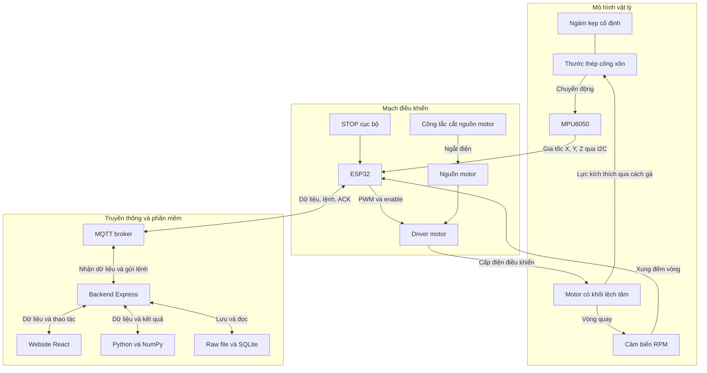
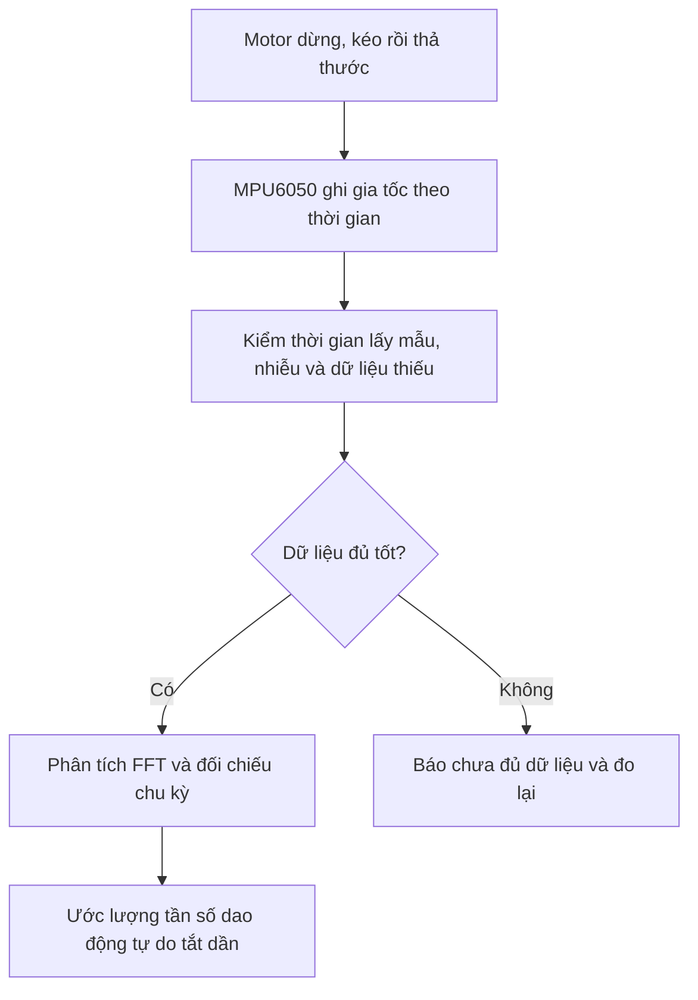
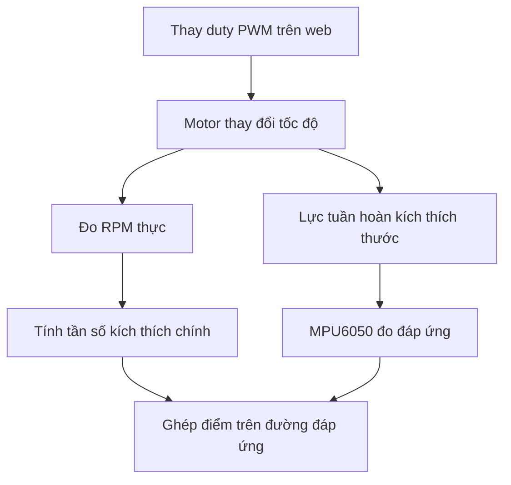

# ResonanceGuard — Sơ đồ, hoạt động, đo cộng hưởng và PWM

> Nội dung chính ở mục 1–6 được lấy từ [cuộc trò chuyện được chia sẻ](https://chatgpt.com/s/t_6ae0b113c2f8819183c8265faa8b1c6a), ưu tiên nguồn này khi gộp với bản trước. Các mục 7–11 giữ lại phần giải thích bổ sung từ file cũ.
>
> Trạng thái “bản 3” bên dưới là mô tả tại thời điểm nội dung nguồn được viết, không phải kết quả nghiệm thu mới của mã nguồn hiện tại.

**ResonanceGuard có hai phần phối hợp: mô hình vật lý tạo và đo dao động, cùng hệ thống IoT để điều khiển, lưu và phân tích dữ liệu.** Sơ đồ dưới đây là hệ thống hoàn chỉnh mà nhóm hướng tới; bản 3 hiện mới thử các đường truyền bằng thiết bị mô phỏng.

## 1. Sơ đồ toàn bộ hệ thống

**Đường kích thích phải có thật:** motor cần được gá sao cho lực truyền tới thước. Motor đặt gần thước nhưng không truyền lực phù hợp thì chưa tạo được thí nghiệm cộng hưởng.

Sơ đồ trên mô tả chức năng, không phải sơ đồ đấu dây. Công tắc cắt nguồn phải ngắt đường cấp điện motor bằng phần cứng; nút STOP gửi về ESP32 có vai trò khác. Nguồn motor cấp điện phù hợp cho motor/driver; không cấp motor trực tiếp từ GPIO.

## 2. Từng bộ phận làm gì?

| Bộ phận | Vai trò |
|---|---|
| **Thước thép** | Vật được khảo sát: có thể uốn và dao động |
| **Ngàm kẹp** | Giữ cố định một đầu thước; chiều dài phần thước nhô ra ảnh hưởng tần số dao động |
| **Motor + khối lệch tâm** | Tạo lực tuần hoàn để kích thích thước; thay tốc độ để thay tần số kích thích |
| **Driver motor** | Nhận tín hiệu nhỏ từ ESP32 để điều khiển nguồn điện cấp cho motor |
| **Cảm biến RPM** | Phát xung khi trục quay, giúp xác định tốc độ thực |
| **MPU6050** | Đo gia tốc ba trục theo thời gian; không trực tiếp trả về tần số cộng hưởng |
| **ESP32** | Lấy mẫu gia tốc, tính RPM, gửi dữ liệu, nhận lệnh và thực hiện dừng cục bộ |
| **MQTT broker** | Chuyển bản tin giữa ESP32 và backend |
| **Backend Express** | Kiểm tra dữ liệu/lệnh, quản lý phiên đo, lưu dữ liệu và gọi bộ phân tích |
| **Python + NumPy** | Xử lý tín hiệu, FFT, ước lượng đặc trưng dao động và phân tích đường đáp ứng |
| **Website React** | Hiển thị số liệu, đồ thị, chất lượng phép đo; cho người dùng bắt đầu phiên và điều khiển motor |
| **Raw file + SQLite** | Giữ dữ liệu gốc, cấu hình và kết quả để xem lại, đối chiếu |
| **STOP và cắt nguồn** | Cho phép dừng tại mô hình; không phụ thuộc hoàn toàn vào website hoặc Internet |

## 3. Khi bạn thao tác, hệ thống hoạt động thế nào?

Ví dụ bạn chọn PWM 40% rồi bấm **START**:

1. Website gửi yêu cầu tới backend.
2. Backend kiểm tra rồi gửi lệnh có mã định danh và thời hạn qua MQTT.
3. ESP32 kiểm tra lệnh và điều kiện chạy, sau đó điều khiển driver.
4. Driver cấp điện cho motor; motor tạo lực kích thích thước.
5. Cảm biến RPM báo tốc độ quay, MPU6050 báo gia tốc.
6. ESP32 gửi dữ liệu về backend để lưu, phân tích và cập nhật website.

**PWM 40% không có nghĩa motor quay đúng một tốc độ cố định.** Tải, nguồn và đặc tính motor đều ảnh hưởng tốc độ, nên nhóm cần cảm biến RPM để biết tốc độ thực.

ACK cũng chỉ cho biết ESP32 đã xử lý lệnh. **RPM mới cung cấp phản hồi về chuyển động quay.**

## 4. Làm sao tìm được tần số cộng hưởng?

Nhóm cần thực hiện **hai phép đo khác nhau**, rồi đối chiếu chúng.

**Phép đo A — Kéo–thả để tìm vùng tần số dao động tự do**

Tắt motor, chờ rotor dừng, kéo nhẹ đầu thước rồi thả:

Ví dụ kết quả hợp lệ cho thấy thước dao động khoảng **10 Hz**. Con số này giúp nhóm biết nên khảo sát motor quanh vùng nào.

**Đỉnh FFT của phép kéo–thả là mode ứng viên/tần số dao động tự do tắt dần.** Khi cản nhỏ, nó thường gần tần số riêng; không mặc định chúng bằng nhau tuyệt đối.

Cần đo lặp, chẳng hạn ít nhất 5 lần hợp lệ theo sổ tay, để xem kết quả có ổn định không.

**Phép đo B — Quét tốc độ motor để khảo sát cộng hưởng**

Với khối lệch tâm quay một vòng tạo một chu kỳ lực chính:

\[
f_{\text{kích thích}}=\frac{RPM}{60}
\]

Nhóm thay đổi tốc độ qua nhiều nấc **ở cả hai phía vùng 10 Hz**, chờ đáp ứng tương đối ổn định ở mỗi nấc, rồi ghi:

| Dữ liệu | Dùng để biết |
|---|---|
| RPM thực | Tần số kích thích thực |
| Gia tốc theo thời gian | Đáp ứng của thước |
| Thành phần gia tốc tại tần số quay | Mức đáp ứng tương ứng với kích thích chính |
| Cấu hình ngàm, tải, cách gá | Các điểm đo có so sánh được với nhau không |

Sau đó, phần mềm lập **đường đáp ứng theo tần số kích thích**, tìm vùng có đỉnh được hỗ trợ bởi dữ liệu và đối chiếu với phép kéo–thả.

**Không đơn giản chọn điểm có gia tốc lớn nhất.** Với motor lệch tâm:

- Lực kích thích tăng khi tốc độ quay tăng.
- Cùng một biên độ dịch chuyển, dao động nhanh hơn cũng tạo gia tốc lớn hơn.

Vì vậy cần xử lý/chuẩn hóa phù hợp với mô hình kích thích trong sổ tay. Nếu chỉ thấy gia tốc tăng theo RPM, nhóm chưa thể kết luận đã tìm thấy cộng hưởng.

## 5. Một ví dụ kết luận đúng

Giả sử:

- Kéo–thả cho kết quả lặp lại quanh **10 Hz**.
- Quét motor qua vùng này cho một đỉnh đáp ứng sau xử lý phù hợp quanh **9,8 Hz**.
- Đỉnh xuất hiện lại khi đo lặp và dữ liệu có chất lượng đạt yêu cầu.

Khi đó nhóm có thể báo **có bằng chứng phù hợp với cộng hưởng quanh 9,8 Hz trong cấu hình đã đo**.

Nếu không có đỉnh rõ, website phải báo **chưa đủ bằng chứng**, lưu dữ liệu và lý do; không tự lấy `RPM/60` hoặc đỉnh FFT lúc motor quay làm tần số cộng hưởng.

## 6. Phiên bản 3 hiện nằm ở đâu?

| Phần | Phiên bản 3 |
|---|---|
| Website ↔ backend ↔ MQTT ↔ ESP32 | Có mã nguồn để thử |
| Điều khiển motor và nhận RPM | Mô phỏng |
| Đọc gia tốc MPU6050 | Mô phỏng |
| Motor kích thích làm thước rung | Chưa có |
| Thu mẫu phục vụ phân tích dao động | Chưa có |
| FFT, kéo–thả và quét cộng hưởng | Chưa có |

**Bản 3 giúp nhóm xây đường truyền. Để đo cộng hưởng, nhóm phải bổ sung phép đo dao động có kiểm soát và phần phân tích; khi dùng phần cứng thật, còn cần kiểm chứng cách motor truyền lực vào thước.**

**Ghi chú bổ sung về bản 3:** các điểm telemetry cách nhau khoảng 250 ms chỉ phục vụ hiển thị/truyền thông, chưa phải chuỗi lấy mẫu để nhận dạng dao động thước. Baseline và đánh giá bất thường cũng chưa thuộc phần đã triển khai nêu trong tài liệu này. Test local không thay thế biên dịch ESP32 hoặc chạy Wokwi; chỉ đánh dấu phần đã thực sự kiểm chứng.

## 7. Ba luồng hoạt động

| Luồng | Đường đi | Mục đích |
|---|---|---|
| Gia tốc | MPU6050 → ESP32 → MQTT → backend → website | Quan sát đáp ứng dao động |
| Tốc độ | Cảm biến RPM → ESP32 → MQTT → backend → website | Biết tốc độ và tần số kích thích chính |
| Điều khiển | Website → backend → MQTT → ESP32 → driver → motor | START, STOP, thay PWM |

## 8. Vì sao cần gia tốc và RPM?

### Gia tốc

MPU6050 ghi lại chuyển động bằng chuỗi gia tốc theo thời gian; phần mềm phân tích chuỗi này để tìm các thành phần tần số. Giống như micro thu âm, còn phần mềm phân tích âm cao/thấp.

Trong dao động điều hòa lý tưởng, gia tốc do dao động gần bằng 0 tại vị trí cân bằng, lớn nhất về độ lớn ở hai biên. Gia tốc cũng lặp theo nhịp dao động.

**1 g = 9,80665 m/s² theo giá trị gia tốc chuẩn**, thường làm tròn 9,8 m/s². Không phải gram đo khối lượng. Đứng yên, trục thẳng đứng có thể báo gần 1 g do trọng lực; số đó không có nghĩa thước đang rung.

Trước khi phân tích, cần kiểm thời gian lấy mẫu, dữ liệu thiếu/nhiễu và xử lý nền. FFT nhận dạng mode dùng trục gia tốc có dấu phù hợp hướng uốn; không tự dùng độ lớn vector vì có thể làm sai thành phần tần số.

### RPM

Tần số quay (Hz) = RPM / 60.

| RPM | Tần số quay |
|---|---|
| 300 | 5 Hz |
| 600 | 10 Hz |
| 1.200 | 20 Hz |

Với khối lệch tâm tạo một chu kỳ lực chính mỗi vòng, tần số kích thích chính bằng RPM/60. Đáp ứng có thể có bội tần; không gán mọi đỉnh phổ cho tần số riêng.

Nếu cảm biến phát PPR xung mỗi vòng của đúng trục cần đo: RPM = 60 × số xung mỗi giây / PPR. Cần biết đúng PPR và vị trí trục, nhất là khi có hộp số.

**RPM cho biết đang kích thích ở tần số nào; gia tốc cho biết thước đáp ứng ra sao.** Chỉ biết 600 RPM chưa chứng minh cộng hưởng ở 10 Hz.

## 9. Chỉnh PWM để làm gì?

### 9.1. PWM là gì?

PWM bật/tắt tín hiệu rất nhanh. **Duty cycle** là tỷ lệ thời gian bật trong một chu kỳ:

Duty (%) = thời gian bật / thời gian một chu kỳ × 100%.

| Duty PWM | Ý nghĩa tín hiệu điều khiển |
|---|---|
| 0% | Không có khoảng bật |
| 30% | Bật 30% thời gian, tắt 70% |
| 60% | Bật 60% thời gian, tắt 40% |
| 100% | Bật liên tục; không có nghĩa giao diện bản 3 cho phép mức này |

ESP32 gửi PWM tới driver; driver đóng/cắt điện motor theo chế độ hoạt động. Tăng duty thường làm motor có xu hướng quay nhanh hơn dưới cùng điều kiện tải. Tốc độ còn phụ thuộc nguồn, ma sát và đặc tính motor.

PWM 60% không đồng nghĩa đạt đúng 60% tốc độ tối đa, cũng không có nghĩa công suất tiêu thụ đúng 60%. Khi đầu ra tắt, motor có thể vẫn quay do quán tính; phanh/dừng cơ học phụ thuộc driver và chế độ điều khiển.

### 9.2. Duty PWM khác tần số PWM

Ví dụ minh họa: PWM 1.000 Hz có một chu kỳ dài 1 ms. Duty 30% nghĩa bật 0,3 ms, tắt 0,7 ms trong mỗi chu kỳ.

**1.000 Hz là nhịp đóng/cắt điện, không phải tốc độ quay hay tần số cộng hưởng.** Motor có thể quay 600 RPM = 10 vòng/giây dù đang nhận PWM 1.000 Hz.

Trong thao tác quét, nhóm chủ yếu thay **duty PWM** để tác động tới tốc độ, rồi đo RPM thực.

### 9.3. PWM liên quan gì tới khảo sát cộng hưởng?

Muốn khảo sát 10 Hz với kích thích một chu kỳ/vòng, cần tốc độ gần 600 RPM. Nhóm chỉnh duty cho đến khi RPM đo được gần 600; **không suy sẵn PWM 40% chắc chắn bằng 600 RPM**. Các mức lân cận cũng phải ghi tốc độ thực.

Đặt duty rồi quan sát RPM là điều khiển mức đầu ra. Muốn tự giữ RPM khi tải đổi phải thêm bộ điều khiển phản hồi. Hiển thị RPM chưa đồng nghĩa tự giữ tốc độ.

### 9.4. PWM trong bản 3

- Web gửi duty qua backend/MQTT tới ESP32.
- ESP32 áp dụng PWM/enable cho motor custom.
- Motor custom tạo xung encoder theo tốc độ mô phỏng.
- Web hiển thị ACK, đầu ra và RPM riêng.
- Motor chưa liên kết cơ học với MPU6050; tăng PWM không tự làm gia tốc MPU6050 đổi.

Mục đích thử PWM ở bản 3 là kiểm tra **lệnh xuống và phản hồi tốc độ lên**, chưa phải tìm cộng hưởng.

## 10. Baseline và A–B–A

Sau khi đo ổn định, dùng cấu hình A làm tham chiếu. Thay chiều dài/tải có kiểm soát thành B, rồi trở về A để quan sát thay đổi và phục hồi.

A–B–A minh họa ảnh hưởng cấu hình. Đánh giá bộ phát hiện cần baseline và ngưỡng đóng băng trước tập kiểm mới, không vừa chỉnh ngưỡng vừa chấm trên cùng dữ liệu. Độ lệch chưa tự chứng minh thước bị nứt/hư.

## 11. Ba câu cần nhớ

1. **PWM là thứ mình chỉnh** để tác động tới motor.
2. **RPM là tốc độ mình đo**, từ đó suy ra tần số quay/kích thích chính theo điều kiện phù hợp.
3. **Gia tốc là đáp ứng mình đo trên thước**; phân tích đáp ứng và đối chiếu dao động tự do mới giúp đánh giá cộng hưởng.

Đường truyền bản 3 là bước chuẩn bị. Chứng minh cộng hưởng cần thêm phép đo có kiểm soát, phân tích đúng và bằng chứng lặp lại được.
