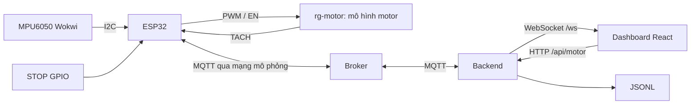

# Kiến trúc hiện có và hướng chuyển sang thiết bị thật

Đối chiếu mã nguồn ngày **03/11/2026**, không chạy hệ thống. Đường dẫn code tính từ [thư mục demo bản 03](../ResonanceGuard_03_IOT_INTEGRATION/), hiện đã rút gọn còn một cấp. Các mục 1–5 mô tả **code demo Wokwi đang có**, không phải bản đã nghiệm thu để cấp điện motor thật. Đích dự án là thiết bị thật; phương án chuyển tiếp nằm ở mục 6.

## 1. Thành phần và đường kết nối

| Thành phần | Đang có trong mã |
|---|---|
| ESP32 | Board `wokwi-esp32-devkit-v1`; Arduino cho ESP32, Wire/WiFi/LEDC và FreeRTOS task; chưa khóa phiên bản core trong file cấu hình build của project |
| Thư viện firmware | `ArduinoMqttClient@0.1.8`, `ArduinoJson@7.4.2`; MPU6050 được đọc thanh ghi trực tiếp |
| Motor | Custom chip `rg-motor`, type `chip-rg-motor`; nguồn `firmware/rg-motor.chip.c` và `.chip.json` |
| Backend | Node.js ES modules, Express, MQTT.js, `ws`; listener mặc định 127.0.0.1:3000 |
| Frontend | React/ReactDOM, Vite; đồ thị SVG, dev server 5173 proxy `/api` và `/ws` |
| Broker | Trung gian bên ngoài backend; mặc định code dùng dịch vụ công khai. Aedes chỉ khởi tạo trong test/smoke local |

Nguồn: `firmware/diagram.json:6–21,85–89`; `firmware/libraries.txt:1–2`; `firmware/sketch.ino:1–10,169–188,349–358`; `package.json:15–26`; `server/index.js:3–11`; `web/vite.config.js:7–13`; `tests/integration.test.js:28–36`.

Không có nhánh động lực học motor–thanh–MPU trong code. Firmware không gọi HTTP tới backend; Dashboard không mở MQTT trực tiếp. `firmware/sketch.ino:398–525`; `web/src/main.jsx:97–101,142`.

`setup.mjs:13–31` đọc `MQTT_URL`/`MQTT_PREFIX`, sinh `BROKER`, `BROKER_PORT`, `PREFIX` trong `firmware/config.h`. Backend đọc cùng tên biến môi trường; không xác nhận giá trị runtime trong lượt rà soát tài liệu. Luồng setup hỗ trợ `mqtt://`, cổng mặc định **1883**, từ chối URL có credentials/TLS/path; firmware dùng WiFiClient thường và chưa đặt tài khoản MQTT. Backend chuyển trực tiếp URL được cung cấp cho MQTT.js. `server/index.js:3–8`; `firmware/sketch.ino:19,48–49,379–389,418`.

Chưa tìm thấy cấu hình khởi chạy gateway/bridge riêng hoặc file Wokwi CLI/PlatformIO trong cây project đã khảo sát. Loại gateway của phiên Wokwi đang dùng chưa xác định từ workspace. Backend/Vite cần tiến trình riêng; không suy rằng Node kết nối được thì Wokwi đã đi qua gateway thành công. Chưa tìm thấy URL project Wokwi công khai đã lưu trong các tài liệu văn bản đã tìm; link tạo project mới không phải link nguyên mẫu đã lưu.

## 2. GPIO và mô hình motor

| Tín hiệu bản 03 | GPIO/cấu hình | Đối chiếu nguồn |
|---|---|---|
| MPU SDA / SCL | 21 / 22; địa chỉ code `0x68`; không nối INT/AD0 tường minh trong diagram | `sketch.ino:18,367`; `diagram.json:94–115` |
| PWM | 25, 1.000 Hz, 8 bit | `sketch.ino:14,349–354`; `diagram.json:172–191` |
| EN | 33, HIGH khi RUN, LOW khi OFF | `sketch.ino:15,120,355`; `diagram.json:196–199` |
| TACH | 26, RISING, PPR=1 | `sketch.ino:13,366,522`; `diagram.json:202–205` |
| STOP | 19, INPUT_PULLUP, nhấn kéo LOW về GND | `sketch.ino:17,111,346`; `diagram.json:148–155` |
| LED RUN | 27, active-high; diagram chưa có điện trở nối tiếp LED RUN | `sketch.ino:16,121`; `diagram.json:160–168` |
| START xanh / biến trở | Diagram nối 18 / 34 nhưng ghi UNUSED, firmware không dùng cho điều khiển | `diagram.json:25–43,130–143`; `sketch.ino:388` |
| Phản hồi công tắc 32 | Chưa thấy khai báo hoặc kết nối | `sketch.ino:13–18,341–389`; `diagram.json:92–213` |

Các tên file trong cột nguồn đều thuộc `firmware/`. Không có AIN1/AIN2, lệnh đảo chiều hoặc driver TB6612 điện học. Chip chỉ có PWM/EN/TACH/GND. Bảng phần cứng dự kiến trong [sổ tay §6.2](../RESONANCE_GUARD_COMPLETE_PROJECT_GUIDE.md) dùng **19=AIN2, 27=MPU INT, 33=STBY, 32=phản hồi công tắc**; không dùng bảng đó đấu vào mô phỏng hiện tại.

API/MQTT dùng duty dạng tỷ lệ **0..0,8**; UI dùng **0..80%**. Firmware đổi thành `round(duty*255)` và state báo duty đã lượng tử hóa `/255`. `firmware/motor_control.h:80–89`; `firmware/sketch.ino:122–132`; `web/src/main.jsx:100,272`.

Motor cập nhật mỗi 1 ms; EN HIGH và duty >0,06 cho tốc độ đích `(duty-0.06)/0.94*1800`, giới hạn 0..1800 RPM. Mỗi bước cập nhật `rpm += (target-rpm)/180`; tích phân vòng quay để phát TACH danh định một xung/vòng. Có vùng chết và quán tính giả định khoảng 180 ms, chưa hiệu chuẩn motor thật. EN LOW/PWM0 không làm rotor ảo dừng tức thời. `firmware/rg-motor.chip.c:51–84,99–104`.

RPM đọc từ hai cạnh lên: `60000000 / period_us`, PPR cố định 1. Chưa có đủ hai cạnh hoặc mất cạnh ít nhất 2 giây → NAN → `rpm:null`, quality `no_recent_pulses`; không biến thành số đo 0 RPM. Sau khoảng nghỉ dài, cạnh đầu chưa đủ tạo số đo mới. `firmware/rpm_reader.h:13–28`; `firmware/sketch.ino:507–525`.

## 3. Gia tốc, metadata và lưu trữ

MPU được đánh thức, cấu hình ±4 g và đọc lại thang đo. Một lần đọc lấy sáu byte từ 0x3B, ghép ba số signed 16 bit và đổi `raw/8192*9.80665` thành m/s². `firmware/sketch.ino:161–188,369–375`.

Nhánh telemetry khoảng **250 ms theo millis() ESP** gửi state rồi đọc một bộ ax/ay/az, gửi gia tốc và RPM. Chỉ chạy nhánh này khi MQTT connected; thời gian mạng/I²C ảnh hưởng nhịp thực tế. Chưa có timer/FIFO/INT/buffer lấy mẫu đều 200 Hz. Task 10 ms là điều khiển motor; ISR là TACH. `firmware/sketch.ino:89–95,106–138,411–440,463–525`.

| Loại | Field thực tế |
|---|---|
| Envelope firmware | `schema_version:1`, `device_id:"rg01"`, `source:"synthetic"`, `boot_id:string`, `seq:uint32`, `t_device_ms:uint32` |
| Gia tốc | `ax/ay/az:number` hoặc cả ba null, `unit:"m/s2"`, `quality:"wokwi_i2c"` hoặc `"imu_read_failed"` |
| RPM | `rpm:number|null`, `ppr:1`, `pulses:uint32`, `quality:"valid_model_pulses"` hoặc `"no_recent_pulses"` |
| State | `running:boolean`, `duty:number`, `stop_reason:string`, `last_command_id:string` |
| ACK | Envelope + `command_id:string`, `accepted:boolean`, `reason:string`, `command_t_device_ms`, `lease_until_device_ms`, `running:boolean` |

Nguồn: `firmware/sketch.ino:191–199,312–322,466–525`; kiểm payload backend tại `server/protocol.js:3–45`. `seq` dùng chung các loại bản tin; timestamp envelope gia tốc gán trước khi đọc I²C, chưa phải timestamp phần cứng tại thời điểm lấy mẫu. Backend thêm `received_at` theo đồng hồ server. Chưa có run/config ID, timestamp từng mẫu trong block, gap/clip/overrun hoặc cấu hình phiên.

`source:synthetic` bao gồm dữ liệu linh kiện Wokwi; `quality:wokwi_i2c` nhận diện đường đọc MPU. Firmware không tự sinh sóng sin; Node peer trong test/smoke lại tự đưa payload fixture, là nguồn kiểm thử khác. Không gọi cả hai là dữ liệu đo phần cứng thật.

Backend ghi `data/telemetry-*.jsonl` cho các event hợp lệ (state/ACK/telemetry) và `data/diagnostics-*.jsonl` cho trace. Có giới hạn bộ đệm ghi, chưa bảo đảm lưu đầy đủ khi đĩa lỗi/chậm. History giữ 240 event telemetry, API command giữ 100 bản ghi; xuất CSV chỉ lấy history đang giữ trong RAM. Chưa có phát lại phiên sau restart hoặc SQLite. `server/app.js:26–30,45–56,265–270,323–326`; `web/src/main.jsx:243–256`.

## 4. MQTT, HTTP và WebSocket

Prefix lấy từ cấu hình chung; không ghi namespace riêng vào tài liệu. Tất cả publisher của demo dùng `retain:false`.

| Suffix sau `PREFIX/` | Bên publish | QoS publish | Bên subscribe |
|---|---|---|---|
| `state` | ESP32 | 0 | Backend, yêu cầu QoS1 |
| `telemetry/vibration` | ESP32 | 0 | Backend, yêu cầu QoS1 |
| `telemetry/rpm` | ESP32 | 0 | Backend, yêu cầu QoS1 |
| `ack` | ESP32 | 1 | Backend, yêu cầu QoS1 |
| `cmd/motor` | Backend | 1 | ESP32, yêu cầu QoS1 |

Nguồn: `firmware/sketch.ino:201–216,420,479–525`; `server/app.js:107,331`. Subscribe QoS1 không nâng publish QoS0 thành QoS1. Không tìm thấy Last Will trong nơi cấu hình hai client; state cũng không retain. Firmware dùng clean session, keepalive **10.000 ms**, connection timeout **1.000 ms** và thử MQTT lại khoảng **3.000 ms** khi Wi-Fi đã connected. `firmware/sketch.ino:379–389,413–420`. Backend clean session, reconnect 2.000 ms, connect timeout 10.000 ms; keepalive không ghi đè, bản MQTT.js trong workspace mặc định 60 giây. `server/app.js:20–25`; `node_modules/mqtt/build/lib/client.js:62–69`.

Script probe riêng dùng topic ngẫu nhiên `rg-demo/diagnostic-…/rg01/diagnostic`, QoS1, không retain; không phải topic điều khiển motor. `scripts/probe-public.mjs:5–6,23–31`.

| Giao diện | Hành vi |
|---|---|
| `GET /api/state` | Snapshot broker/subscription/state/tuổi dữ liệu/ACK/history/streams/timing |
| `GET /api/commands/:id` | Bản ghi lệnh/trace trong bộ nhớ; 200 hoặc 404 |
| `POST /api/motor` | Body `action` là `start`, `stop`, `renew`, `set_duty`; duty tỷ lệ 0..0,8 cho lệnh khác STOP |
| WebSocket `/ws` | `snapshot`, `state`, `telemetry/vibration`, `telemetry/rpm`, `ack`; event thường là `{type,data,received_at}` |

Nguồn: `server/app.js:18–19,67–76,236–278,289–342`. HTTP lỗi 400 cho action/duty sai, 503 khi broker/subscription chưa sẵn sàng, 409 khi state thiếu/cũ cho lệnh khác STOP. HTTP **202** chỉ báo `sent_waiting_for_device_ack`. Origin hiện giới hạn localhost/127.0.0.1 ở 3000/5173; không tự đổi port mà bỏ qua proxy/Origin. `server/app.js:17,279–309`; `web/vite.config.js:10–13`.

Backend loại payload quá lớn, JSON/schema/source/unit/quality/range sai, replay retain, boot cũ, seq trùng/lùi và clock lùi; telemetry/ACK phải đúng boot hiện biết từ state. Đổi boot xóa lịch sử/ACK đang giữ và hủy command chờ. Chưa có bộ reorder/gap phục vụ phân tích. `server/app.js:169–235`. Cờ retain ở đường nhận không bảo đảm phát hiện mọi lần publisher trực tiếp dùng retain; publisher vẫn phải tuân thủ giao thức không retain.

## 5. Command, ACK, lease và dừng

Ví dụ body HTTP để người vận hành dùng trong môi trường mô phỏng: `{"action":"start","duty":0.3}`. Backend bổ sung schema/device/source, `boot_id`, UUID `command_id`, `lease_ms:4000`, `not_after_device_ms=state.t_device_ms+3000` theo uint32. Không có endpoint/action arm riêng. `server/app.js:295–317`.

Firmware sinh boot nonce 64 bit bằng hai lần `esp_random()`, client ID gắn hash namespace và boot; không có nonce riêng khác cho từng command. Nó nhớ 32 command ID gần nhất. ID trùng trả `duplicate_no_effect`, không tác động đầu ra hoặc kéo dài lease; ID được ghi nhớ trước kiểm boot/deadline. `firmware/sketch.ino:376–380`; `firmware/motor_control.h:15–16,48–55`.

Lệnh khác STOP cần đúng boot, deadline còn hiệu lực và không quá 5.000 ms phía trước, local STOP không giữ, MQTT connected, duty 0..0,8, lease 500..4.000 ms. `renew`/`set_duty` chỉ hợp lệ khi đang chạy; mỗi lệnh hợp lệ cập nhật deadline lease từ lúc xử lý. Lease đã hết thì renew không làm chạy lại. STOP mới được xử lý trước kiểm boot/deadline trong MotorControl, nhưng vẫn qua parser/schema/ID bên ngoài; retained command bị loại trước đó. `firmware/motor_control.h:44–90`; `firmware/sketch.ino:246–299`.

| Xác nhận | Điều chứng minh được |
|---|---|
| HTTP 202 | Backend đã phát yêu cầu, đang chờ ACK thiết bị |
| `COMMAND_BROKER_PUBACK` | Broker xác nhận gói command QoS1 |
| `ACK BROKER_CONFIRMED` | Broker xác nhận gói ACK ứng dụng do ESP gửi, chưa xác nhận backend/React xử lý |
| ACK ứng dụng | ESP đã quyết định lệnh; accepted/running không phải phép đo điện hoặc bằng chứng rotor quay |
| State / RPM | State là đầu ra đã ghi qua API; RPM tính từ TACH, không phải chứng nhận rotor vật lý dừng |

Nguồn: `server/app.js:331–342`; `firmware/sketch.ino:106–138,238–241,294–322,466–525`.

Backend chỉ chấp nhận ACK khớp pending command/boot trong 5.000 ms theo đồng hồ máy. Frontend cũng có HTTP/ACK timeout 5.000 ms; chỉ ACK START phù hợp và health mới mới bật renew mỗi 1.000 ms. Mất WS/broker, stale, ACK từ chối/timeout hoặc boot đổi sẽ disarm. ACK/HTTP của epoch cũ không bật renew trở lại. Backend không tự phát renew. `server/app.js:203–223`; `web/src/control.js:8–49`; `web/src/main.jsx:97–101,149–183,208–232`.

Khi setup hoàn tất: EN/RUN LOW, PWM0. Task điều khiển độc lập với mạng, vòng danh định 10 ms; kiểm STOP LOW, cờ mất MQTT và hết lease để OFF. Mất Wi-Fi/MQTT được xử lý khi firmware phát hiện; không hứa độ trễ thực tế chưa đo. Khi đã dừng, reconnect không tự phục hồi duty; cần START mới. Serial in ở loop có thể hiện muộn so với timestamp đổi đầu ra, `skipped` cho biết revision bị bỏ qua. `firmware/sketch.ino:106–158,344–358,398–450`; `firmware/motor_control.h:18–40,80–89`.

STOP hiện chỉ là nút logic GPIO19. Diagram chưa thể hiện đường VM hoặc công tắc cắt công suất độc lập; GPIO32 chưa triển khai. Quán tính rotor ảo vẫn còn sau PWM0/EN LOW. Không dùng test phần mềm làm nghiệm thu phần cứng hoặc trạng thái điện trước khi setup khởi tạo GPIO.

## 6. Kiến trúc thiết bị thật dự kiến và phần tái sử dụng

Thiết bị thật sẽ thay ESP32/MPU/motor mô phỏng bằng ESP32, MPU6050, Hall/encoder, driver, nguồn và motor thực. Web vẫn giao tiếp HTTP/WebSocket với backend, backend vẫn qua MQTT với ESP32; không có Wokwi hoặc gateway Wokwi trong đường chạy thật. Broker và cấu hình kết nối cho thiết bị thật còn cần lựa chọn/kiểm chứng.

| Phần | Hướng xử lý khi chuyển sang thiết bị thật |
|---|---|
| React/Express/MQTT/WS | Giữ nền web/backend, điều chỉnh hợp đồng dữ liệu và kiểm thử tích hợp |
| Firmware | Tạo cấu hình/bản phần cứng phù hợp board, cảm biến, driver và bảng chân đã chốt; giữ bản demo làm tham chiếu |
| Motor custom | Chỉ dùng cho demo Wokwi; phần cứng có driver và đường cấp công suất riêng |
| Hall/encoder | Thiết bị input riêng, xác minh PPR, mức tín hiệu, cạnh và timeout; không lấy model TACH thay phép đo thật |
| Gia tốc/phân tích | Xây sampler có thời gian/sequence/quality rõ ràng trước FFT; nhịp MQTT hiện tại chưa đáp ứng phần này |
| Command/ACK/lease | Tái sử dụng thiết kế logic sau khi kiểm timing, đầu ra và các điều kiện dừng trên phần cứng |
| Nguồn dữ liệu | Cập nhật đồng bộ firmware/parser/backend/log/UI; hiện `server/protocol.js:6` và firmware chỉ nhận `source=synthetic`, nên chưa nhận dữ liệu đo thật bằng một nhãn mới đơn lẻ |

Phần cứng chưa có model motor/nguồn/driver được chốt, chưa xác lập truyền lực motor–thanh hoặc nghiệm thu STOP công suất. Không lấy giới hạn duty/RPM/quán tính của custom chip làm thông số motor thật. Đọc [tổng quan](01_TONG_QUAN.md) và [các mốc chuyển sang thiết bị thật](03_CHAY_MO_PHONG.md#thiet-bi-that) để theo dõi thứ tự thực hiện.
